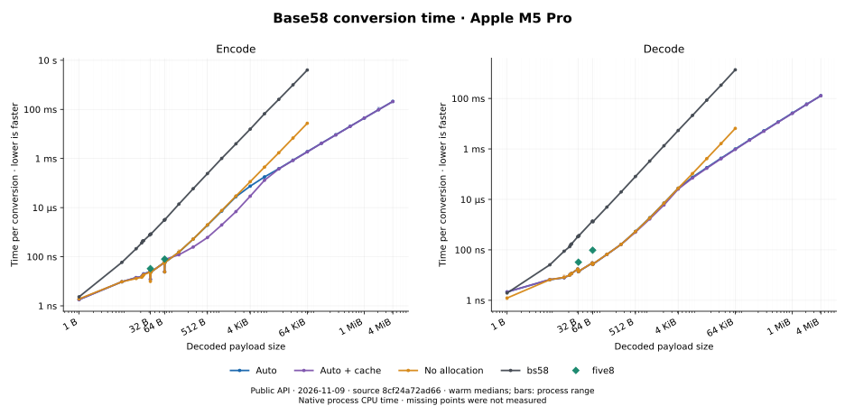
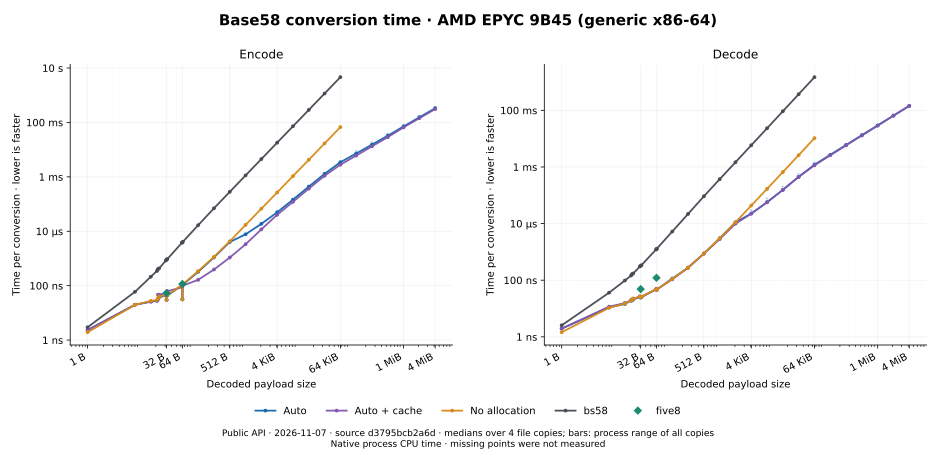
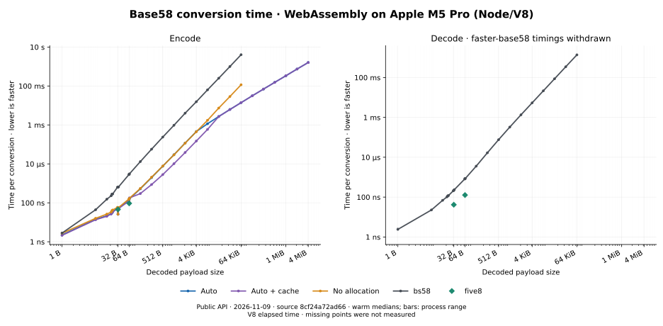

# faster-base58

Bitcoin Base58 encoding and decoding in Rust. The default API selects algorithms
by input size and CPU support. It is `no_std` by default, using `alloc` for its
faster general conversions. On x86-64, runtime SIMD detection uses the standard
library when `std` is enabled, and `cpufeatures` otherwise.

```toml
[dependencies]
faster-base58 = { git = "https://github.com/elichai/faster-base58" }
```

Requires Rust 1.95 or newer. This crate has not been published to crates.io yet.

## Encode and decode

Reusable configurations can be constants. Conversion starts at the terminal method:

```rust
# #[cfg(feature = "alloc")]
# {
use faster_base58::{Encoder, Decoder};

const ENCODER: Encoder = Encoder::bitcoin();
const DECODER: Decoder = Decoder::bitcoin();

let data = [0u8; 21];
let text: String = ENCODER.encode(&data).into_string();
assert_eq!(DECODER.decode(&text).into_array::<21>()?, data);
let mut buffer = [0; ENCODER.max_encoded_len(21)];
assert_eq!(ENCODER.encode(&data).onto(&mut buffer)?, text);
# }
# Ok::<(), Box<dyn std::error::Error>>(())
```

`Encoder` and `Decoder` are small `Copy` values without type parameters.
Constructors, setters, `.encode()` and `.decode()` are `const fn` and always inlined,
so constant configurations fold away; runtime-selected settings still dispatch.

Encoding provides `.into_string()`, `.into_vec()` (ASCII bytes), and `.onto()`
(borrowed `&str`). Decoding provides `.into_vec()`, `.into_array::<N>()`, and
`.onto()` (borrowed `&mut [u8]`). Input can be borrowed or owned. Decoded input
implements `AsRef<[u8]>`: strings and raw bytes work, and bytes need no UTF-8
validation first. Owned output methods require `alloc` (enabled by
default). Borrowed output and exact arrays are available with either allocation policy.

```rust
use faster_base58::{Encoder, Decoder};

const ENCODER: Encoder = Encoder::bitcoin();
const DECODER: Decoder = Decoder::bitcoin();
let input = [0, 1, 2, 3];
let mut text_buffer = [0; ENCODER.max_encoded_len(4)];
let mut byte_buffer = [0; 4];
let text = ENCODER.encode(input).onto(&mut text_buffer)?;
assert_eq!(DECODER.decode(text).into_array::<4>()?, input);
assert_eq!(DECODER.decode(text).onto(&mut byte_buffer)?, input);
# Ok::<(), Box<dyn std::error::Error>>(())
```

`ENCODER.max_encoded_len(n)` bounds encoded output; exact result capacity also
works. Plain decoding needs at most one output byte per input text byte. Leading
zero bytes round-trip as leading `'1'` characters. `.into_array::<N>()` requires
exactly `N` bytes: shorter results return `InvalidLength`, longer ones `BufferTooSmall`
(decoding stops when the array is full, so the actual length is not known).

Invalid-character indices are byte offsets into the input. `Error` is `#[non_exhaustive]`;
downstream matches need a wildcard arm. Errors implement `Display` and
the standard error trait. Successful calls leave the unused output tail untouched;
on errors, output contents and error precedence are unspecified. Conversion timing
depends on input values and length; these functions are not constant-time.

## Optional Base58Check

Enable `features = ["check"]` to add Bitcoin's four-byte double-SHA-256 checksum.
This enables an optional `sha2` dependency without requiring `std`. With the
feature disabled, normal dependencies do not include SHA-256. Select checking
on a configuration:

```rust
# #[cfg(all(feature = "check", feature = "alloc"))]
# fn main() -> Result<(), faster_base58::Error> {
use faster_base58::{Encoder, Decoder};

const ENCODER: Encoder = Encoder::bitcoin().with_check();
const DECODER: Decoder = Decoder::bitcoin().with_check();

let data = [0u8; 21];
let text: String = ENCODER.encode(&data).into_string();
assert_eq!(text, "1111111111111111111114oLvT2");
assert_eq!(DECODER.decode(&text).into_array::<21>()?, data);
let mut bytes = [0u8; 21];
assert_eq!(DECODER.decode(&text).onto(&mut bytes)?, data);

const VERSIONED_ENCODER: Encoder = Encoder::bitcoin().with_check_version(0);
const VERSIONED_DECODER: Decoder = Decoder::bitcoin().with_check_version(0);
let text = VERSIONED_ENCODER.encode([0u8; 20]).into_string();
assert_eq!(VERSIONED_DECODER.decode(&text).into_array::<21>()?, data);
# Ok(())
# }
# #[cfg(not(all(feature = "check", feature = "alloc")))]
# fn main() {}
```

`.with_check()` hashes the input as supplied. `.with_check_version(v)` prepends
`v` on encode and requires that first data byte on decode. The version is included
in the checksum and **retained** in decoded output. Setters replace the previous
setting; `.with_check()` clears any configured version. Versions are one byte;
multi-byte prefixes, such as BIP32's four-byte extended-key version, are part of
the payload: use `.with_check()` and keep them in the data.

Checked decoding removes the checksum. Errors distinguish `MissingChecksum`,
`InvalidChecksum`, and `InvalidVersion { expected, actual }`; `actual: None`
means valid empty data has no version byte. These variants and setters are gated
by `check`. Checksum verification precedes version validation.

`ENCODER.max_encoded_len(n)` includes checksum and any inserted version. Checked
decoding with `.onto()` or `.into_array::<N>()` needs room only for the returned
data (including a retained version): the checksum is held on the stack, and the
unused output tail stays untouched. Neither direction allocates a temporary frame;
normal codec workspace still applies to large inputs, and hashing adds work.
Enabling the feature does not select checking for plain configurations.

## No internal allocation

Disable default features to exclude allocating backends and owned output methods:

```toml
faster-base58 = { git = "https://github.com/elichai/faster-base58", default-features = false }
```

The same `Encoder` / `Decoder` buffer and array methods then make no heap
allocations, including first calls and error paths. Encoding uses fixed tables for
32/64-byte frames and batched conversion elsewhere; decoding uses tiny/batched
conversion. General large inputs take quadratic time. The optional `check` feature
works with either policy. `cache` and development-only `__internals` enable `alloc`.
Cargo features are additive: any dependency that enables `alloc` enables it for
all consumers of that crate instance. Dropping an owned input can still call its
allocator; borrow inputs when counting all allocator operations.

Auto trades workspace for large-input speed. At 4 MiB on the M5 Pro, default
encoding peaks at about 66 MiB of extra requested heap in 7 allocations and
decoding at about 54 MiB in 18, excluding caller buffers (2026-11-01; [allocation
details](docs/performance.md#cache-and-memory)).

## Optional caching

Add `features = ["cache"]` to the dependency to retain reusable tables. This
feature enables `std`. Caching is off by default; it changes dispatch as well as
retention. First use builds tables; the warm timings below exclude that setup.
[Cold calls and cache tradeoffs](docs/performance.md#cache-and-memory) help assess
whether reuse repays the setup and memory cost for your workload.

Enabling `cache` alone allocates **zero heap bytes**. Conversions allocate tables
on first use and retain them for the process lifetime. Only needed table classes
are initialized; retained heap depends on input sizes, CPU and call history.

| Cache family | Maximum retained heap payload across production classes |
| --- | ---: |
| Encoding and decoding Matrix tables | 18,617,760 B (17.8 MiB) |
| NTT twiddles | 9,436,416 B (9.0 MiB) |
| **Combined** | **28,054,176 B (26.8 MiB)** |

This is retained table capacity, **not a limit on total active heap**: per-call
scratch, larger owned tables, allocator overhead and concurrent calls add to it.
The static headers of the cache families take 2,176 bytes when present. None of
these figures measures RSS. [Memory and algorithm details](DESIGN.md#heap-stack-and-cache-costs).

## Performance

Measured **2026-11-05** with ordinary public consumers (no `__internals`), release
opt-level 3, fat LTO and generic target flags. Each cell is **encode / decode**:
the median over fresh processes, each timing all libraries interleaved in batches
of at least 10 ms. Native cells use process CPU time, Wasm V8 elapsed time.
Workspace allocation is included; caller buffers are reused. Bold marks the lowest
median, without a significance claim. No-allocation and bs58 stop at 64 KiB; five8
covers 32/64 B. [Method, ranges and limits](docs/performance.md).

### Apple M5 Pro

Rust 1.99.1 / LLVM 23.1.1, `aarch64-apple-darwin`; source `8bab387`, five processes.

| Payload | Auto | Auto + cache | No allocation | bs58 | five8 |
|---|---:|---:|---:|---:|---:|
| 32 B | 11.7 ns / 13.4 ns | 11.8 ns / 13.5 ns | **9.71 ns** / **13.3 ns** | 781 ns / 326 ns | 31.4 ns / 31.5 ns |
| 64 B | **23.4 ns** / 25.7 ns | 23.5 ns / **25.6 ns** | 23.5 ns / 27 ns | 2.91 µs / 1.15 µs | 74.4 ns / 93.9 ns |
| 512 B | 1.87 µs / 684 ns | **568 ns** / **564 ns** | 1.94 µs / 698 ns | 236 µs / 77 µs | — / — |
| 4 KiB | 108 µs / 40 µs | **28.8 µs** / **25.2 µs** | 113 µs / 38 µs | 15.2 ms / 5.1 ms | — / — |
| 64 KiB | 1.91 ms / 1.09 ms | **1.91 ms** / **1 ms** | 26.2 ms / 9.1 ms | 3.94 s / 1.3 s | — / — |
| 1 MiB | **45.3 ms** / 28.2 ms | 45.5 ms / **26.6 ms** | — / — | — / — | — / — |
| 4 MiB | **216 ms** / 138 ms | 217 ms / **133 ms** | — / — | — / — | — / — |



### AMD EPYC 9B45 (GCP, generic x86-64)

Rust 1.99.0 / LLVM 23.1.1, generic `x86_64-unknown-linux-gnu` with runtime CPU
selection, CPU 0 pinned; source `18b2eb8`, three processes. `-C target-cpu=native`
results are in the [performance guide](docs/performance.md#generic-and-native-x86-64).

| Payload | Auto | Auto + cache | No allocation | bs58 | five8 |
|---|---:|---:|---:|---:|---:|
| 32 B | 30 ns / **24.2 ns** | **30 ns** / 25.2 ns | 30 ns / 24.7 ns | 902 ns / 322 ns | 52.9 ns / 48.6 ns |
| 64 B | **31.1 ns** / **46 ns** | 31.2 ns / 46.6 ns | 31.3 ns / 46.3 ns | 3.87 µs / 1.24 µs | 115 ns / 121 ns |
| 512 B | 4.03 µs / 1.01 µs | **1.1 µs** / 1 µs | 4.25 µs / **999 ns** | 282 µs / 92.1 µs | — / — |
| 4 KiB | 48.9 µs / **27.5 µs** | **40.7 µs** / 27.8 µs | 253 µs / 55.3 µs | 18.1 ms / 5.84 ms | — / — |
| 64 KiB | 3.44 ms / 1.28 ms | **2.81 ms** / **1.22 ms** | 64 ms / 13.4 ms | 4.62 s / 1.49 s | — / — |
| 1 MiB | 71.8 ms / 30.6 ms | **65.9 ms** / **29.8 ms** | — / — | — / — | — / — |
| 4 MiB | 334 ms / 150 ms | **311 ms** / **148 ms** | — / — | — / — | — / — |



### WebAssembly on Apple M5 Pro (Node/V8)

Scalar Wasm, Rust 1.99.1; Node 26.13.0 / V8 14.6.202.34; source `18b2eb8` (the
Auto module is byte-identical at `8bab387`), three processes.

| Payload | Auto | Auto + cache | No allocation | bs58 | five8 |
|---|---:|---:|---:|---:|---:|
| 32 B | **26.2 ns** / 54.1 ns | 26.5 ns / 56.4 ns | 26.2 ns / 55.6 ns | 694 ns / 233 ns | 48.2 ns / **45.3 ns** |
| 64 B | 105 ns / 156 ns | 103 ns / 135 ns | 104 ns / 134 ns | 3.03 µs / 880 ns | **95.4 ns** / **130 ns** |
| 512 B | 7.71 µs / 5.34 µs | **2.86 µs** / **2.7 µs** | 7.78 µs / 5.16 µs | 251 µs / 77.6 µs | — / — |
| 4 KiB | 466 µs / 219 µs | **151 µs** / **126 µs** | 460 µs / 308 µs | 16.6 ms / 5.5 ms | — / — |
| 64 KiB | **15 ms** / **6.74 ms** | 15.2 ms / 6.93 ms | 125 ms / 82.5 ms | 4.21 s / 1.41 s | — / — |
| 1 MiB | 374 ms / 178 ms | **374 ms** / **174 ms** | — / — | — / — | — / — |
| 4 MiB | **1.77 s** / 880 ms | 1.8 s / **880 ms** | — / — | — / — | — / — |



A separate [basexx comparison](docs/performance.md#basexx-comparison) includes a
general-purpose comparator that is much faster than bs58.

## Linked size

Code and data linked **above an empty consumer** with the same scaffold, both
directions reachable, from the same builds as the timing tables (2026-11-05).
These are cdylib section deltas, including associated code and metadata;
readonly data, BSS, cache headers, retained heap and Wasm memory pages are
separate costs.

| Consumer | M5 code / readonly | x86-64 code / readonly | Wasm code / data section |
|---|---:|---:|---:|
| Auto | 70.9 KiB / 24.4 KiB | 280.0 KiB / 34.9 KiB | 72.3 KiB / 14.1 KiB |
| Auto + cache | 73.6 KiB / 26.5 KiB | 272.2 KiB / 35.3 KiB | 74.0 KiB / 14.8 KiB |
| No allocation | 9.8 KiB / 10.6 KiB | 20.4 KiB / 14.4 KiB | 14.0 KiB / 9.5 KiB |
| bs58 | 1.3 KiB / 0.9 KiB | 2.0 KiB / 0.9 KiB | 2.7 KiB / 0.7 KiB |

On x86-64, `features = ["compact"]` keeps eight IFMA kernel widths instead of
twelve. This reduces linked code and uses more chunks for some multiplications.
It preserves the API and allocation contracts; the speed tradeoff depends on
operand size. Other production targets do not use these IFMA kernels.

## Development and license

[CORRECTNESS.md](CORRECTNESS.md) lists the test commands (most suites need
`--features __internals`; checksum suites need `check`) and describes the
differential/property tests, sanitizer fuzzing, Miri, scoped proofs and remaining
gaps. [DESIGN.md](DESIGN.md) explains algorithms, dispatch and resource costs. The
`__internals` feature exposes unstable backend controls for tests and benchmarks;
applications need neither. Benchmarks compare bs58, basexx, fixed-length five8 and
a development-only Malachite adapter.

Implementation influences, algorithm references and upstream licenses are listed
in [REFERENCES.md](REFERENCES.md).

Licensed under [MIT](LICENSE-MIT) OR [Apache-2.0](LICENSE-APACHE), at your option.
