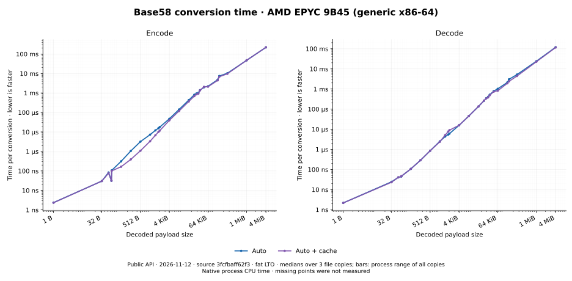

# faster-base58

Bitcoin Base58 encoding and decoding in Rust, with automatic algorithm and CPU
selection. The crate is `no_std` by default. Disable the default `alloc` feature
for heap-free conversion.

```toml
[dependencies]
faster-base58 = "0.1.0"
```

Requires Rust 1.95 or newer.

## Performance

Timings measured **2026-11-25**, source
[`472586e62d25`](https://github.com/elichai/faster-base58/commit/472586e62d2577e8fd99c9a30e91f31c7078b143).
Warm public-API **encode / decode** times with reused caller output, generic CPU
flags, release opt-level 3, 16 codegen units and fat LTO. Internal workspace
allocation is timed.
`Auto` uses default features, `Auto + cache` enables caching, and `No allocation`
disables default features. Comparators are bs58 0.5.1 and five8 1.0.0.
Each process interleaves all libraries in three batches calibrated to at least 10 ms.
Bold marks the lowest observed median without a significance claim. No-allocation
and bs58 cover through 64 KiB; five8 covers 32/64 B.
[Methods, ranges, both LTO settings, first calls and resource costs](docs/performance.md).

Each cell labels **Encode** and **Decode**. In the Auto columns, each direction
also shows **peak internal heap** for a warm call, including retained cache tables.
**Input and output storage are excluded.** Heap counts use three fresh-process
repeats and a separate fixture at each payload size; they are requested Rust
layout bytes, not RSS. The
no-allocation build uses zero internal heap. Heap measurements are dated
**2026-11-25**, source
[`472586e62d25`](https://github.com/elichai/faster-base58/commit/472586e62d2577e8fd99c9a30e91f31c7078b143).
[Heap measurement scope and first-call costs](docs/performance.md#cache-and-memory).

### Apple M5 Pro

Rust 1.99.1 / LLVM 23.1.1, AArch64; process CPU time, 5 processes × 3 file copies.

| Payload | Auto | Auto + cache | No allocation | bs58 | five8 |
|---|---:|---:|---:|---:|---:|
| 32 B | Encode: 11.8 ns; heap 0 B<br>Decode: 13.7 ns; heap 0 B | Encode: 11.9 ns; heap 0 B<br>Decode: **13.6 ns**; heap 0 B | Encode: **9.8 ns**<br>Decode: 13.7 ns | Encode: 792 ns<br>Decode: 334 ns | Encode: 33 ns<br>Decode: 32.1 ns |
| 64 B | Encode: 23.8 ns; heap 0 B<br>Decode: 26 ns; heap 0 B | Encode: 23.8 ns; heap 0 B<br>Decode: 26 ns; heap 0 B | Encode: **23.7 ns**<br>Decode: **25.6 ns** | Encode: 2.95 µs<br>Decode: 1.36 µs | Encode: 77.5 ns<br>Decode: 95.9 ns |
| 512 B | Encode: 1.8 µs; heap 0 B<br>Decode: 512 ns; heap 0 B | Encode: **596 ns**; heap 47 KiB<br>Decode: **479 ns**; heap 40.2 KiB | Encode: 1.91 µs<br>Decode: 515 ns | Encode: 234 µs<br>Decode: 78.1 µs | Encode: -<br>Decode: - |
| 4 KiB | Encode: 71.3 µs; heap 82.4 KiB<br>Decode: 26 µs; heap 0 B | Encode: **28.9 µs**; heap 2.76 MiB<br>Decode: **24.9 µs**; heap 2.32 MiB | Encode: 106 µs<br>Decode: 26.1 µs | Encode: 15.3 ms<br>Decode: 5.1 ms | Encode: -<br>Decode: - |
| 64 KiB | Encode: 1.84 ms; heap 1.28 MiB<br>Decode: 986 µs; heap 1.02 MiB | Encode: **1.8 ms**; heap 1.53 MiB<br>Decode: **943 µs**; heap 1.17 MiB | Encode: 25.8 ms<br>Decode: 6.17 ms | Encode: 3.95 s<br>Decode: 1.31 s | Encode: -<br>Decode: - |
| 1 MiB | Encode: 43.2 ms; heap 17 MiB<br>Decode: 25.8 ms; heap 14.1 MiB | Encode: **42.9 ms**; heap 17 MiB<br>Decode: **25.1 ms**; heap 14.2 MiB | Encode: -<br>Decode: - | Encode: -<br>Decode: - | Encode: -<br>Decode: - |
| 4 MiB | Encode: 206 ms; heap 66.4 MiB<br>Decode: 128 ms; heap 54.2 MiB | Encode: **204 ms**; heap 66.4 MiB<br>Decode: **126 ms**; heap 54.7 MiB | Encode: -<br>Decode: - | Encode: -<br>Decode: - | Encode: -<br>Decode: - |


### AMD EPYC 9B45 (generic x86-64)

Rust 1.99.0 / LLVM 23.1.1, generic x86-64 with runtime CPU selection.
Process CPU time, 3 processes × 4 file copies, pinned to CPU 1.

| Payload | Auto | Auto + cache | No allocation | bs58 | five8 |
|---|---:|---:|---:|---:|---:|
| 32 B | Encode: 30 ns; heap 0 B<br>Decode: 23.9 ns; heap 0 B | Encode: 30 ns; heap 0 B<br>Decode: **23.6 ns**; heap 0 B | Encode: **29.9 ns**<br>Decode: 23.9 ns | Encode: 900 ns<br>Decode: 322 ns | Encode: 52.9 ns<br>Decode: 49 ns |
| 64 B | Encode: **31 ns**; heap 0 B<br>Decode: 45.3 ns; heap 0 B | Encode: 31.4 ns; heap 0 B<br>Decode: 45.2 ns; heap 0 B | Encode: 31.4 ns<br>Decode: **45.1 ns** | Encode: 3.87 µs<br>Decode: 1.24 µs | Encode: 115 ns<br>Decode: 132 ns |
| 512 B | Encode: 3.23 µs; heap 5.2 KiB<br>Decode: 858 ns; heap 0 B | Encode: **1.13 µs**; heap 47 KiB<br>Decode: **854 ns**; heap 0 B | Encode: 4.05 µs<br>Decode: 855 ns | Encode: 281 µs<br>Decode: 92.5 µs | Encode: -<br>Decode: - |
| 4 KiB | Encode: 47.5 µs; heap 38.4 KiB<br>Decode: **15.6 µs**; heap 21.3 KiB | Encode: **39.5 µs**; heap 91.8 KiB<br>Decode: 15.7 µs; heap 30.3 KiB | Encode: 241 µs<br>Decode: 41.4 µs | Encode: 18 ms<br>Decode: 5.83 ms | Encode: -<br>Decode: - |
| 64 KiB | Encode: 2.14 ms; heap 1.28 MiB<br>Decode: 924 µs; heap 952 KiB | Encode: **1.99 ms**; heap 1.53 MiB<br>Decode: **819 µs**; heap 1000 KiB | Encode: 61 ms<br>Decode: 9.9 ms | Encode: 4.62 s<br>Decode: 1.48 s | Encode: -<br>Decode: - |
| 1 MiB | Encode: 46.5 ms; heap 17 MiB<br>Decode: 23.9 ms; heap 14 MiB | Encode: **46.4 ms**; heap 17 MiB<br>Decode: **22.4 ms**; heap 14.1 MiB | Encode: -<br>Decode: - | Encode: -<br>Decode: - | Encode: -<br>Decode: - |
| 4 MiB | Encode: **218 ms**; heap 66.4 MiB<br>Decode: 118 ms; heap 54.1 MiB | Encode: **218 ms**; heap 66.4 MiB<br>Decode: **115 ms**; heap 54.1 MiB | Encode: -<br>Decode: - | Encode: -<br>Decode: - | Encode: -<br>Decode: - |



### WebAssembly on Apple M5 Pro (Node/V8)

Rust 1.99.1; Node 26.13.1 / V8 14.6.202.34; scalar Wasm, V8 elapsed time, 5 processes.

| Payload | Auto | Auto + cache | No allocation | bs58 | five8 |
|---|---:|---:|---:|---:|---:|
| 32 B | Encode: 25.5 ns; heap 0 B<br>Decode: 52.2 ns; heap 0 B | Encode: 25.5 ns; heap 0 B<br>Decode: 49.7 ns; heap 0 B | Encode: **25.5 ns**<br>Decode: 52.5 ns | Encode: 647 ns<br>Decode: 214 ns | Encode: 44.5 ns<br>Decode: **40.7 ns** |
| 64 B | Encode: 98.9 ns; heap 0 B<br>Decode: 137 ns; heap 0 B | Encode: 99 ns; heap 0 B<br>Decode: 132 ns; heap 0 B | Encode: 99.9 ns<br>Decode: 136 ns | Encode: 2.78 µs<br>Decode: 805 ns | Encode: **91 ns**<br>Decode: **124 ns** |
| 512 B | Encode: 7.35 µs; heap 0 B<br>Decode: 5.77 µs; heap 0 B | Encode: **2.76 µs**; heap 46.9 KiB<br>Decode: **2.48 µs**; heap 40 KiB | Encode: 7.31 µs<br>Decode: 5.72 µs | Encode: 231 µs<br>Decode: 72.2 µs | Encode: -<br>Decode: - |
| 4 KiB | Encode: 285 µs; heap 82.3 KiB<br>Decode: 186 µs; heap 60.3 KiB | Encode: **145 µs**; heap 2.76 MiB<br>Decode: **123 µs**; heap 2.32 MiB | Encode: 443 µs<br>Decode: 333 µs | Encode: 15.2 ms<br>Decode: 5.14 ms | Encode: -<br>Decode: - |
| 64 KiB | Encode: 8.52 ms; heap 1.28 MiB<br>Decode: **5.95 ms**; heap 1.02 MiB | Encode: **8.51 ms**; heap 1.53 MiB<br>Decode: 5.96 ms; heap 1.02 MiB | Encode: 113 ms<br>Decode: 82.5 ms | Encode: 3.94 s<br>Decode: 1.33 s | Encode: -<br>Decode: - |
| 1 MiB | Encode: 220 ms; heap 17 MiB<br>Decode: **155 ms**; heap 14.1 MiB | Encode: **219 ms**; heap 17 MiB<br>Decode: 155 ms; heap 14.1 MiB | Encode: -<br>Decode: - | Encode: -<br>Decode: - | Encode: -<br>Decode: - |
| 4 MiB | Encode: **1.07 s**; heap 66.4 MiB<br>Decode: **763 ms**; heap 54.2 MiB | Encode: 1.08 s; heap 66.4 MiB<br>Decode: 766 ms; heap 54.2 MiB | Encode: -<br>Decode: - | Encode: -<br>Decode: - | Encode: -<br>Decode: - |


[Wasm SIMD128 results](docs/performance.md#wasm-simd128) use separate builds.

## Encode and decode

Configure an encoder or decoder, then choose owned or borrowed output:

```rust
use faster_base58::{Encoder, Decoder};

const ENCODER: Encoder = Encoder::bitcoin();
const DECODER: Decoder = Decoder::bitcoin();

let data = [0u8; 21];
let text: String = ENCODER.encode(&data).into_string();
assert_eq!(DECODER.decode(&text).into_array::<21>().unwrap(), data);
let mut buffer = [0; ENCODER.max_encoded_len(21)];
assert_eq!(ENCODER.encode(&data).onto(&mut buffer).unwrap(), text);
```

`Encoder` and `Decoder` are small `Copy` values and can be constants.
These examples use `unwrap()` for brevity; handle errors in application code.

Encoding provides `.into_string()`, `.into_vec()` (ASCII bytes), and `.onto()`
(borrowed `&str`). Decoding provides `.into_vec()`, `.into_array::<N>()`, and
`.onto()` (borrowed `&mut [u8]`). Input can be borrowed or owned. Decoded input
implements `AsRef<[u8]>`: strings and raw bytes work, and bytes need no UTF-8
validation first. Owned output methods require `alloc` (enabled by
default). Borrowed output and exact arrays are available with either allocation policy.

```rust
use faster_base58::{Encoder, Decoder};

const ENCODER: Encoder = Encoder::bitcoin();
const DECODER: Decoder = Decoder::bitcoin();
let input = [0, 1, 2, 3];
let mut text_buffer = [0; ENCODER.max_encoded_len(4)];
let mut byte_buffer = [0; 4];
let text = ENCODER.encode(input).onto(&mut text_buffer).unwrap();
assert_eq!(DECODER.decode(text).into_array::<4>().unwrap(), input);
assert_eq!(DECODER.decode(text).onto(&mut byte_buffer).unwrap(), input);
```

`ENCODER.max_encoded_len(n)` bounds encoded output; exact result capacity also
works. Plain decoding needs at most one output byte per input text byte. Leading
zero bytes round-trip as leading `'1'` characters. `.into_array::<N>()` requires
exactly `N` bytes: shorter results return `InvalidLength`, longer ones `BufferTooSmall`
(decoding stops when the array is full, so the actual length is not known).

Invalid-character indices are byte offsets into the input. `Error` is `#[non_exhaustive]`;
downstream matches need a wildcard arm. Errors implement `Display` and
the standard error trait. Successful calls leave the unused output tail untouched;
on errors, output contents and error precedence are unspecified. Conversion timing
depends on input values and length; these functions are not constant-time.

## Optional Base58Check

Enable `features = ["check"]` to add Bitcoin's four-byte double-SHA-256 checksum.
This enables an optional `sha2` dependency without requiring `std`. With the
feature disabled, normal dependencies do not include SHA-256. Select checking
on a configuration:

```rust
use faster_base58::{Encoder, Decoder};

const ENCODER: Encoder = Encoder::bitcoin().with_check();
const DECODER: Decoder = Decoder::bitcoin().with_check();

let data = [0u8; 21];
let text: String = ENCODER.encode(&data).into_string();
assert_eq!(text, "1111111111111111111114oLvT2");
assert_eq!(DECODER.decode(&text).into_array::<21>().unwrap(), data);
let mut bytes = [0u8; 21];
assert_eq!(DECODER.decode(&text).onto(&mut bytes).unwrap(), data);

const VERSIONED_ENCODER: Encoder = Encoder::bitcoin().with_check_version(0);
const VERSIONED_DECODER: Decoder = Decoder::bitcoin().with_check_version(0);
let text = VERSIONED_ENCODER.encode([0u8; 20]).into_string();
assert_eq!(VERSIONED_DECODER.decode(&text).into_array::<21>().unwrap(), data);
```

`.with_check()` hashes the input as supplied. `.with_check_version(v)` prepends
`v` on encode and requires that first data byte on decode. The version is included
in the checksum and **retained** in decoded output. Setters replace the previous
setting; `.with_check()` clears any configured version. Versions are one byte;
multi-byte prefixes, such as BIP32's four-byte extended-key version, are part of
the payload: use `.with_check()` and keep them in the data.

Checked decoding removes the checksum. Errors distinguish `MissingChecksum`,
`InvalidChecksum`, and `InvalidVersion { expected, actual }`; `actual: None`
means valid empty data has no version byte. These variants and setters are gated
by `check`. Checksum verification precedes version validation.

`ENCODER.max_encoded_len(n)` includes checksum and any inserted version. Checked
decoding with `.onto()` or `.into_array::<N>()` needs room only for the returned
data (including a retained version): the checksum is held on the stack, and the
unused output tail stays untouched. Neither direction allocates a temporary frame;
normal codec workspace still applies to large inputs, and hashing adds work.
Enabling the feature does not select checking for plain configurations.

## No internal allocation

Disable default features to exclude allocating backends and owned output methods:

```toml
faster-base58 = { version = "0.1.0", default-features = false }
```

The same `Encoder` / `Decoder` buffer and array methods then make no heap
allocations, including first calls and error paths. Encoding uses fixed tables for
32/64-byte frames and batched conversion elsewhere; decoding uses tiny/batched
conversion. General large inputs take quadratic time. The optional `check` feature
works with either policy. `cache` and development-only `__internals` enable `alloc`.
Cargo features are additive: any dependency that enables `alloc` enables it for
all consumers of that crate instance. Dropping an owned input can still call its
allocator; borrow inputs when counting all allocator operations.

## Optional caching

Add `features = ["cache"]` to retain reusable tables and enable `std`. Caching is
off by default and changes algorithm selection. Enabling it allocates no heap
storage until a conversion needs tables. Those tables remain for the process
lifetime; retention depends on input sizes, CPU and call history. Warm timings
exclude first-use setup. See [cache and memory costs](docs/performance.md#cache-and-memory).

| Cache family | Maximum retained heap payload across production classes |
| --- | ---: |
| Encoding and decoding Matrix tables | 18,617,760 B (17.8 MiB) |
| NTT twiddles | 9,436,416 B (9.0 MiB) |
| **Combined** | **28,054,176 B (26.8 MiB)** |

This is retained table capacity, **not a limit on total active heap**: per-call
scratch, larger owned tables, allocator overhead and concurrent calls add to it.
The static headers of the cache families take 2,176 bytes when present. None of
these figures measures RSS. [Memory and algorithm details](DESIGN.md#heap-stack-and-cache-costs).

## Linked size

Code and readonly/data section bytes **above a matching empty consumer**, from
the same fat-LTO builds as the timing figures, with both directions reachable.
These linked-consumer sizes include associated code and metadata. BSS, retained
heap, stack and Wasm linear memory are separate costs.
[Full size accounting and LTO-off results](docs/performance.md#linked-size-and-compact).

| Consumer | M5 code / readonly | x86-64 code / readonly | Wasm code / data section |
|---|---:|---:|---:|
| Auto | 61.8 KiB / 21.9 KiB | 284.0 KiB / 34.5 KiB | 79.2 KiB / 14.0 KiB |
| Auto + cache | 71.1 KiB / 25.3 KiB | 286.1 KiB / 36.4 KiB | 88.9 KiB / 15.2 KiB |
| No allocation | 10.4 KiB / 10.5 KiB | 21.3 KiB / 14.2 KiB | 14.8 KiB / 9.4 KiB |
| bs58 | 1.4 KiB / 0.9 KiB | 2.0 KiB / 0.9 KiB | 2.7 KiB / 0.7 KiB |
| five8 | 11.8 KiB / 2.0 KiB | 11.8 KiB / 1.7 KiB | 10.0 KiB / 1.6 KiB |

On x86-64, `features = ["compact"]` keeps eight IFMA kernel widths instead of
twelve. This reduces linked code and uses more chunks for some multiplications.
It preserves the API and allocation contracts; the speed tradeoff depends on
operand size. Other production targets do not use these IFMA kernels.

## Development and license

[CI.md](CI.md) lists the CI jobs and their local commands (most suites need
`--features __internals`; checksum suites need `check`).
[CORRECTNESS.md](CORRECTNESS.md) describes the differential/property tests,
sanitizer fuzzing, Miri, scoped proofs and remaining gaps.
[DESIGN.md](DESIGN.md) explains algorithms, dispatch and resource costs. The
`__internals` feature exposes unstable backend controls for tests and benchmarks;
applications need neither. Benchmarks compare bs58, basexx, fixed-length five8 and
a development-only Malachite adapter.

Implementation influences, algorithm references and upstream licenses are listed
in [REFERENCES.md](REFERENCES.md).

Licensed under [MIT](LICENSE-MIT) OR [Apache-2.0](LICENSE-APACHE), at your option.
