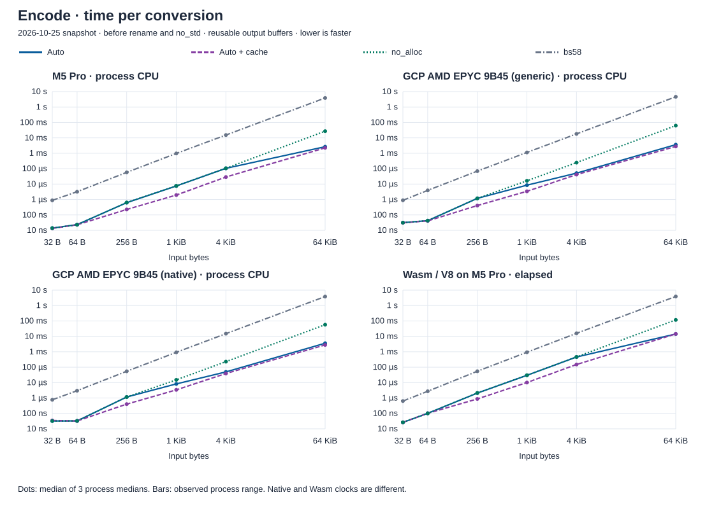
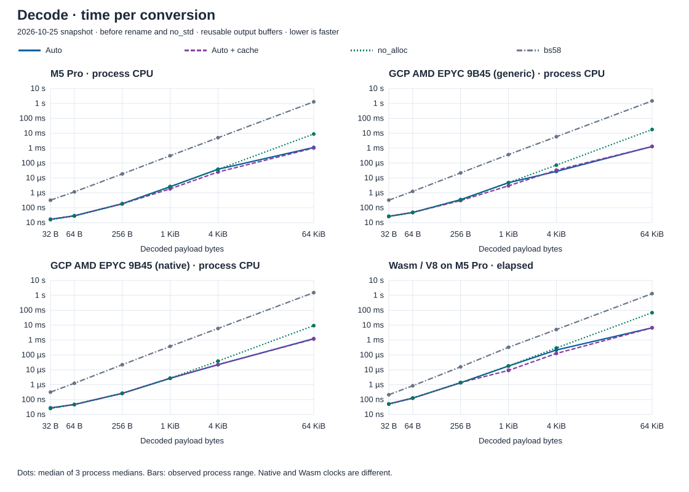

# faster-base58

Bitcoin Base58 encoding and decoding in Rust. The default API selects algorithms
by input size and CPU support. It is `no_std` by default, using `alloc` for its
faster general conversions. On x86-64, runtime SIMD detection uses the standard
library when `std` is enabled, and `cpufeatures` otherwise.

```toml
[dependencies]
faster-base58 = { git = "https://github.com/elichai/faster-base58" }
```

Requires Rust 1.95 or newer. This crate has not been published to crates.io yet.

## Encode and decode

Use borrowed output with arrays or reusable buffers, or return owned strings and vectors:

```rust
use faster_base58 as b58;

fn main() -> Result<(), Box<dyn std::error::Error>> {
    let input = [0, 1, 2, 3];
    let mut text_buffer = [0; b58::max_encoded_len(4)];
    let mut byte_buffer = [0; 4];
    let text = b58::encode_into(input, &mut text_buffer)?;
    assert_eq!(b58::decode_array::<4>(text)?, input);
    assert_eq!(b58::decode_into(text, &mut byte_buffer)?, input);
    let owned_text = b58::encode_string(input);
    assert_eq!(b58::decode_vec(&owned_text)?, input);

    let written = b58::encode(&input, &mut text_buffer)?;
    let text = std::str::from_utf8(&text_buffer[..written])?;
    let written = b58::decode(text, &mut byte_buffer)?;
    assert_eq!(&byte_buffer[..written], &input);

    let short: Result<usize, b58::BufferTooSmall> = b58::encode(&[0], &mut []);
    assert_eq!(short, Err(b58::BufferTooSmall));
    assert_eq!(b58::decode("0", &mut [0; 1]),
               Err(b58::Error::InvalidCharacter { index: 0 }));
    Ok(())
}
```

`max_encoded_len(n)` bounds the encoded output; an exactly sized result buffer
also works. Decoding needs at most one output byte per input text byte. Leading
zero bytes round-trip as leading `'1'` characters. `decode_array::<N>` requires
exactly `N` bytes: shorter results return `InvalidLength`, longer ones `BufferTooSmall`.

Invalid-character indices are UTF-8 byte offsets. Errors implement `Display` and
the standard error trait. Successful calls leave the unused output tail untouched;
on errors, output contents and error precedence are unspecified. Conversion timing
depends on input values and length; these functions are not constant-time.

## No internal allocation

`no_alloc` makes no heap allocations, including first calls and error paths.
It uses fixed tables for 32/64-byte encoding and batched conversion elsewhere.
General large inputs take quadratic time; the default API can allocate workspace
for faster algorithms. The examples are ordinary `std` programs; the library need not be.

```rust
use faster_base58::{max_encoded_len, no_alloc};

fn main() -> Result<(), Box<dyn std::error::Error>> {
    let input = [0, 1, 2, 3];
    let mut text_buffer = [0; max_encoded_len(4)];
    let mut byte_buffer = [0; 4];
    let text = no_alloc::encode_into(&input, &mut text_buffer)?;
    assert_eq!(no_alloc::decode_array::<4>(text)?, input);
    assert_eq!(no_alloc::decode_into(text, &mut byte_buffer)?, input);
    let written = no_alloc::encode(&input, &mut text_buffer)?;
    let text = std::str::from_utf8(&text_buffer[..written])?;
    assert_eq!(no_alloc::decode(text, &mut byte_buffer)?, input.len());
    Ok(())
}
```

This module shares the root error and buffer contracts. It has no owned-result
helpers. Enabling `cache` does not change its allocation guarantee.

## Optional caching

Add `features = ["cache"]` to the dependency to retain reusable tables. This
feature enables `std`. Caching is off by default; it changes dispatch as well as
retention. First use builds tables, so cached warm timings exclude that setup.
In the snapshot below, M5 1 KiB encoding improves from 7.55 to 1.94 µs warm, while
first-call wall time rises from 13.08 to 109.79 µs. Caching is not uniformly faster:
GCP generic 4 KiB decoding takes 33.39 µs versus 27.46 µs by default.

Tables are lazy **heap** allocations. Recorded capacity bounds are 18,617,760 bytes
for matrix tables and 25,164,288 bytes for production NTT twiddles: **41.8 MiB**
together, depending on call history. All cache families also use **6,280 bytes of
static headers** in the recorded 64-bit layout; these stores are absent by default.
Fixed 32/64-byte constants are separate (2,208 bytes of reference layout).
These are payload capacities, not RSS. Allocator overhead, construction scratch,
large per-call tables and concurrent conversions add memory; this is not a bound
on active heap. [Memory and algorithm details](DESIGN.md#heap-stack-and-cache-costs).

## Performance

**2026-10-25 snapshot**, before the later allocation changes, `no_std`, and package
rename. Warm raw conversions reuse caller buffers; owned helpers are excluded.
Native uses process CPU time; Wasm uses elapsed time. Bold marks the lowest
observed median, not a statistical result. [Methods, ranges and newer measurements](docs/performance.md).

| Host / operation (4 KiB) | Auto | Auto + `cache` | `no_alloc` | bs58 |
| --- | ---: | ---: | ---: | ---: |
| M5 Pro / encode | 105.31 µs | **28.68 µs** | 106.48 µs | 15.23 ms |
| M5 Pro / decode | 38.37 µs | **24.89 µs** | 37.29 µs | 5.01 ms |
| GCP AMD EPYC 9B45 (generic) / encode | 51.45 µs | **41.27 µs** | 247.16 µs | 18.05 ms |
| GCP AMD EPYC 9B45 (generic) / decode | **27.46 µs** | 33.39 µs | 72.40 µs | 5.87 ms |
| GCP AMD EPYC 9B45 (native) / encode | 49.47 µs | **38.88 µs** | 228.19 µs | 14.90 ms |
| GCP AMD EPYC 9B45 (native) / decode | **22.03 µs** | 22.37 µs | 38.56 µs | 5.97 ms |
| Wasm / V8 on M5 Pro / encode | 458.00 µs | **149.54 µs** | 465.10 µs | 15.75 ms |
| Wasm / V8 on M5 Pro / decode | 214.61 µs | **125.10 µs** | 293.05 µs | 5.06 ms |





## Linked size

Later **2026-10-25 allocation snapshot**, still before `no_std` and the rename.
Stripped encode+decode consumers, **KiB**, including scaffolding/runtime. Native
rows are executables; Wasm is a module. Padding and link choices affect totals.

| Target | Auto | Auto + `cache` | `no_alloc` | bs58 |
| --- | ---: | ---: | ---: | ---: |
| M5 Pro | 360.4 | 376.5 | 295.8 | 295.7 |
| GCP AMD EPYC 9B45 (generic) | 602.0 | 600.1 | 317.6 | 284.3 |
| GCP AMD EPYC 9B45 (native) | 584.1 | 572.3 | 307.8 | 285.6 |
| Wasm / V8 on M5 Pro | 101.4 | 103.5 | 39.2 | 19.6 |

[Exact sections, empty-scaffold deltas and hashes](docs/tradeoffs/2026-10-25/allocation-layout/README.md#matched-linked-size)
are retained with the measurements. These numbers do not measure the renamed release.

## Development and license

Run `cargo test` and `cargo test --features cache`. The `__internals` feature
exposes unstable backend controls for tests and benchmarks; applications need neither.
Benchmark targets include bs58, fixed-length five8, and a development-only Malachite adapter.
[Verification and its limits](docs/review/production.md) cover differential/property
tests, sanitizer fuzzing, Miri and bounded proofs. [Historical research](docs/historical-readme.md)
preserves the earlier derivations and experiments.

Licensed under [MIT](LICENSE-MIT) OR [Apache-2.0](LICENSE-APACHE), at your option.
