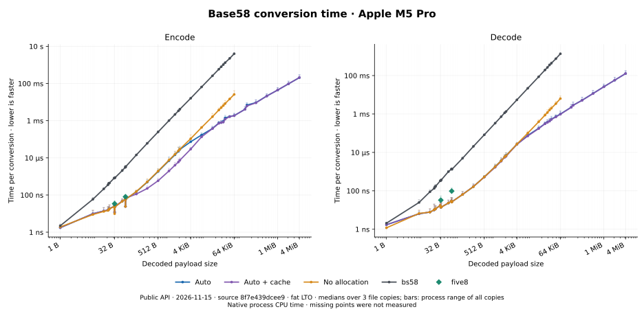

# faster-base58

Bitcoin Base58 encoding and decoding in Rust, with automatic algorithm and CPU
selection. The crate is `no_std` by default. Disable the default `alloc` feature
for heap-free conversion.

```toml
[dependencies]
faster-base58 = "0.1.0"
```

Requires Rust 1.95 or newer.

## Performance

Warm public-API encode/decode timings with automatic algorithm and CPU selection,
reused caller buffers, generic CPU flags and **fat LTO**. `cache` retains tables
between calls; default builds do not. Workspace allocation is included.

Latest recorded measurements: **2026-11-12**, source
[`3fcfbaff62f3`](https://github.com/elichai/faster-base58/commit/3fcfbaff62f3257ddc6de357f4856cf6225eabf8).
The encoder has changed since this run; a refresh of timings and linked sizes is
pending. [Methods, all sizes and resource costs](docs/performance.md#native-results).

### Apple M5 Pro

| Payload | Default encode / decode | Cache encode / decode |
| --- | ---: | ---: |
| 32 B | 11.8 ns / 13.7 ns | 11.9 ns / 13.6 ns |
| 64 B | 24.1 ns / 26 ns | 23.9 ns / 25.8 ns |
| 512 B | 1.83 µs / 519 ns | 582 ns / 505 ns |
| 4 KiB | 73.9 µs / 26.1 µs | 29.1 µs / 24.6 µs |
| 1 MiB | 43.6 ms / 25.8 ms | 43.5 ms / 25.3 ms |
| 4 MiB | 206 ms / 126 ms | 206 ms / 126 ms |



### AMD EPYC 9B45 (GCP)

| Payload | Default encode / decode | Cache encode / decode |
| --- | ---: | ---: |
| 32 B | 30.1 ns / 24.4 ns | 30 ns / 23.2 ns |
| 64 B | 31.1 ns / 44.8 ns | 31.5 ns / 45.1 ns |
| 512 B | 3.18 µs / 854 ns | 1.08 µs / 857 ns |
| 4 KiB | 47.5 µs / 15.7 µs | 39.6 µs / 15.8 µs |
| 1 MiB | 47.5 ms / 24 ms | 47.6 ms / 22.6 ms |
| 4 MiB | 221 ms / 120 ms | 220 ms / 116 ms |


### Other measurement scopes

Wasm, no-allocation, comparator, Base58Check, owned-output and allocation-counting
performance are not covered by this native run. Missing results are not estimates.


## Encode and decode

Configure an encoder or decoder, then choose owned or borrowed output:

```rust
use faster_base58::{Encoder, Decoder};

const ENCODER: Encoder = Encoder::bitcoin();
const DECODER: Decoder = Decoder::bitcoin();

let data = [0u8; 21];
let text: String = ENCODER.encode(&data).into_string();
assert_eq!(DECODER.decode(&text).into_array::<21>().unwrap(), data);
let mut buffer = [0; ENCODER.max_encoded_len(21)];
assert_eq!(ENCODER.encode(&data).onto(&mut buffer).unwrap(), text);
```

`Encoder` and `Decoder` are small `Copy` values and can be constants.
These examples use `unwrap()` for brevity; handle errors in application code.

Encoding provides `.into_string()`, `.into_vec()` (ASCII bytes), and `.onto()`
(borrowed `&str`). Decoding provides `.into_vec()`, `.into_array::<N>()`, and
`.onto()` (borrowed `&mut [u8]`). Input can be borrowed or owned. Decoded input
implements `AsRef<[u8]>`: strings and raw bytes work, and bytes need no UTF-8
validation first. Owned output methods require `alloc` (enabled by
default). Borrowed output and exact arrays are available with either allocation policy.

```rust
use faster_base58::{Encoder, Decoder};

const ENCODER: Encoder = Encoder::bitcoin();
const DECODER: Decoder = Decoder::bitcoin();
let input = [0, 1, 2, 3];
let mut text_buffer = [0; ENCODER.max_encoded_len(4)];
let mut byte_buffer = [0; 4];
let text = ENCODER.encode(input).onto(&mut text_buffer).unwrap();
assert_eq!(DECODER.decode(text).into_array::<4>().unwrap(), input);
assert_eq!(DECODER.decode(text).onto(&mut byte_buffer).unwrap(), input);
```

`ENCODER.max_encoded_len(n)` bounds encoded output; exact result capacity also
works. Plain decoding needs at most one output byte per input text byte. Leading
zero bytes round-trip as leading `'1'` characters. `.into_array::<N>()` requires
exactly `N` bytes: shorter results return `InvalidLength`, longer ones `BufferTooSmall`
(decoding stops when the array is full, so the actual length is not known).

Invalid-character indices are byte offsets into the input. `Error` is `#[non_exhaustive]`;
downstream matches need a wildcard arm. Errors implement `Display` and
the standard error trait. Successful calls leave the unused output tail untouched;
on errors, output contents and error precedence are unspecified. Conversion timing
depends on input values and length; these functions are not constant-time.

## Optional Base58Check

Enable `features = ["check"]` to add Bitcoin's four-byte double-SHA-256 checksum.
This enables an optional `sha2` dependency without requiring `std`. With the
feature disabled, normal dependencies do not include SHA-256. Select checking
on a configuration:

```rust
use faster_base58::{Encoder, Decoder};

const ENCODER: Encoder = Encoder::bitcoin().with_check();
const DECODER: Decoder = Decoder::bitcoin().with_check();

let data = [0u8; 21];
let text: String = ENCODER.encode(&data).into_string();
assert_eq!(text, "1111111111111111111114oLvT2");
assert_eq!(DECODER.decode(&text).into_array::<21>().unwrap(), data);
let mut bytes = [0u8; 21];
assert_eq!(DECODER.decode(&text).onto(&mut bytes).unwrap(), data);

const VERSIONED_ENCODER: Encoder = Encoder::bitcoin().with_check_version(0);
const VERSIONED_DECODER: Decoder = Decoder::bitcoin().with_check_version(0);
let text = VERSIONED_ENCODER.encode([0u8; 20]).into_string();
assert_eq!(VERSIONED_DECODER.decode(&text).into_array::<21>().unwrap(), data);
```

`.with_check()` hashes the input as supplied. `.with_check_version(v)` prepends
`v` on encode and requires that first data byte on decode. The version is included
in the checksum and **retained** in decoded output. Setters replace the previous
setting; `.with_check()` clears any configured version. Versions are one byte;
multi-byte prefixes, such as BIP32's four-byte extended-key version, are part of
the payload: use `.with_check()` and keep them in the data.

Checked decoding removes the checksum. Errors distinguish `MissingChecksum`,
`InvalidChecksum`, and `InvalidVersion { expected, actual }`; `actual: None`
means valid empty data has no version byte. These variants and setters are gated
by `check`. Checksum verification precedes version validation.

`ENCODER.max_encoded_len(n)` includes checksum and any inserted version. Checked
decoding with `.onto()` or `.into_array::<N>()` needs room only for the returned
data (including a retained version): the checksum is held on the stack, and the
unused output tail stays untouched. Neither direction allocates a temporary frame;
normal codec workspace still applies to large inputs, and hashing adds work.
Enabling the feature does not select checking for plain configurations.

## No internal allocation

Disable default features to exclude allocating backends and owned output methods:

```toml
faster-base58 = { version = "0.1.0", default-features = false }
```

The same `Encoder` / `Decoder` buffer and array methods then make no heap
allocations, including first calls and error paths. Encoding uses fixed tables for
32/64-byte frames and batched conversion elsewhere; decoding uses tiny/batched
conversion. General large inputs take quadratic time. The optional `check` feature
works with either policy. `cache` and development-only `__internals` enable `alloc`.
Cargo features are additive: any dependency that enables `alloc` enables it for
all consumers of that crate instance. Dropping an owned input can still call its
allocator; borrow inputs when counting all allocator operations.

## Optional caching

Add `features = ["cache"]` to retain reusable tables and enable `std`. Caching is
off by default and changes algorithm selection. Enabling it allocates no heap
storage until a conversion needs tables. Those tables remain for the process
lifetime; retention depends on input sizes, CPU and call history. Warm timings
exclude first-use setup. See [cache and memory costs](docs/performance.md#cache-and-memory).

| Cache family | Maximum retained heap payload across production classes |
| --- | ---: |
| Encoding and decoding Matrix tables | 18,617,760 B (17.8 MiB) |
| NTT twiddles | 9,436,416 B (9.0 MiB) |
| **Combined** | **28,054,176 B (26.8 MiB)** |

This is retained table capacity, **not a limit on total active heap**: per-call
scratch, larger owned tables, allocator overhead and concurrent calls add to it.
The static headers of the cache families take 2,176 bytes when present. None of
these figures measures RSS. [Memory and algorithm details](DESIGN.md#heap-stack-and-cache-costs).

## Linked size

Code and readonly bytes from the **same recorded native artifacts** as the timing
results, with both directions reachable. Each value subtracts a matching empty
consumer to account for the probe scaffold. These are linked-consumer section
sizes, not crate-only instruction counts. Stack, heap and file layout are separate
costs. The [full accounting](docs/performance.md#linked-size-and-compact) includes
initialized data, BSS and stripped-file bytes. The encoder changes after the
recorded source also require a linked-size refresh.

| Host / LTO / policy | Code B | Readonly B |
| --- | ---: | ---: |
| m5 / fat / default | 67,760 | 24,950 |
| m5 / fat / cache | 76,232 | 27,768 |
| m5 / off / default | 80,728 | 50,006 |
| m5 / off / cache | 84,760 | 58,019 |
| gcp / fat / default | 308,157 | 38,444 |
| gcp / fat / cache | 303,789 | 39,280 |
| gcp / off / default | 332,787 | 75,964 |
| gcp / off / cache | 324,707 | 72,072 |

## Development and license

[CI.md](CI.md) lists the CI jobs and their local commands (most suites need
`--features __internals`; checksum suites need `check`).
[CORRECTNESS.md](CORRECTNESS.md) describes the differential/property tests,
sanitizer fuzzing, Miri, scoped proofs and remaining gaps.
[DESIGN.md](DESIGN.md) explains algorithms, dispatch and resource costs. The
`__internals` feature exposes unstable backend controls for tests and benchmarks;
applications need neither. Benchmarks compare bs58, basexx, fixed-length five8 and
a development-only Malachite adapter.

Implementation influences, algorithm references and upstream licenses are listed
in [REFERENCES.md](REFERENCES.md).

Licensed under [MIT](LICENSE-MIT) OR [Apache-2.0](LICENSE-APACHE), at your option.
