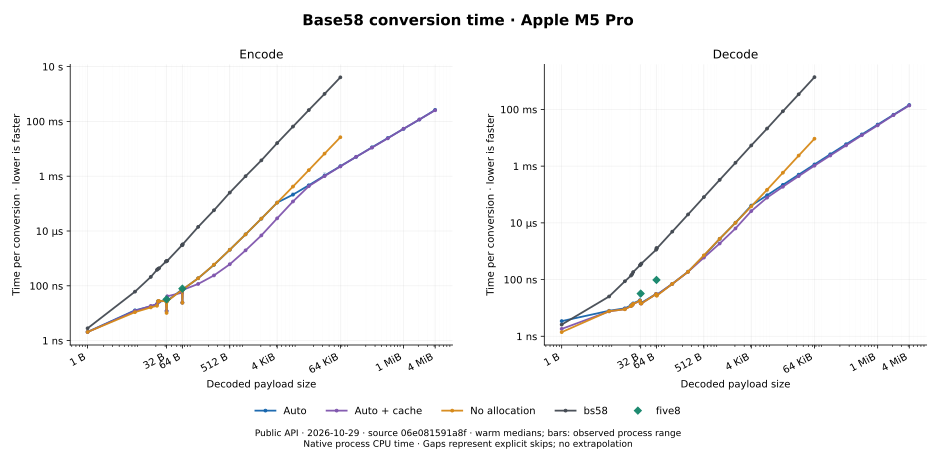
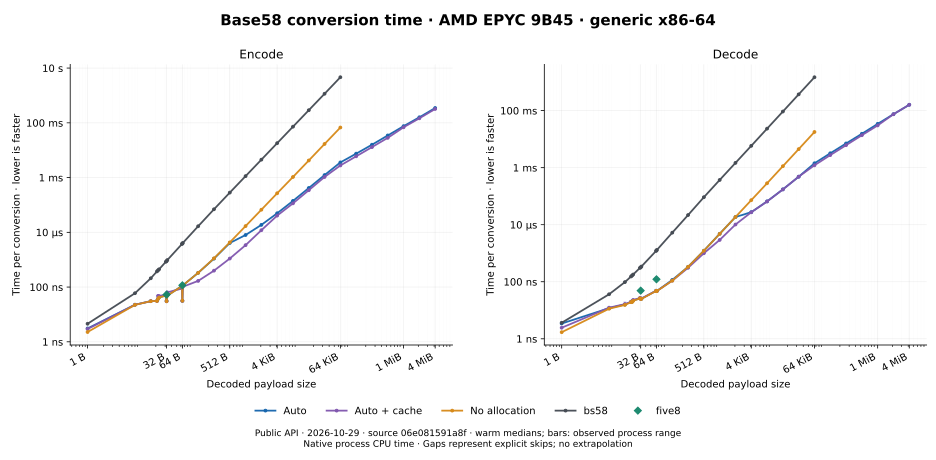
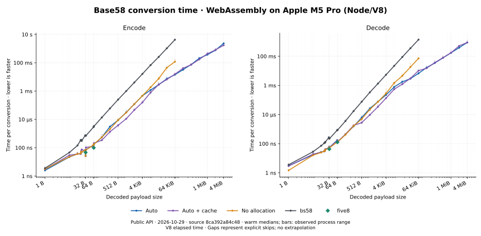

# faster-base58

Bitcoin Base58 encoding and decoding in Rust. The default API selects algorithms
by input size and CPU support. It is `no_std` by default, using `alloc` for its
faster general conversions. On x86-64, runtime SIMD detection uses the standard
library when `std` is enabled, and `cpufeatures` otherwise.

```toml
[dependencies]
faster-base58 = { git = "https://github.com/elichai/faster-base58" }
```

Requires Rust 1.95 or newer. This crate has not been published to crates.io yet.

## Encode and decode

Use borrowed output with arrays or reusable buffers, or return owned strings and vectors:

```rust
use faster_base58 as b58;

fn main() -> Result<(), Box<dyn std::error::Error>> {
    let input = [0, 1, 2, 3];
    let mut text_buffer = [0; b58::max_encoded_len(4)];
    let mut byte_buffer = [0; 4];
    let text = b58::encode_into(input, &mut text_buffer)?;
    assert_eq!(b58::decode_array::<4>(text)?, input);
    assert_eq!(b58::decode_into(text, &mut byte_buffer)?, input);
    let owned_text = b58::encode_string(input);
    assert_eq!(b58::decode_vec(&owned_text)?, input);

    let written = b58::encode(&input, &mut text_buffer)?;
    let text = std::str::from_utf8(&text_buffer[..written])?;
    let written = b58::decode(text, &mut byte_buffer)?;
    assert_eq!(&byte_buffer[..written], &input);

    let short: Result<usize, b58::BufferTooSmall> = b58::encode(&[0], &mut []);
    assert_eq!(short, Err(b58::BufferTooSmall));
    assert_eq!(b58::decode("0", &mut [0; 1]),
               Err(b58::Error::InvalidCharacter { index: 0 }));
    Ok(())
}
```

`max_encoded_len(n)` bounds the encoded output; an exactly sized result buffer
also works. Decoding needs at most one output byte per input text byte. Leading
zero bytes round-trip as leading `'1'` characters. `decode_array::<N>` requires
exactly `N` bytes: shorter results return `InvalidLength`, longer ones `BufferTooSmall`.

Invalid-character indices are UTF-8 byte offsets. Errors implement `Display` and
the standard error trait. Successful calls leave the unused output tail untouched;
on errors, output contents and error precedence are unspecified. Conversion timing
depends on input values and length; these functions are not constant-time.

## No internal allocation

`no_alloc` makes no heap allocations, including first calls and error paths.
It uses fixed tables for 32/64-byte encoding and batched conversion elsewhere.
General large inputs take quadratic time; the default API can allocate workspace
for faster algorithms. The examples are ordinary `std` programs; the library need not be.

```rust
use faster_base58::{max_encoded_len, no_alloc};

fn main() -> Result<(), Box<dyn std::error::Error>> {
    let input = [0, 1, 2, 3];
    let mut text_buffer = [0; max_encoded_len(4)];
    let mut byte_buffer = [0; 4];
    let text = no_alloc::encode_into(&input, &mut text_buffer)?;
    assert_eq!(no_alloc::decode_array::<4>(text)?, input);
    assert_eq!(no_alloc::decode_into(text, &mut byte_buffer)?, input);
    let written = no_alloc::encode(&input, &mut text_buffer)?;
    let text = std::str::from_utf8(&text_buffer[..written])?;
    assert_eq!(no_alloc::decode(text, &mut byte_buffer)?, input.len());
    Ok(())
}
```

This module shares the root error and buffer contracts. It has no owned-result
helpers. Enabling `cache` does not change its allocation guarantee.

Auto trades workspace for large-input speed. At 4 MiB, the M5 measurements with
default features peak at about 126 MiB of extra requested heap for encoding and
105 MiB for decoding, excluding caller buffers. The sampled 1/4 MiB M5 encode
calls each make 14 allocations and zero reallocations with either cache policy.
[Allocation details](DESIGN.md#heap-stack-and-cache-costs).

## Optional caching

Add `features = ["cache"]` to the dependency to retain reusable tables. This
feature enables `std`. Caching is off by default; it changes dispatch as well as
retention. First use builds tables; the warm timings below exclude that setup.
[Cold calls and cache tradeoffs](docs/performance.md#cache-and-memory) help assess
whether reuse repays the setup and memory cost for your workload.

Tables are lazy **heap** allocations. Recorded capacity bounds are 18,617,760 bytes
for matrix tables and 25,164,288 bytes for production NTT twiddles: **41.8 MiB**
together, depending on call history. All cache families also use **6,280 bytes of
static headers** in the recorded 64-bit layout; these stores are absent by default.
Dead stripping can remove headers for cache families a consumer does not use.
Fixed 32/64-byte constants are separate (2,208 bytes of reference layout).
These are payload capacities, not RSS. Allocator overhead, construction scratch,
large per-call tables and concurrent conversions add memory; this is not a bound
on active heap. [Memory and algorithm details](DESIGN.md#heap-stack-and-cache-costs).

## Performance

**Measured 2026-10-29 from combined source `06e081591a8f`**, including the
formatter, table alignment and radix scratch improvements. Warm calls reuse
output buffers and include Auto's workspace allocations. Native
uses process CPU time; Wasm uses V8 elapsed time. Each cell is **encode / decode**.
Bold marks the lowest observed median, without a statistical significance claim.
[Methods, cold calls, observed ranges and source identities](docs/performance.md).

Ordinary public consumers have no `__internals` feature. Each cell uses three
fresh processes, each with three warm batches of at least 10 ms. The reported
value is the median of the three process medians; figure bars show their range.
No-allocation and bs58 stop at 64 KiB by benchmark policy; five8 covers 32/64 B.
The figures show all supported sizes from 1 B through 4 MiB.

A separate [basexx comparison](docs/performance.md#basexx-comparison) includes a
general-purpose comparator that substantially outperforms bs58 at 1 and 4 KiB.

### Apple M5 Pro

Rust 1.99.1 / LLVM 23.1.1; compiler-default target flags.

| Payload | Auto | Auto + cache | No allocation | bs58 | five8 |
|---|---:|---:|---:|---:|---:|
| 32 B | 12 ns / 15.4 ns | 12.1 ns / **14.4 ns** | **10.2 ns** / 14.5 ns | 806 ns / 340 ns | 32 ns / 32.1 ns |
| 64 B | 24.4 ns / 28.5 ns | 24.3 ns / 28.2 ns | **24 ns** / **27.6 ns** | 3.07 µs / 1.29 µs | 78.7 ns / 97 ns |
| 512 B | 2.06 µs / 679 ns | **610 ns** / **595 ns** | 2.06 µs / 715 ns | 252 µs / 80.8 µs | — / — |
| 4 KiB | 109 µs / 40.6 µs | **29 µs** / **25.9 µs** | 109 µs / 38.2 µs | 16.2 ms / 5.36 ms | — / — |
| 64 KiB | 2.32 ms / 1.15 ms | **2.27 ms** / **1.04 ms** | 26.5 ms / 9.26 ms | 4.07 s / 1.37 s | — / — |
| 1 MiB | **53.7 ms** / 29.3 ms | 54 ms / **27.3 ms** | — / — | — / — | — / — |
| 4 MiB | 264 ms / 143 ms | **255 ms** / **137 ms** | — / — | — / — | — / — |



### AMD EPYC 9B45 (GCP, generic x86-64)

Rust 1.99.0 / LLVM 23.1.1; generic target, runtime CPU selection enabled, CPU 0
pinned. These are ordinary public consumers. The older internal-worker native
comparison is separate in the [performance guide](docs/performance.md#generic-and-native-x86-64).

| Payload | Auto | Auto + cache | No allocation | bs58 | five8 |
|---|---:|---:|---:|---:|---:|
| 32 B | 31.2 ns / 25.7 ns | **30.1 ns** / 25.3 ns | 30.3 ns / **25.3 ns** | 884 ns / 319 ns | 53 ns / 48.7 ns |
| 64 B | **31.3 ns** / 47.3 ns | 31.4 ns / 47.3 ns | 31.5 ns / **47 ns** | 3.91 µs / 1.25 µs | 116 ns / 122 ns |
| 512 B | 4.07 µs / 1.22 µs | **1.1 µs** / **998 ns** | 4.28 µs / 1.22 µs | 282 µs / 92.1 µs | — / — |
| 4 KiB | 49.7 µs / 27.5 µs | **40.8 µs** / **27.3 µs** | 267 µs / 72.5 µs | 18.1 ms / 5.83 ms | — / — |
| 64 KiB | 3.58 ms / 1.43 ms | **2.77 ms** / **1.21 ms** | 67.5 ms / 17.8 ms | 4.64 s / 1.48 s | — / — |
| 1 MiB | 75.6 ms / 34.3 ms | **68.8 ms** / **30.3 ms** | — / — | — / — | — / — |
| 4 MiB | 349 ms / 161 ms | **321 ms** / **160 ms** | — / — | — / — | — / — |



### WebAssembly on Apple M5 Pro (Node/V8)

Rust 1.99.1 / LLVM 23.1.1; scalar Wasm; Node 26.13.0 / V8 14.6.202.34-node.40.
These are elapsed-time observations from one combined source snapshot; they
do not establish a source-caused speedup over older tables.
[Observed ranges and controls](docs/performance.md#timing-limits).

| Payload | Auto | Auto + cache | No allocation | bs58 | five8 |
|---|---:|---:|---:|---:|---:|
| 32 B | 26.1 ns / 53.5 ns | 26.4 ns / 53.8 ns | **26 ns** / 53.9 ns | 614 ns / 218 ns | 45.8 ns / **42.3 ns** |
| 64 B | 102 ns / 133 ns | 101 ns / 134 ns | 103 ns / 128 ns | 3.02 µs / 849 ns | **95.8 ns** / **127 ns** |
| 512 B | 7.69 µs / 5.04 µs | **2.87 µs** / **2.67 µs** | 7.68 µs / 4.92 µs | 244 µs / 77.5 µs | — / — |
| 4 KiB | 466 µs / 218 µs | **148 µs** / **127 µs** | 472 µs / 294 µs | 16.1 ms / 5.43 ms | — / — |
| 64 KiB | 14.7 ms / 6.76 ms | **14.3 ms** / **6.59 ms** | 119 ms / 72.6 ms | 4.07 s / 1.4 s | — / — |
| 1 MiB | 347 ms / 174 ms | **345 ms** / **173 ms** | — / — | — / — | — / — |
| 4 MiB | 1.67 s / 837 ms | **1.65 s** / **835 ms** | — / — | — / — | — / — |



## Linked size

Code and data linked **above a matching empty consumer**, in KiB, measured
2026-10-29 from the same combined source snapshot as the timing tables. Both API
directions are reachable: opt-level 3, fat LTO, 16 codegen units, generic target
flags. These are linked cdylib section deltas, including associated code and
metadata. Full files also contain runtime, scaffolding and platform padding.

| Consumer | M5 code / readonly | x86-64 code / readonly | Wasm code / data section |
|---|---:|---:|---:|
| Auto | 68.1 KiB / 24.7 KiB | 279.5 KiB / 35.1 KiB | 69.9 KiB / 14.6 KiB |
| Auto + cache | 71.1 KiB / 27.0 KiB | 270.2 KiB / 35.8 KiB | 71.6 KiB / 15.4 KiB |
| No allocation | 9.4 KiB / 10.7 KiB | 20.3 KiB / 14.6 KiB | 13.5 KiB / 9.6 KiB |
| bs58 | 1.4 KiB / 0.9 KiB | 2.0 KiB / 0.9 KiB | 2.7 KiB / 0.8 KiB |

Readonly constants, initialized data, BSS, cache headers, retained heap and Wasm
linear-memory pages are different costs. The pair lookup table has 3,364 entries
of two bytes (6,728 B); whether it survives linking depends on reachable paths.
[Section accounting, cache memory and historical compact results](docs/performance.md).

On x86-64, `features = ["compact"]` keeps eight IFMA kernel widths instead of
twelve. This reduces linked code and uses more chunks for some multiplications.
It preserves the API and allocation contracts; the speed tradeoff depends on
operand size. Other production targets do not use these IFMA kernels.

## Development and license

Run `cargo test` and `cargo test --features cache`. The `__internals` feature
exposes unstable backend controls for tests and benchmarks; applications need neither.
Benchmark targets include bs58, fixed-length five8, and a development-only Malachite adapter.
[CORRECTNESS.md](CORRECTNESS.md) describes differential/property tests, sanitizer
fuzzing, Miri, scoped proofs and remaining coverage gaps.
[DESIGN.md](DESIGN.md) explains algorithms, dispatch and resource costs.

Implementation influences, algorithm references and upstream licenses are listed
in [REFERENCES.md](REFERENCES.md).

Licensed under [MIT](LICENSE-MIT) OR [Apache-2.0](LICENSE-APACHE), at your option.
