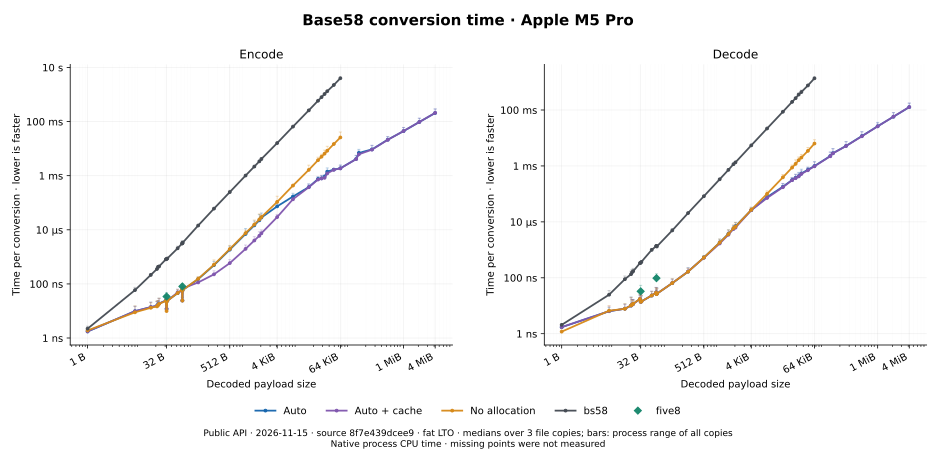
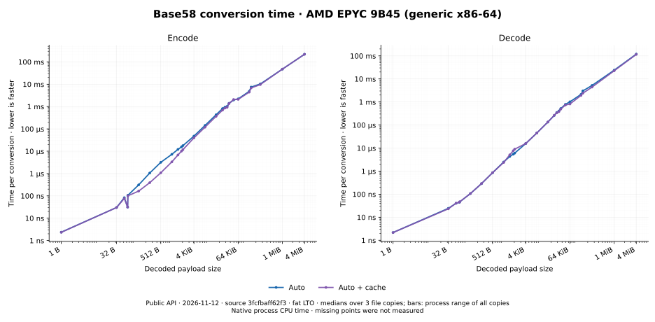

# Performance and resource tradeoffs

The [README](../README.md#performance) shows the measured competing-crate
comparison near the top. [DESIGN.md](../DESIGN.md) describes algorithms,
dispatch and memory ownership; [CORRECTNESS.md](../CORRECTNESS.md) describes
validation and its limits.

## Public conversion results

Measured **2026-11-25**, source
[`472586e62d2577e8fd99c9a30e91f31c7078b143`](https://github.com/elichai/faster-base58/commit/472586e62d2577e8fd99c9a30e91f31c7078b143).
Ordinary public consumers call `Encoder::bitcoin().encode(..).onto(..)` and
`Decoder::bitcoin().decode(..).onto(..)` from `code_size.py` cdylibs/modules.
Release opt-level 3, 16 codegen units, generic CPU flags (`RUSTFLAGS=""`),
fat LTO and LTO off for native, fat LTO for scalar Wasm. Default and `cache`
are separate builds. No-allocation disables default features. No `__internals`,
`check`, `compact`, allocation counting or `target-cpu=native` is enabled.
Comparators use bs58 0.5.1 and five8 1.0.0 with default features.

Effective LTO is selected with `CARGO_PROFILE_RELEASE_LTO=fat` or `off`. The
generated probe manifest says fat; its text does not capture that environment
override.

| Platform | Compiler / runtime | Clock / sampling |
| --- | --- | --- |
| Apple M5 Pro, macOS 26.7.3, AArch64, AC power | Rust 1.99.1 / LLVM 23.1.1 | Process CPU; 5 processes × 3 file copies |
| GCP AMD EPYC 9B45, Linux, generic x86-64, CPU 1 pinned | Rust 1.99.0 / LLVM 23.1.1 | Process CPU; 3 processes × 4 file copies |
| Scalar Wasm on M5 | Rust 1.99.1; Node 26.13.1 / V8 14.6.202.34 | V8 elapsed; 5 processes |

All libraries are interleaved within each process in three timed batches,
calibrated to at least 10 ms. Each retained process/copy cell is its median batch
time. Absolute medians first take each copy's median over processes, then the
median over copies. Ranges span all retained process/copy cells. Individual batch
values are not retained. All observations from each completed cohort are retained;
none are adjusted by control ratios.
Loader and timed order rotate partially; their effects are not independently balanced.

Fixtures are deterministic random bytes with a nonzero first byte. Caller buffers
are outside timing. Native buffers are 64-byte aligned and reused; native untimed
checks poison the expected output before each label. Wasm allocates and copies
caller buffers outside each timed batch and reuses them within the repeated-call
interval. Both workers check each library's output outside timing. Internal codec
workspace allocation is timed. Decode uses prevalidated UTF-8 while Base58 digit
validation remains inside the decoder. Cache timings exclude first-use table setup.

All compared artifacts are built before timing each cohort. GCP uses the shared
VM lock and CPU 1, and disables transparent huge pages for the warm cohort.
An unmeasured 10-second busy loop primes CPU 1 before the GCP warm run.
The runner applies no realtime-scheduler or ASLR overrides. M5 power and
thermal receipts bracket the complete run; background desktop activity is not
isolated. Wasm uses `--no-liftoff --no-wasm-lazy-compilation
--no-wasm-async-compilation`. Native CPU clocks and V8 elapsed time are separate
measurement scopes.






### Complete warm timings

Each conversion cell labels **Encode** and **Decode**. A range is shown when the
observed process/copy maximum exceeds the minimum by more than 3%; it is not a confidence interval.
Logarithmic figures omit zero bytes.

In fat-LTO tables, Auto cells show **peak internal heap** beside each direction's
timing. These are separate, untimed public-consumer measurements at
the same decoded byte counts, with input and output storage excluded. Warm peaks
include cached tables retained by the first call. The [heap protocol](#cache-and-memory)
defines their fixtures and cache state. LTO-off tables contain timings only.

<details>
<summary>Apple M5 Pro / fat LTO</summary>

| Payload | Auto | Auto + cache | No allocation | bs58 | five8 |
| --- | ---: | ---: | ---: | ---: | ---: |
| 0 B | Encode: 1.43 ns [1.4 ns, 1.6 ns]; heap 0 B<br>Decode: 1.44 ns [1.38 ns, 1.69 ns]; heap 0 B | Encode: 1.44 ns [1.39 ns, 1.64 ns]; heap 0 B<br>Decode: 1.44 ns [1.4 ns, 1.62 ns]; heap 0 B | Encode: 1.86 ns [1.84 ns, 2.01 ns]<br>Decode: 1 ns [0.931 ns, 1.27 ns] | Encode: 1.03 ns [0.966 ns, 1.07 ns]<br>Decode: 0.722 ns [0.693 ns, 1.04 ns] | Encode: —<br>Decode: — |
| 1 B | Encode: 1.77 ns [1.69 ns, 1.9 ns]; heap 0 B<br>Decode: 1.7 ns [1.69 ns, 1.89 ns]; heap 0 B | Encode: 1.78 ns [1.7 ns, 1.9 ns]; heap 0 B<br>Decode: 1.71 ns [1.69 ns, 1.91 ns]; heap 0 B | Encode: 1.9 ns [1.88 ns, 2.06 ns]<br>Decode: 1.19 ns [1.15 ns, 1.37 ns] | Encode: 2.13 ns [2.04 ns, 2.47 ns]<br>Decode: 1.92 ns [1.82 ns, 2.23 ns] | Encode: —<br>Decode: — |
| 8 B | Encode: 9.69 ns [9.57 ns, 10.2 ns]; heap 0 B<br>Decode: 6.34 ns [6.29 ns, 6.53 ns]; heap 0 B | Encode: 9.6 ns [9.51 ns, 10.9 ns]; heap 0 B<br>Decode: 6.3 ns; heap 0 B | Encode: 8.83 ns [8.75 ns, 9.78 ns]<br>Decode: 6.53 ns | Encode: 56.3 ns [54.9 ns, 61.6 ns]<br>Decode: 24.8 ns [24.2 ns, 25.1 ns] | Encode: —<br>Decode: — |
| 16 B | Encode: 13.6 ns [13.4 ns, 13.9 ns]; heap 0 B<br>Decode: 7.68 ns [7.63 ns, 8.12 ns]; heap 0 B | Encode: 13.7 ns [13.5 ns, 14 ns]; heap 0 B<br>Decode: 7.78 ns [7.7 ns, 7.97 ns]; heap 0 B | Encode: 12.7 ns [12.5 ns, 13.2 ns]<br>Decode: 7.68 ns [7.56 ns, 7.98 ns] | Encode: 202 ns [199 ns, 217 ns]<br>Decode: 86.9 ns [85.7 ns, 88.8 ns] | Encode: —<br>Decode: — |
| 21 B | Encode: 15 ns [14.8 ns, 15.4 ns]; heap 0 B<br>Decode: 10 ns [9.92 ns, 11.6 ns]; heap 0 B | Encode: 15.2 ns [14.8 ns, 15.8 ns]; heap 0 B<br>Decode: 10 ns [9.9 ns, 11.9 ns]; heap 0 B | Encode: 14.4 ns [13.8 ns, 15 ns]<br>Decode: 10.2 ns [9.86 ns, 11 ns] | Encode: 347 ns [338 ns, 373 ns]<br>Decode: 130 ns [130 ns, 147 ns] | Encode: —<br>Decode: — |
| 22 B | Encode: 16.1 ns [15.8 ns, 17.4 ns]; heap 0 B<br>Decode: 10.9 ns [10.7 ns, 11.9 ns]; heap 0 B | Encode: 16 ns [15.6 ns, 16.6 ns]; heap 0 B<br>Decode: 11 ns; heap 0 B | Encode: 15.6 ns [15.1 ns, 16.3 ns]<br>Decode: 10.9 ns | Encode: 411 ns [404 ns, 439 ns]<br>Decode: 155 ns [154 ns, 159 ns] | Encode: —<br>Decode: — |
| 23 B | Encode: 18.8 ns [18.6 ns, 22.3 ns]; heap 0 B<br>Decode: 11.3 ns [11.2 ns, 12.8 ns]; heap 0 B | Encode: 18.4 ns [18.2 ns, 21.8 ns]; heap 0 B<br>Decode: 11.3 ns [11.2 ns, 12.5 ns]; heap 0 B | Encode: 17.9 ns [17.6 ns, 20.9 ns]<br>Decode: 11.6 ns [11.4 ns, 12.8 ns] | Encode: 428 ns [418 ns, 483 ns]<br>Decode: 166 ns [164 ns, 186 ns] | Encode: —<br>Decode: — |
| 31 B | Encode: 23.7 ns [23.1 ns, 24.9 ns]; heap 0 B<br>Decode: 17.1 ns; heap 0 B | Encode: 23.8 ns [23.1 ns, 24.6 ns]; heap 0 B<br>Decode: 17.1 ns [17 ns, 17.8 ns]; heap 0 B | Encode: 22.4 ns [21.9 ns, 23.7 ns]<br>Decode: 17.1 ns [16.9 ns, 18.1 ns] | Encode: 766 ns [724 ns, 810 ns]<br>Decode: 320 ns [316 ns, 351 ns] | Encode: —<br>Decode: — |
| 32 B | Encode: 11.8 ns; heap 0 B<br>Decode: 13.7 ns; heap 0 B | Encode: 11.9 ns; heap 0 B<br>Decode: 13.6 ns; heap 0 B | Encode: 9.8 ns [9.74 ns, 10.4 ns]<br>Decode: 13.7 ns | Encode: 792 ns [776 ns, 835 ns]<br>Decode: 334 ns [326 ns, 348 ns] | Encode: 33 ns [31.7 ns, 35.5 ns]<br>Decode: 32.1 ns [31.5 ns, 33 ns] |
| 33 B | Encode: 23.7 ns [23.3 ns, 24.7 ns]; heap 0 B<br>Decode: 14 ns [13.9 ns, 14.8 ns]; heap 0 B | Encode: 23.3 ns [22.8 ns, 24.2 ns]; heap 0 B<br>Decode: 14.2 ns [14 ns, 14.5 ns]; heap 0 B | Encode: 22.8 ns [22.1 ns, 23.7 ns]<br>Decode: 14.1 ns | Encode: 861 ns [805 ns, 878 ns]<br>Decode: 360 ns [351 ns, 372 ns] | Encode: —<br>Decode: — |
| 52 B | Encode: 45.8 ns [44.6 ns, 46.8 ns]; heap 0 B<br>Decode: 23 ns; heap 0 B | Encode: 48.7 ns [47.7 ns, 49.6 ns]; heap 47 KiB<br>Decode: 23.2 ns; heap 0 B | Encode: 44.6 ns [43.7 ns, 46.6 ns]<br>Decode: 23.2 ns [22.9 ns, 24 ns] | Encode: 1.93 µs [1.91 µs, 2.1 µs]<br>Decode: 950 ns [938 ns, 988 ns] | Encode: —<br>Decode: — |
| 63 B | Encode: 58.5 ns [56.5 ns, 60.6 ns]; heap 0 B<br>Decode: 29.5 ns; heap 0 B | Encode: 54.5 ns [53.7 ns, 56 ns]; heap 47 KiB<br>Decode: 29.7 ns; heap 0 B | Encode: 58 ns [55.2 ns, 60.8 ns]<br>Decode: 29.4 ns | Encode: 2.93 µs [2.88 µs, 3.09 µs]<br>Decode: 1.3 µs [1.24 µs, 1.36 µs] | Encode: —<br>Decode: — |
| 64 B | Encode: 23.8 ns; heap 0 B<br>Decode: 26 ns [25.8 ns, 30 ns]; heap 0 B | Encode: 23.8 ns; heap 0 B<br>Decode: 26 ns [25.8 ns, 30.5 ns]; heap 0 B | Encode: 23.7 ns<br>Decode: 25.6 ns [25.4 ns, 28.1 ns] | Encode: 2.95 µs [2.91 µs, 3.15 µs]<br>Decode: 1.36 µs [1.28 µs, 1.5 µs] | Encode: 77.5 ns [71.5 ns, 82.8 ns]<br>Decode: 95.9 ns [94.7 ns, 104 ns] |
| 65 B | Encode: 57.9 ns [56.6 ns, 60.5 ns]; heap 0 B<br>Decode: 26.3 ns [26.1 ns, 28.1 ns]; heap 0 B | Encode: 68.1 ns [65.4 ns, 74.7 ns]; heap 47 KiB<br>Decode: 26.5 ns [26.3 ns, 28.1 ns]; heap 0 B | Encode: 57.4 ns [56.7 ns, 60.7 ns]<br>Decode: 26.3 ns | Encode: 3.12 µs [3.09 µs, 3.34 µs]<br>Decode: 1.27 µs [1.22 µs, 1.33 µs] | Encode: —<br>Decode: — |
| 128 B | Encode: 148 ns [146 ns, 153 ns]; heap 0 B<br>Decode: 63.7 ns [63.1 ns, 67.8 ns]; heap 0 B | Encode: 107 ns [106 ns, 113 ns]; heap 47 KiB<br>Decode: 63.8 ns [63.2 ns, 76.1 ns]; heap 0 B | Encode: 151 ns [149 ns, 159 ns]<br>Decode: 63.6 ns [62.8 ns, 66.8 ns] | Encode: 13.5 µs [13.4 µs, 14.6 µs]<br>Decode: 4.75 µs [4.7 µs, 5.05 µs] | Encode: —<br>Decode: — |
| 256 B | Encode: 480 ns [472 ns, 504 ns]; heap 0 B<br>Decode: 159 ns [158 ns, 168 ns]; heap 0 B | Encode: 232 ns [229 ns, 248 ns]; heap 47 KiB<br>Decode: 161 ns [159 ns, 171 ns]; heap 0 B | Encode: 506 ns [494 ns, 538 ns]<br>Decode: 159 ns [158 ns, 166 ns] | Encode: 57.3 µs [56.6 µs, 61.5 µs]<br>Decode: 19.1 µs [18.9 µs, 20.8 µs] | Encode: —<br>Decode: — |
| 512 B | Encode: 1.8 µs [1.77 µs, 1.86 µs]; heap 0 B<br>Decode: 512 ns; heap 0 B | Encode: 596 ns [585 ns, 609 ns]; heap 47 KiB<br>Decode: 479 ns; heap 40.2 KiB | Encode: 1.91 µs [1.89 µs, 1.99 µs]<br>Decode: 515 ns [510 ns, 534 ns] | Encode: 234 µs [232 µs, 250 µs]<br>Decode: 78.1 µs [77.5 µs, 81.3 µs] | Encode: —<br>Decode: — |
| 1 KiB | Encode: 6.84 µs; heap 0 B<br>Decode: 1.79 µs; heap 0 B | Encode: 1.95 µs; heap 182 KiB<br>Decode: 1.64 µs; heap 154 KiB | Encode: 7.33 µs<br>Decode: 1.78 µs | Encode: 945 µs [937 µs, 988 µs]<br>Decode: 317 µs [314 µs, 329 µs] | Encode: —<br>Decode: — |
| 1,504 B | Encode: 14.4 µs; heap 0 B<br>Decode: 3.69 µs; heap 0 B | Encode: 3.95 µs; heap 712 KiB<br>Decode: 3.42 µs; heap 602 KiB | Encode: 15.4 µs<br>Decode: 3.61 µs [3.59 µs, 3.73 µs] | Encode: 2.05 ms [2.02 ms, 2.17 ms]<br>Decode: 686 µs [680 µs, 712 µs] | Encode: —<br>Decode: — |
| 1,875 B | Encode: 22 µs; heap 0 B<br>Decode: 5.59 µs; heap 0 B | Encode: 5.89 µs; heap 712 KiB<br>Decode: 5.12 µs; heap 602 KiB | Encode: 23.7 µs [23.4 µs, 24.2 µs]<br>Decode: 5.54 µs [5.4 µs, 5.64 µs] | Encode: 3.18 ms [3.15 ms, 3.31 ms]<br>Decode: 1.07 ms [1.06 ms, 1.11 ms] | Encode: —<br>Decode: — |
| 2 KiB | Encode: 26.4 µs; heap 0 B<br>Decode: 6.56 µs; heap 0 B | Encode: 6.85 µs; heap 712 KiB<br>Decode: 6.01 µs; heap 602 KiB | Encode: 28.2 µs<br>Decode: 6.55 µs [6.46 µs, 6.67 µs] | Encode: 3.81 ms [3.77 ms, 3.93 ms]<br>Decode: 1.28 ms [1.26 ms, 1.32 ms] | Encode: —<br>Decode: — |
| 4 KiB | Encode: 71.3 µs; heap 82.4 KiB<br>Decode: 26 µs [25.8 µs, 27.9 µs]; heap 0 B | Encode: 28.9 µs [28.7 µs, 29.6 µs]; heap 2.76 MiB<br>Decode: 24.9 µs [24.7 µs, 26.5 µs]; heap 2.32 MiB | Encode: 106 µs<br>Decode: 26.1 µs [25.8 µs, 27.8 µs] | Encode: 15.3 ms [15.1 ms, 16.2 ms]<br>Decode: 5.1 ms [5.04 ms, 5.62 ms] | Encode: —<br>Decode: — |
| 8 KiB | Encode: 164 µs [162 µs, 168 µs]; heap 164 KiB<br>Decode: 74.1 µs [73.3 µs, 76.6 µs]; heap 125 KiB | Encode: 120 µs [118 µs, 126 µs]; heap 11 MiB<br>Decode: 69.4 µs [68.8 µs, 71.3 µs]; heap 280 KiB | Encode: 411 µs [406 µs, 423 µs]<br>Decode: 97.7 µs [96.4 µs, 100 µs] | Encode: 61 ms [60.7 ms, 66 ms]<br>Decode: 20.5 ms [20.2 ms, 21.8 ms] | Encode: —<br>Decode: — |
| 16 KiB | Encode: 369 µs; heap 328 KiB<br>Decode: 178 µs [176 µs, 184 µs]; heap 256 KiB | Encode: 359 µs; heap 392 KiB<br>Decode: 169 µs; heap 410 KiB | Encode: 1.62 ms<br>Decode: 384 µs | Encode: 245 ms<br>Decode: 81.8 ms [81 ms, 84.8 ms] | Encode: —<br>Decode: — |
| 24 KiB | Encode: 740 µs; heap 612 KiB<br>Decode: 304 µs; heap 456 KiB | Encode: 679 µs; heap 3.35 MiB<br>Decode: 288 µs; heap 1.03 MiB | Encode: 3.62 ms [3.57 ms, 3.7 ms]<br>Decode: 848 µs | Encode: 551 ms<br>Decode: 184 ms [182 ms, 189 ms] | Encode: —<br>Decode: — |
| 28 KiB | Encode: 781 µs [766 µs, 1.03 ms]; heap 634 KiB<br>Decode: 372 µs [365 µs, 418 µs]; heap 474 KiB | Encode: 758 µs [754 µs, 1.02 ms]; heap 762 KiB<br>Decode: 350 µs [347 µs, 458 µs]; heap 1.05 MiB | Encode: 4.92 ms [4.86 ms, 7.59 ms]<br>Decode: 1.16 ms [1.14 ms, 1.33 ms] | Encode: 754 ms [749 ms, 809 ms]<br>Decode: 250 ms [248 ms, 276 ms] | Encode: —<br>Decode: — |
| 32 KiB | Encode: 820 µs [812 µs, 852 µs]; heap 656 KiB<br>Decode: 421 µs [419 µs, 436 µs]; heap 518 KiB | Encode: 800 µs [791 µs, 932 µs]; heap 784 KiB<br>Decode: 403 µs; heap 672 KiB | Encode: 6.41 ms [6.35 ms, 8.72 ms]<br>Decode: 1.51 ms [1.49 ms, 1.55 ms] | Encode: 983 ms [977 ms, 1.07 s]<br>Decode: 326 ms [325 ms, 344 ms] | Encode: —<br>Decode: — |
| 36 KiB | Encode: 1.35 ms [1.34 ms, 1.46 ms]; heap 1.15 MiB<br>Decode: 521 µs [509 µs, 541 µs]; heap 838 KiB | Encode: 1.12 ms [1.11 ms, 1.2 ms]; heap 12 MiB<br>Decode: 495 µs [488 µs, 505 µs]; heap 1.56 MiB | Encode: 8.13 ms [7.95 ms, 8.26 ms]<br>Decode: 1.91 ms [1.88 ms, 1.97 ms] | Encode: 1.24 s [1.24 s, 1.31 s]<br>Decode: 412 ms [410 ms, 439 ms] | Encode: —<br>Decode: — |
| 48 KiB | Encode: 1.65 ms [1.63 ms, 1.68 ms]; heap 1.19 MiB<br>Decode: 709 µs [693 µs, 726 µs]; heap 923 KiB | Encode: 1.57 ms [1.55 ms, 1.6 ms]; heap 4 MiB<br>Decode: 678 µs; heap 1.49 MiB | Encode: 14.3 ms [14.1 ms, 14.7 ms]<br>Decode: 3.4 ms [3.33 ms, 3.55 ms] | Encode: 2.21 s [2.2 s, 2.34 s]<br>Decode: 738 ms [729 ms, 776 ms] | Encode: —<br>Decode: — |
| 64 KiB | Encode: 1.84 ms [1.82 ms, 2.11 ms]; heap 1.28 MiB<br>Decode: 986 µs [976 µs, 1.07 ms]; heap 1.02 MiB | Encode: 1.8 ms [1.78 ms, 2.02 ms]; heap 1.53 MiB<br>Decode: 943 µs [938 µs, 1.11 ms]; heap 1.17 MiB | Encode: 25.8 ms [25.5 ms, 26.9 ms]<br>Decode: 6.17 ms [6.02 ms, 6.96 ms] | Encode: 3.95 s [3.91 s, 4.25 s]<br>Decode: 1.31 s [1.3 s, 1.42 s] | Encode: —<br>Decode: — |
| 128 KiB | Encode: 4.08 ms [4.05 ms, 4.43 ms]; heap 2.56 MiB<br>Decode: 2.26 ms [2.25 ms, 2.35 ms]; heap 2.04 MiB | Encode: 3.97 ms [3.94 ms, 4.41 ms]; heap 3.06 MiB<br>Decode: 2.17 ms [2.15 ms, 2.37 ms]; heap 2.19 MiB | Encode: —<br>Decode: — | Encode: —<br>Decode: — | Encode: —<br>Decode: — |
| 144 KiB | Encode: 6.71 ms [6.64 ms, 7.37 ms]; heap 4.65 MiB<br>Decode: 2.74 ms [2.72 ms, 3.05 ms]; heap 3.31 MiB | Encode: 5.8 ms [5.75 ms, 6.45 ms]; heap 15.5 MiB<br>Decode: 2.62 ms [2.6 ms, 2.95 ms]; heap 3.89 MiB | Encode: —<br>Decode: — | Encode: —<br>Decode: — | Encode: —<br>Decode: — |
| 256 KiB | Encode: 8.99 ms [8.94 ms, 11.4 ms]; heap 4.62 MiB<br>Decode: 5.14 ms [5.1 ms, 5.82 ms]; heap 4.08 MiB | Encode: 8.78 ms [8.73 ms, 9.81 ms]; heap 5.37 MiB<br>Decode: 4.96 ms [4.93 ms, 5.86 ms]; heap 4.67 MiB | Encode: —<br>Decode: — | Encode: —<br>Decode: — | Encode: —<br>Decode: — |
| 512 KiB | Encode: 19.8 ms [19.7 ms, 22.1 ms]; heap 8.73 MiB<br>Decode: 11.5 ms [11.5 ms, 13.2 ms]; heap 7.42 MiB | Encode: 19.4 ms [19.3 ms, 21.6 ms]; heap 9.98 MiB<br>Decode: 11.2 ms [11.1 ms, 13.2 ms]; heap 8.01 MiB | Encode: —<br>Decode: — | Encode: —<br>Decode: — | Encode: —<br>Decode: — |
| 1 MiB | Encode: 43.2 ms [43 ms, 47.4 ms]; heap 17 MiB<br>Decode: 25.8 ms [25.6 ms, 28.2 ms]; heap 14.1 MiB | Encode: 42.9 ms [42.7 ms, 47.6 ms]; heap 17 MiB<br>Decode: 25.1 ms [25 ms, 28.7 ms]; heap 14.2 MiB | Encode: —<br>Decode: — | Encode: —<br>Decode: — | Encode: —<br>Decode: — |
| 2 MiB | Encode: 94.5 ms [93.9 ms, 115 ms]; heap 33.4 MiB<br>Decode: 57.8 ms [57.3 ms, 73.5 ms]; heap 27.4 MiB | Encode: 93.8 ms [93.2 ms, 116 ms]; heap 33.4 MiB<br>Decode: 56.6 ms [56.5 ms, 70.6 ms]; heap 28 MiB | Encode: —<br>Decode: — | Encode: —<br>Decode: — | Encode: —<br>Decode: — |
| 4 MiB | Encode: 206 ms [205 ms, 224 ms]; heap 66.4 MiB<br>Decode: 128 ms [126 ms, 161 ms]; heap 54.2 MiB | Encode: 204 ms [203 ms, 225 ms]; heap 66.4 MiB<br>Decode: 126 ms [125 ms, 162 ms]; heap 54.7 MiB | Encode: —<br>Decode: — | Encode: —<br>Decode: — | Encode: —<br>Decode: — |

</details>

<details>
<summary>Apple M5 Pro / off LTO</summary>

| Payload | Auto | Auto + cache | No allocation | bs58 | five8 |
| --- | ---: | ---: | ---: | ---: | ---: |
| 0 B | Encode: 1.59 ns [1.41 ns, 1.82 ns]<br>Decode: 1.82 ns [1.79 ns, 1.88 ns] | Encode: 1.53 ns [1.3 ns, 1.9 ns]<br>Decode: 1.84 ns [1.8 ns, 1.9 ns] | Encode: 1.8 ns [1.77 ns, 1.87 ns]<br>Decode: 1.05 ns [0.913 ns, 1.14 ns] | Encode: 1.18 ns [1.16 ns, 1.39 ns]<br>Decode: 1.82 ns [1.77 ns, 1.89 ns] | Encode: —<br>Decode: — |
| 1 B | Encode: 1.63 ns [1.58 ns, 1.82 ns]<br>Decode: 2.23 ns [2.21 ns, 2.28 ns] | Encode: 1.76 ns [1.54 ns, 2.03 ns]<br>Decode: 2.22 ns [2.18 ns, 2.28 ns] | Encode: 1.86 ns [1.8 ns, 1.93 ns]<br>Decode: 1.28 ns [1.21 ns, 1.39 ns] | Encode: 2.46 ns [2.37 ns, 2.56 ns]<br>Decode: 2.63 ns [2.27 ns, 2.79 ns] | Encode: —<br>Decode: — |
| 8 B | Encode: 11.5 ns [11.3 ns, 12.2 ns]<br>Decode: 15.7 ns [15.5 ns, 16.3 ns] | Encode: 23.4 ns [22.1 ns, 25.3 ns]<br>Decode: 16.2 ns [15.9 ns, 16.8 ns] | Encode: 23.8 ns [22.1 ns, 25.1 ns]<br>Decode: 15.1 ns [14.6 ns, 15.7 ns] | Encode: 77.2 ns [71.4 ns, 82.1 ns]<br>Decode: 25.4 ns [24.7 ns, 26.4 ns] | Encode: —<br>Decode: — |
| 16 B | Encode: 17.1 ns [16.6 ns, 18.8 ns]<br>Decode: 21.8 ns [21.5 ns, 22.9 ns] | Encode: 35.1 ns [33.9 ns, 37 ns]<br>Decode: 24.3 ns [24 ns, 25.6 ns] | Encode: 35.7 ns [32.8 ns, 39.5 ns]<br>Decode: 21.6 ns [21.2 ns, 22.4 ns] | Encode: 209 ns [205 ns, 222 ns]<br>Decode: 81 ns [79.8 ns, 85.3 ns] | Encode: —<br>Decode: — |
| 21 B | Encode: 17.9 ns [17.3 ns, 18.6 ns]<br>Decode: 26.3 ns [25.7 ns, 27.2 ns] | Encode: 36.3 ns [33.9 ns, 39.1 ns]<br>Decode: 27.3 ns [26.7 ns, 28.4 ns] | Encode: 37.4 ns [35.3 ns, 39.6 ns]<br>Decode: 25.6 ns [25.3 ns, 26.4 ns] | Encode: 339 ns [335 ns, 360 ns]<br>Decode: 124 ns [123 ns, 132 ns] | Encode: —<br>Decode: — |
| 22 B | Encode: 19.8 ns [19.2 ns, 20.7 ns]<br>Decode: 31.9 ns [31 ns, 33.2 ns] | Encode: 37.2 ns [36 ns, 41.6 ns]<br>Decode: 34.8 ns [34.3 ns, 36.6 ns] | Encode: 39.3 ns [37.1 ns, 42.7 ns]<br>Decode: 31.1 ns [30.2 ns, 32.7 ns] | Encode: 408 ns [402 ns, 435 ns]<br>Decode: 146 ns [145 ns, 154 ns] | Encode: —<br>Decode: — |
| 23 B | Encode: 21.6 ns [20.8 ns, 22.9 ns]<br>Decode: 34.3 ns [34 ns, 35.5 ns] | Encode: 44.2 ns [40.5 ns, 48.8 ns]<br>Decode: 37.8 ns [37 ns, 39.6 ns] | Encode: 48.7 ns [45 ns, 51.8 ns]<br>Decode: 33 ns [32.5 ns, 34.3 ns] | Encode: 437 ns [424 ns, 466 ns]<br>Decode: 161 ns [159 ns, 170 ns] | Encode: —<br>Decode: — |
| 31 B | Encode: 28.6 ns [27.8 ns, 29.5 ns]<br>Decode: 44.6 ns [43.6 ns, 45.9 ns] | Encode: 60 ns [57.2 ns, 66.1 ns]<br>Decode: 49.3 ns [48.3 ns, 56 ns] | Encode: 59.8 ns [55.6 ns, 63.5 ns]<br>Decode: 43.2 ns [41.8 ns, 46.1 ns] | Encode: 746 ns [739 ns, 790 ns]<br>Decode: 313 ns [307 ns, 331 ns] | Encode: —<br>Decode: — |
| 32 B | Encode: 22.9 ns [22.5 ns, 24.9 ns]<br>Decode: 38.7 ns [38.3 ns, 40.3 ns] | Encode: 21.1 ns [20.8 ns, 22.5 ns]<br>Decode: 44.9 ns [43.6 ns, 46.6 ns] | Encode: 22.2 ns [21.8 ns, 24 ns]<br>Decode: 38.3 ns [37.4 ns, 41 ns] | Encode: 829 ns [808 ns, 882 ns]<br>Decode: 328 ns [320 ns, 370 ns] | Encode: 32.5 ns [31.4 ns, 34.4 ns]<br>Decode: 32.1 ns [31.8 ns, 33 ns] |
| 33 B | Encode: 29.3 ns [28.7 ns, 30.9 ns]<br>Decode: 39.3 ns [38.9 ns, 40.6 ns] | Encode: 59.9 ns [58.4 ns, 62.8 ns]<br>Decode: 43.6 ns [43 ns, 45.9 ns] | Encode: 59.1 ns [56.6 ns, 63.4 ns]<br>Decode: 38.9 ns [38.4 ns, 41.2 ns] | Encode: 808 ns [801 ns, 872 ns]<br>Decode: 345 ns [343 ns, 369 ns] | Encode: —<br>Decode: — |
| 52 B | Encode: 52 ns [50.9 ns, 56.4 ns]<br>Decode: 66 ns [65.2 ns, 68 ns] | Encode: 47.4 ns [46 ns, 50.8 ns]<br>Decode: 76.5 ns [74.7 ns, 80 ns] | Encode: 104 ns [99.8 ns, 114 ns]<br>Decode: 65.5 ns [65 ns, 68.8 ns] | Encode: 2.05 µs [1.98 µs, 2.17 µs]<br>Decode: 855 ns [815 ns, 905 ns] | Encode: —<br>Decode: — |
| 63 B | Encode: 68.2 ns [66.3 ns, 71.9 ns]<br>Decode: 76.6 ns [76 ns, 79.5 ns] | Encode: 53.8 ns [49.9 ns, 58.4 ns]<br>Decode: 89.7 ns [87.7 ns, 93.5 ns] | Encode: 125 ns [120 ns, 133 ns]<br>Decode: 76.4 ns [75.5 ns, 79.2 ns] | Encode: 3.01 µs [2.96 µs, 3.19 µs]<br>Decode: 1.14 µs [1.11 µs, 1.23 µs] | Encode: —<br>Decode: — |
| 64 B | Encode: 24.7 ns [24.3 ns, 26.3 ns]<br>Decode: 71.7 ns [71.3 ns, 78.7 ns] | Encode: 24.3 ns [24.1 ns, 26.1 ns]<br>Decode: 83.5 ns [82.2 ns, 90.4 ns] | Encode: 24.4 ns [24.1 ns, 26.1 ns]<br>Decode: 71.9 ns [71.1 ns, 77.8 ns] | Encode: 3.09 µs [3.03 µs, 3.59 µs]<br>Decode: 1.15 µs [1.14 µs, 1.31 µs] | Encode: 72.4 ns [71.3 ns, 88.7 ns]<br>Decode: 95 ns [94.2 ns, 106 ns] |
| 65 B | Encode: 67.4 ns [66 ns, 72.7 ns]<br>Decode: 73 ns [72.4 ns, 75.6 ns] | Encode: 69.5 ns [68 ns, 73.6 ns]<br>Decode: 84.3 ns [82 ns, 89.4 ns] | Encode: 125 ns [121 ns, 138 ns]<br>Decode: 72.5 ns [71.7 ns, 74.3 ns] | Encode: 3.31 µs [3.19 µs, 3.52 µs]<br>Decode: 1.21 µs [1.2 µs, 1.27 µs] | Encode: —<br>Decode: — |
| 128 B | Encode: 174 ns [168 ns, 182 ns]<br>Decode: 159 ns [152 ns, 177 ns] | Encode: 117 ns [115 ns, 127 ns]<br>Decode: 181 ns [179 ns, 207 ns] | Encode: 292 ns [273 ns, 335 ns]<br>Decode: 157 ns [154 ns, 168 ns] | Encode: 13.5 µs [13.4 µs, 14.9 µs]<br>Decode: 4.61 µs [4.58 µs, 5.25 µs] | Encode: —<br>Decode: — |
| 256 B | Encode: 522 ns [513 ns, 563 ns]<br>Decode: 350 ns [341 ns, 406 ns] | Encode: 234 ns [233 ns, 254 ns]<br>Decode: 404 ns [392 ns, 431 ns] | Encode: 769 ns [726 ns, 840 ns]<br>Decode: 358 ns [349 ns, 382 ns] | Encode: 56.5 µs [56.4 µs, 62.7 µs]<br>Decode: 18.6 µs [18.5 µs, 20.4 µs] | Encode: —<br>Decode: — |
| 512 B | Encode: 1.87 µs [1.83 µs, 1.97 µs]<br>Decode: 870 ns [853 ns, 920 ns] | Encode: 577 ns [570 ns, 596 ns]<br>Decode: 492 ns [486 ns, 502 ns] | Encode: 2.35 µs [2.28 µs, 2.44 µs]<br>Decode: 899 ns [871 ns, 948 ns] | Encode: 231 µs [230 µs, 247 µs]<br>Decode: 76.1 µs [75.9 µs, 78.4 µs] | Encode: —<br>Decode: — |
| 1 KiB | Encode: 6.84 µs [6.73 µs, 7.2 µs]<br>Decode: 2.49 µs [2.43 µs, 2.6 µs] | Encode: 1.95 µs [1.92 µs, 2 µs]<br>Decode: 1.64 µs | Encode: 7.86 µs [7.72 µs, 8.31 µs]<br>Decode: 2.52 µs [2.44 µs, 2.62 µs] | Encode: 934 µs [932 µs, 996 µs]<br>Decode: 310 µs [308 µs, 329 µs] | Encode: —<br>Decode: — |
| 1,504 B | Encode: 14.2 µs [14 µs, 15.1 µs]<br>Decode: 4.64 µs [4.57 µs, 4.74 µs] | Encode: 3.97 µs [3.94 µs, 4.17 µs]<br>Decode: 3.42 µs [3.37 µs, 3.47 µs] | Encode: 16.1 µs [15.7 µs, 16.5 µs]<br>Decode: 4.78 µs [4.63 µs, 5 µs] | Encode: 2.02 ms [2.02 ms, 2.19 ms]<br>Decode: 671 µs | Encode: —<br>Decode: — |
| 1,875 B | Encode: 21.9 µs [21.5 µs, 22.4 µs]<br>Decode: 6.67 µs [6.53 µs, 6.85 µs] | Encode: 5.85 µs<br>Decode: 5.13 µs | Encode: 24.3 µs [23.9 µs, 24.8 µs]<br>Decode: 6.75 µs [6.67 µs, 6.93 µs] | Encode: 3.15 ms<br>Decode: 1.04 ms [1.04 ms, 1.08 ms] | Encode: —<br>Decode: — |
| 2 KiB | Encode: 26.1 µs [25.6 µs, 26.6 µs]<br>Decode: 7.86 µs [7.66 µs, 8.31 µs] | Encode: 6.78 µs [6.72 µs, 6.97 µs]<br>Decode: 6.01 µs [5.93 µs, 6.2 µs] | Encode: 29 µs [28.3 µs, 29.5 µs]<br>Decode: 7.97 µs [7.85 µs, 8.14 µs] | Encode: 3.75 ms<br>Decode: 1.25 ms | Encode: —<br>Decode: — |
| 4 KiB | Encode: 74.4 µs [72.8 µs, 75.9 µs]<br>Decode: 27.2 µs [26.9 µs, 28.8 µs] | Encode: 28.8 µs<br>Decode: 24.6 µs | Encode: 109 µs [108 µs, 111 µs]<br>Decode: 27.7 µs [27.3 µs, 28.1 µs] | Encode: 15.1 ms<br>Decode: 5.01 ms | Encode: —<br>Decode: — |
| 8 KiB | Encode: 170 µs [167 µs, 176 µs]<br>Decode: 78 µs [76.7 µs, 80.2 µs] | Encode: 118 µs [116 µs, 121 µs]<br>Decode: 69.2 µs | Encode: 423 µs<br>Decode: 102 µs [100 µs, 110 µs] | Encode: 60.4 ms<br>Decode: 20.1 ms | Encode: —<br>Decode: — |
| 16 KiB | Encode: 379 µs<br>Decode: 187 µs [183 µs, 190 µs] | Encode: 365 µs [358 µs, 369 µs]<br>Decode: 170 µs | Encode: 1.68 ms [1.64 ms, 1.7 ms]<br>Decode: 388 µs | Encode: 243 ms [242 ms, 250 ms]<br>Decode: 80.3 ms [80.2 ms, 83.7 ms] | Encode: —<br>Decode: — |
| 24 KiB | Encode: 760 µs<br>Decode: 316 µs [310 µs, 344 µs] | Encode: 676 µs<br>Decode: 289 µs [286 µs, 295 µs] | Encode: 3.74 ms<br>Decode: 859 µs [845 µs, 875 µs] | Encode: 548 ms<br>Decode: 182 ms [181 ms, 191 ms] | Encode: —<br>Decode: — |
| 28 KiB | Encode: 796 µs<br>Decode: 380 µs [374 µs, 398 µs] | Encode: 770 µs [758 µs, 781 µs]<br>Decode: 347 µs [343 µs, 355 µs] | Encode: 5.06 ms<br>Decode: 1.16 ms [1.16 ms, 1.2 ms] | Encode: 745 ms<br>Decode: 247 ms [246 ms, 261 ms] | Encode: —<br>Decode: — |
| 32 KiB | Encode: 840 µs [828 µs, 901 µs]<br>Decode: 435 µs [428 µs, 458 µs] | Encode: 813 µs<br>Decode: 404 µs | Encode: 6.58 ms [6.5 ms, 6.71 ms]<br>Decode: 1.5 ms [1.48 ms, 1.72 ms] | Encode: 974 ms<br>Decode: 322 ms | Encode: —<br>Decode: — |
| 36 KiB | Encode: 1.35 ms<br>Decode: 540 µs [532 µs, 560 µs] | Encode: 1.12 ms<br>Decode: 495 µs | Encode: 8.3 ms [8.17 ms, 8.52 ms]<br>Decode: 1.89 ms [1.87 ms, 1.93 ms] | Encode: 1.23 s<br>Decode: 409 ms | Encode: —<br>Decode: — |
| 48 KiB | Encode: 1.69 ms [1.66 ms, 1.79 ms]<br>Decode: 728 µs [721 µs, 796 µs] | Encode: 1.57 ms<br>Decode: 679 µs [672 µs, 735 µs] | Encode: 14.7 ms [14.5 ms, 15.1 ms]<br>Decode: 3.32 ms [3.29 ms, 3.41 ms] | Encode: 2.19 s<br>Decode: 727 ms | Encode: —<br>Decode: — |
| 64 KiB | Encode: 1.85 ms<br>Decode: 1.01 ms [991 µs, 1.07 ms] | Encode: 1.8 ms<br>Decode: 941 µs | Encode: 25.9 ms<br>Decode: 5.89 ms | Encode: 3.89 s<br>Decode: 1.29 s | Encode: —<br>Decode: — |
| 128 KiB | Encode: 4.11 ms<br>Decode: 2.29 ms | Encode: 4 ms [3.93 ms, 4.05 ms]<br>Decode: 2.16 ms | Encode: —<br>Decode: — | Encode: —<br>Decode: — | Encode: —<br>Decode: — |
| 144 KiB | Encode: 6.63 ms<br>Decode: 2.81 ms [2.78 ms, 3.02 ms] | Encode: 5.75 ms<br>Decode: 2.62 ms [2.6 ms, 2.69 ms] | Encode: —<br>Decode: — | Encode: —<br>Decode: — | Encode: —<br>Decode: — |
| 256 KiB | Encode: 9.05 ms<br>Decode: 5.21 ms | Encode: 8.87 ms<br>Decode: 4.94 ms | Encode: —<br>Decode: — | Encode: —<br>Decode: — | Encode: —<br>Decode: — |
| 512 KiB | Encode: 20 ms [19.8 ms, 20.9 ms]<br>Decode: 11.7 ms [11.6 ms, 11.9 ms] | Encode: 19.6 ms<br>Decode: 11.2 ms | Encode: —<br>Decode: — | Encode: —<br>Decode: — | Encode: —<br>Decode: — |
| 1 MiB | Encode: 43.4 ms<br>Decode: 26.2 ms [25.9 ms, 27.4 ms] | Encode: 43.1 ms<br>Decode: 25.1 ms [24.9 ms, 25.7 ms] | Encode: —<br>Decode: — | Encode: —<br>Decode: — | Encode: —<br>Decode: — |
| 2 MiB | Encode: 95 ms<br>Decode: 58.1 ms [57.7 ms, 59.7 ms] | Encode: 94.1 ms<br>Decode: 56.7 ms | Encode: —<br>Decode: — | Encode: —<br>Decode: — | Encode: —<br>Decode: — |
| 4 MiB | Encode: 208 ms [205 ms, 213 ms]<br>Decode: 129 ms [128 ms, 132 ms] | Encode: 205 ms<br>Decode: 126 ms | Encode: —<br>Decode: — | Encode: —<br>Decode: — | Encode: —<br>Decode: — |

</details>

<details>
<summary>AMD EPYC 9B45 (GCP, generic x86-64) / fat LTO</summary>

| Payload | Auto | Auto + cache | No allocation | bs58 | five8 |
| --- | ---: | ---: | ---: | ---: | ---: |
| 0 B | Encode: 2.64 ns; heap 0 B<br>Decode: 1.82 ns; heap 0 B | Encode: 2.62 ns; heap 0 B<br>Decode: 1.94 ns; heap 0 B | Encode: 1.94 ns<br>Decode: 1.46 ns | Encode: 1.58 ns<br>Decode: 1.82 ns | Encode: —<br>Decode: — |
| 1 B | Encode: 2.34 ns [2.29 ns, 2.38 ns]; heap 0 B<br>Decode: 2.17 ns; heap 0 B | Encode: 2.31 ns; heap 0 B<br>Decode: 2.26 ns [2.19 ns, 2.66 ns]; heap 0 B | Encode: 1.96 ns<br>Decode: 1.47 ns [1.45 ns, 1.7 ns] | Encode: 2.98 ns [2.93 ns, 3.07 ns]<br>Decode: 2.74 ns [2.62 ns, 2.82 ns] | Encode: —<br>Decode: — |
| 8 B | Encode: 19.1 ns; heap 0 B<br>Decode: 10.3 ns; heap 0 B | Encode: 19 ns; heap 0 B<br>Decode: 10 ns [9.99 ns, 10.8 ns]; heap 0 B | Encode: 18.6 ns<br>Decode: 10 ns | Encode: 59.4 ns<br>Decode: 36.3 ns | Encode: —<br>Decode: — |
| 16 B | Encode: 25.7 ns; heap 0 B<br>Decode: 14.2 ns; heap 0 B | Encode: 25.4 ns; heap 0 B<br>Decode: 14.1 ns [14.1 ns, 15.5 ns]; heap 0 B | Encode: 27.6 ns<br>Decode: 14.3 ns | Encode: 213 ns<br>Decode: 97.7 ns | Encode: —<br>Decode: — |
| 21 B | Encode: 28 ns; heap 0 B<br>Decode: 18.7 ns; heap 0 B | Encode: 27.9 ns; heap 0 B<br>Decode: 19 ns [18.9 ns, 19.5 ns]; heap 0 B | Encode: 30.8 ns<br>Decode: 18.4 ns | Encode: 348 ns<br>Decode: 146 ns | Encode: —<br>Decode: — |
| 22 B | Encode: 30.6 ns; heap 0 B<br>Decode: 19 ns; heap 0 B | Encode: 30.5 ns; heap 0 B<br>Decode: 19 ns [19 ns, 20.3 ns]; heap 0 B | Encode: 34.5 ns [34.5 ns, 36 ns]<br>Decode: 19.1 ns | Encode: 408 ns<br>Decode: 166 ns | Encode: —<br>Decode: — |
| 23 B | Encode: 36.6 ns; heap 0 B<br>Decode: 20.8 ns; heap 0 B | Encode: 36.6 ns; heap 0 B<br>Decode: 20.7 ns [20.7 ns, 21.7 ns]; heap 0 B | Encode: 40.2 ns [40.1 ns, 41.6 ns]<br>Decode: 20.7 ns | Encode: 428 ns<br>Decode: 173 ns [173 ns, 180 ns] | Encode: —<br>Decode: — |
| 31 B | Encode: 43.3 ns; heap 0 B<br>Decode: 25.7 ns; heap 0 B | Encode: 43.4 ns; heap 0 B<br>Decode: 25.4 ns [25.4 ns, 26.4 ns]; heap 0 B | Encode: 45.8 ns<br>Decode: 25.4 ns | Encode: 840 ns<br>Decode: 308 ns | Encode: —<br>Decode: — |
| 32 B | Encode: 30 ns; heap 0 B<br>Decode: 23.9 ns; heap 0 B | Encode: 30 ns; heap 0 B<br>Decode: 23.6 ns [23.4 ns, 24.1 ns]; heap 0 B | Encode: 29.9 ns<br>Decode: 23.9 ns | Encode: 900 ns<br>Decode: 322 ns | Encode: 52.9 ns<br>Decode: 49 ns |
| 33 B | Encode: 43.2 ns; heap 0 B<br>Decode: 25.1 ns; heap 0 B | Encode: 43.2 ns; heap 0 B<br>Decode: 24.7 ns; heap 0 B | Encode: 45.7 ns<br>Decode: 24.9 ns | Encode: 947 ns<br>Decode: 337 ns | Encode: —<br>Decode: — |
| 52 B | Encode: 83 ns; heap 0 B<br>Decode: 40.9 ns; heap 0 B | Encode: 76.5 ns; heap 47 KiB<br>Decode: 40.6 ns; heap 0 B | Encode: 92.7 ns<br>Decode: 40.8 ns | Encode: 2.53 µs<br>Decode: 825 ns | Encode: —<br>Decode: — |
| 63 B | Encode: 103 ns; heap 0 B<br>Decode: 48.8 ns; heap 0 B | Encode: 87.1 ns; heap 47 KiB<br>Decode: 48.5 ns; heap 0 B | Encode: 111 ns<br>Decode: 48.4 ns | Encode: 3.79 µs<br>Decode: 1.22 µs | Encode: —<br>Decode: — |
| 64 B | Encode: 31 ns [31 ns, 36.3 ns]; heap 0 B<br>Decode: 45.3 ns; heap 0 B | Encode: 31.4 ns [31.3 ns, 38 ns]; heap 0 B<br>Decode: 45.2 ns; heap 0 B | Encode: 31.4 ns<br>Decode: 45.1 ns | Encode: 3.87 µs<br>Decode: 1.24 µs | Encode: 115 ns<br>Decode: 132 ns |
| 65 B | Encode: 106 ns; heap 0 B<br>Decode: 46.4 ns; heap 0 B | Encode: 99.4 ns; heap 47 KiB<br>Decode: 47 ns; heap 0 B | Encode: 116 ns<br>Decode: 46.1 ns | Encode: 4.04 µs<br>Decode: 1.29 µs | Encode: —<br>Decode: — |
| 128 B | Encode: 310 ns [309 ns, 319 ns]; heap 0 B<br>Decode: 108 ns; heap 0 B | Encode: 168 ns; heap 47 KiB<br>Decode: 107 ns; heap 0 B | Encode: 326 ns [325 ns, 373 ns]<br>Decode: 106 ns | Encode: 16.7 µs<br>Decode: 5.25 µs | Encode: —<br>Decode: — |
| 256 B | Encode: 1.05 µs; heap 0 B<br>Decode: 278 ns; heap 0 B | Encode: 407 ns; heap 47 KiB<br>Decode: 281 ns; heap 0 B | Encode: 1.1 µs<br>Decode: 277 ns | Encode: 69.6 µs<br>Decode: 22.1 µs | Encode: —<br>Decode: — |
| 512 B | Encode: 3.23 µs; heap 5.2 KiB<br>Decode: 858 ns [856 ns, 898 ns]; heap 0 B | Encode: 1.13 µs; heap 47 KiB<br>Decode: 854 ns [853 ns, 888 ns]; heap 0 B | Encode: 4.05 µs<br>Decode: 855 ns [850 ns, 897 ns] | Encode: 281 µs<br>Decode: 92.5 µs | Encode: —<br>Decode: — |
| 1 KiB | Encode: 7.27 µs; heap 9.97 KiB<br>Decode: 2.5 µs; heap 5.59 KiB | Encode: 3.44 µs; heap 182 KiB<br>Decode: 2.35 µs; heap 154 KiB | Encode: 15.7 µs<br>Decode: 2.9 µs | Encode: 1.13 ms<br>Decode: 369 µs | Encode: —<br>Decode: — |
| 1,504 B | Encode: 12.1 µs; heap 14.1 KiB<br>Decode: 4.35 µs; heap 8.02 KiB | Encode: 6.96 µs; heap 712 KiB<br>Decode: 5.05 µs; heap 602 KiB | Encode: 33.3 µs<br>Decode: 5.91 µs | Encode: 2.43 ms<br>Decode: 793 µs | Encode: —<br>Decode: — |
| 1,875 B | Encode: 15.6 µs; heap 18.4 KiB<br>Decode: 5.37 µs; heap 10.2 KiB | Encode: 10.3 µs; heap 712 KiB<br>Decode: 7.63 µs; heap 602 KiB | Encode: 51.4 µs<br>Decode: 8.92 µs | Encode: 3.78 ms<br>Decode: 1.23 ms | Encode: —<br>Decode: — |
| 2 KiB | Encode: 17.6 µs; heap 19.5 KiB<br>Decode: 6.03 µs; heap 10.8 KiB | Encode: 12 µs; heap 712 KiB<br>Decode: 8.91 µs; heap 602 KiB | Encode: 61.3 µs<br>Decode: 10.6 µs | Encode: 4.51 ms<br>Decode: 1.47 ms | Encode: —<br>Decode: — |
| 4 KiB | Encode: 47.5 µs; heap 38.4 KiB<br>Decode: 15.6 µs; heap 21.3 KiB | Encode: 39.5 µs; heap 91.8 KiB<br>Decode: 15.7 µs; heap 30.3 KiB | Encode: 241 µs<br>Decode: 41.4 µs | Encode: 18 ms<br>Decode: 5.83 ms | Encode: —<br>Decode: — |
| 8 KiB | Encode: 143 µs; heap 91.4 KiB<br>Decode: 45 µs; heap 59.8 KiB | Encode: 120 µs; heap 135 KiB<br>Decode: 44.8 µs; heap 59.8 KiB | Encode: 958 µs<br>Decode: 161 µs | Encode: 72.2 ms<br>Decode: 23.2 ms | Encode: —<br>Decode: — |
| 16 KiB | Encode: 427 µs; heap 178 KiB<br>Decode: 134 µs; heap 119 KiB | Encode: 363 µs; heap 220 KiB<br>Decode: 135 µs; heap 119 KiB | Encode: 3.82 ms<br>Decode: 630 µs | Encode: 289 ms<br>Decode: 92.8 ms | Encode: —<br>Decode: — |
| 24 KiB | Encode: 784 µs; heap 285 KiB<br>Decode: 262 µs; heap 181 KiB | Encode: 688 µs; heap 752 KiB<br>Decode: 265 µs; heap 421 KiB | Encode: 8.57 ms<br>Decode: 1.41 ms | Encode: 649 ms<br>Decode: 209 ms | Encode: —<br>Decode: — |
| 28 KiB | Encode: 908 µs; heap 634 KiB<br>Decode: 349 µs; heap 199 KiB | Encode: 816 µs; heap 762 KiB<br>Decode: 338 µs; heap 439 KiB | Encode: 11.7 ms<br>Decode: 1.91 ms | Encode: 884 ms<br>Decode: 284 ms | Encode: —<br>Decode: — |
| 32 KiB | Encode: 969 µs; heap 656 KiB<br>Decode: 408 µs; heap 236 KiB | Encode: 904 µs; heap 784 KiB<br>Decode: 379 µs; heap 477 KiB | Encode: 15.2 ms<br>Decode: 2.49 ms | Encode: 1.15 s<br>Decode: 371 ms | Encode: —<br>Decode: — |
| 36 KiB | Encode: 1.43 ms; heap 429 KiB<br>Decode: 520 µs; heap 275 KiB | Encode: 1.37 ms; heap 1.2 MiB<br>Decode: 488 µs; heap 755 KiB | Encode: 19.1 ms<br>Decode: 3.14 ms | Encode: 1.46 s<br>Decode: 469 ms | Encode: —<br>Decode: — |
| 48 KiB | Encode: 1.88 ms; heap 1.19 MiB<br>Decode: 856 µs; heap 841 KiB | Encode: 2.05 ms; heap 1.25 MiB<br>Decode: 731 µs; heap 889 KiB | Encode: 34.2 ms<br>Decode: 5.57 ms | Encode: 2.6 s<br>Decode: 834 ms | Encode: —<br>Decode: — |
| 64 KiB | Encode: 2.14 ms; heap 1.28 MiB<br>Decode: 924 µs; heap 952 KiB | Encode: 1.99 ms; heap 1.53 MiB<br>Decode: 819 µs; heap 1000 KiB | Encode: 61 ms<br>Decode: 9.9 ms | Encode: 4.62 s<br>Decode: 1.48 s | Encode: —<br>Decode: — |
| 128 KiB | Encode: 4.61 ms; heap 2.56 MiB<br>Decode: 2.31 ms; heap 1.95 MiB | Encode: 4.21 ms; heap 3.06 MiB<br>Decode: 1.92 ms; heap 2 MiB | Encode: —<br>Decode: — | Encode: —<br>Decode: — | Encode: —<br>Decode: — |
| 144 KiB | Encode: 7.38 ms; heap 4.3 MiB<br>Decode: 3.01 ms; heap 3.13 MiB | Encode: 6.45 ms; heap 4.65 MiB<br>Decode: 2.37 ms; heap 3.23 MiB | Encode: —<br>Decode: — | Encode: —<br>Decode: — | Encode: —<br>Decode: — |
| 256 KiB | Encode: 9.95 ms; heap 4.62 MiB<br>Decode: 5.19 ms; heap 4 MiB | Encode: 9.17 ms; heap 5.37 MiB<br>Decode: 4.38 ms; heap 4.04 MiB | Encode: —<br>Decode: — | Encode: —<br>Decode: — | Encode: —<br>Decode: — |
| 512 KiB | Encode: 21.5 ms [20.9 ms, 21.6 ms]; heap 8.73 MiB<br>Decode: 10.7 ms; heap 7.33 MiB | Encode: 20 ms [20 ms, 20.6 ms]; heap 9.98 MiB<br>Decode: 9.96 ms; heap 7.38 MiB | Encode: —<br>Decode: — | Encode: —<br>Decode: — | Encode: —<br>Decode: — |
| 1 MiB | Encode: 46.5 ms; heap 17 MiB<br>Decode: 23.9 ms; heap 14 MiB | Encode: 46.4 ms; heap 17 MiB<br>Decode: 22.4 ms; heap 14.1 MiB | Encode: —<br>Decode: — | Encode: —<br>Decode: — | Encode: —<br>Decode: — |
| 2 MiB | Encode: 101 ms; heap 33.4 MiB<br>Decode: 53.1 ms; heap 27.4 MiB | Encode: 101 ms; heap 33.4 MiB<br>Decode: 51.6 ms; heap 27.4 MiB | Encode: —<br>Decode: — | Encode: —<br>Decode: — | Encode: —<br>Decode: — |
| 4 MiB | Encode: 218 ms; heap 66.4 MiB<br>Decode: 118 ms; heap 54.1 MiB | Encode: 218 ms; heap 66.4 MiB<br>Decode: 115 ms; heap 54.1 MiB | Encode: —<br>Decode: — | Encode: —<br>Decode: — | Encode: —<br>Decode: — |

</details>

<details>
<summary>AMD EPYC 9B45 (GCP, generic x86-64) / off LTO</summary>

| Payload | Auto | Auto + cache | No allocation | bs58 | five8 |
| --- | ---: | ---: | ---: | ---: | ---: |
| 0 B | Encode: 2.42 ns<br>Decode: 2.55 ns | Encode: 2.42 ns<br>Decode: 2.67 ns | Encode: 2.71 ns<br>Decode: 1.94 ns | Encode: 2.18 ns<br>Decode: 2.81 ns | Encode: —<br>Decode: — |
| 1 B | Encode: 2.91 ns<br>Decode: 2.78 ns | Encode: 2.66 ns<br>Decode: 2.78 ns | Encode: 2.57 ns [2.48 ns, 2.62 ns]<br>Decode: 1.7 ns | Encode: 3.67 ns<br>Decode: 3.84 ns [3.78 ns, 4.13 ns] | Encode: —<br>Decode: — |
| 8 B | Encode: 33.3 ns<br>Decode: 27.9 ns | Encode: 33.1 ns<br>Decode: 28.2 ns [28.1 ns, 29.8 ns] | Encode: 35.1 ns<br>Decode: 27 ns | Encode: 60.1 ns<br>Decode: 36.6 ns | Encode: —<br>Decode: — |
| 16 B | Encode: 53.2 ns<br>Decode: 42 ns [40.8 ns, 42.2 ns] | Encode: 52.9 ns<br>Decode: 40.8 ns | Encode: 54.1 ns<br>Decode: 39.6 ns | Encode: 212 ns<br>Decode: 98.7 ns | Encode: —<br>Decode: — |
| 21 B | Encode: 52.6 ns<br>Decode: 51.2 ns [48.5 ns, 51.5 ns] | Encode: 52.3 ns<br>Decode: 49.1 ns | Encode: 57.6 ns<br>Decode: 47.9 ns | Encode: 347 ns<br>Decode: 147 ns | Encode: —<br>Decode: — |
| 22 B | Encode: 56.8 ns<br>Decode: 64.3 ns [56.1 ns, 64.7 ns] | Encode: 56.5 ns<br>Decode: 63 ns [58.8 ns, 64.6 ns] | Encode: 60.8 ns<br>Decode: 58.9 ns [53.1 ns, 61.4 ns] | Encode: 406 ns<br>Decode: 167 ns | Encode: —<br>Decode: — |
| 23 B | Encode: 67.2 ns<br>Decode: 58.9 ns [56.4 ns, 59 ns] | Encode: 67.8 ns<br>Decode: 57 ns [56.7 ns, 58.6 ns] | Encode: 75.7 ns<br>Decode: 55.4 ns | Encode: 427 ns<br>Decode: 174 ns | Encode: —<br>Decode: — |
| 31 B | Encode: 88.4 ns<br>Decode: 75 ns [70.5 ns, 76 ns] | Encode: 87.9 ns<br>Decode: 71.7 ns [70.4 ns, 73.6 ns] | Encode: 93.8 ns<br>Decode: 69.5 ns | Encode: 836 ns<br>Decode: 307 ns | Encode: —<br>Decode: — |
| 32 B | Encode: 34.2 ns<br>Decode: 69.1 ns | Encode: 34.6 ns [34.5 ns, 36.5 ns]<br>Decode: 69.6 ns | Encode: 34.2 ns [33.8 ns, 35.7 ns]<br>Decode: 68.2 ns | Encode: 896 ns<br>Decode: 321 ns | Encode: 54.8 ns<br>Decode: 47.2 ns |
| 33 B | Encode: 87.4 ns<br>Decode: 70.1 ns | Encode: 87.1 ns<br>Decode: 70.9 ns | Encode: 93 ns<br>Decode: 69.1 ns | Encode: 941 ns<br>Decode: 336 ns | Encode: —<br>Decode: — |
| 52 B | Encode: 157 ns<br>Decode: 111 ns [111 ns, 120 ns] | Encode: 84.8 ns<br>Decode: 112 ns | Encode: 171 ns<br>Decode: 111 ns | Encode: 2.52 µs<br>Decode: 824 ns | Encode: —<br>Decode: — |
| 63 B | Encode: 191 ns<br>Decode: 132 ns [131 ns, 144 ns] | Encode: 94.2 ns<br>Decode: 133 ns | Encode: 203 ns<br>Decode: 132 ns | Encode: 3.78 µs<br>Decode: 1.22 µs | Encode: —<br>Decode: — |
| 64 B | Encode: 43.6 ns [43.1 ns, 45.2 ns]<br>Decode: 129 ns | Encode: 44.9 ns<br>Decode: 129 ns | Encode: 44.4 ns [44.3 ns, 45.9 ns]<br>Decode: 129 ns | Encode: 3.86 µs<br>Decode: 1.24 µs | Encode: 115 ns<br>Decode: 120 ns |
| 65 B | Encode: 192 ns<br>Decode: 130 ns | Encode: 111 ns<br>Decode: 131 ns | Encode: 206 ns<br>Decode: 130 ns | Encode: 4.03 µs<br>Decode: 1.29 µs | Encode: —<br>Decode: — |
| 128 B | Encode: 486 ns<br>Decode: 270 ns | Encode: 174 ns<br>Decode: 270 ns | Encode: 511 ns<br>Decode: 271 ns | Encode: 16.7 µs<br>Decode: 5.24 µs | Encode: —<br>Decode: — |
| 256 B | Encode: 1.4 µs<br>Decode: 607 ns [595 ns, 622 ns] | Encode: 403 ns [399 ns, 411 ns]<br>Decode: 605 ns | Encode: 1.47 µs<br>Decode: 606 ns | Encode: 69.8 µs<br>Decode: 21.9 µs | Encode: —<br>Decode: — |
| 512 B | Encode: 4.23 µs [4.18 µs, 4.38 µs]<br>Decode: 1.48 µs | Encode: 1.1 µs<br>Decode: 1.48 µs | Encode: 4.75 µs<br>Decode: 1.48 µs | Encode: 282 µs<br>Decode: 91.8 µs | Encode: —<br>Decode: — |
| 1 KiB | Encode: 9.55 µs [9.23 µs, 12.5 µs]<br>Decode: 4 µs | Encode: 3.4 µs<br>Decode: 2.42 µs | Encode: 17 µs<br>Decode: 4.09 µs | Encode: 1.13 ms<br>Decode: 369 µs | Encode: —<br>Decode: — |
| 1,504 B | Encode: 15 µs [14.8 µs, 15.5 µs]<br>Decode: 6.49 µs | Encode: 6.95 µs<br>Decode: 5.23 µs | Encode: 35.2 µs<br>Decode: 7.99 µs | Encode: 2.44 ms<br>Decode: 794 µs | Encode: —<br>Decode: — |
| 1,875 B | Encode: 19.2 µs<br>Decode: 8.12 µs | Encode: 10.4 µs<br>Decode: 7.91 µs | Encode: 53.9 µs<br>Decode: 11.7 µs | Encode: 3.79 ms<br>Decode: 1.23 ms | Encode: —<br>Decode: — |
| 2 KiB | Encode: 22 µs [21.5 µs, 22.3 µs]<br>Decode: 8.98 µs | Encode: 12 µs<br>Decode: 9.21 µs | Encode: 63.5 µs<br>Decode: 13.7 µs | Encode: 4.52 ms<br>Decode: 1.47 ms | Encode: —<br>Decode: — |
| 4 KiB | Encode: 56.2 µs<br>Decode: 21.6 µs | Encode: 40 µs [39.9 µs, 41.2 µs]<br>Decode: 21.9 µs | Encode: 246 µs<br>Decode: 47.5 µs | Encode: 18.1 ms<br>Decode: 5.85 ms | Encode: —<br>Decode: — |
| 8 KiB | Encode: 157 µs [156 µs, 160 µs]<br>Decode: 56.9 µs | Encode: 121 µs<br>Decode: 57.2 µs | Encode: 962 µs<br>Decode: 169 µs | Encode: 72.2 ms<br>Decode: 23.3 ms | Encode: —<br>Decode: — |
| 16 KiB | Encode: 457 µs<br>Decode: 158 µs | Encode: 364 µs<br>Decode: 158 µs | Encode: 3.81 ms<br>Decode: 626 µs | Encode: 289 ms<br>Decode: 93 ms | Encode: —<br>Decode: — |
| 24 KiB | Encode: 826 µs<br>Decode: 297 µs | Encode: 698 µs<br>Decode: 300 µs | Encode: 8.54 ms<br>Decode: 1.37 ms | Encode: 649 ms<br>Decode: 209 ms | Encode: —<br>Decode: — |
| 28 KiB | Encode: 932 µs<br>Decode: 390 µs [390 µs, 402 µs] | Encode: 856 µs<br>Decode: 381 µs | Encode: 11.6 ms<br>Decode: 1.85 ms | Encode: 884 ms<br>Decode: 284 ms | Encode: —<br>Decode: — |
| 32 KiB | Encode: 999 µs<br>Decode: 456 µs | Encode: 955 µs<br>Decode: 428 µs | Encode: 15.2 ms<br>Decode: 2.4 ms | Encode: 1.15 s<br>Decode: 372 ms | Encode: —<br>Decode: — |
| 36 KiB | Encode: 1.5 ms<br>Decode: 577 µs | Encode: 1.39 ms<br>Decode: 544 µs | Encode: 19 ms<br>Decode: 3.02 ms | Encode: 1.46 s<br>Decode: 470 ms | Encode: —<br>Decode: — |
| 48 KiB | Encode: 1.93 ms<br>Decode: 928 µs | Encode: 2.07 ms<br>Decode: 804 µs | Encode: 34.1 ms<br>Decode: 5.31 ms | Encode: 2.6 s<br>Decode: 836 ms | Encode: —<br>Decode: — |
| 64 KiB | Encode: 2.19 ms<br>Decode: 1.02 ms | Encode: 2.09 ms<br>Decode: 918 µs | Encode: 60.7 ms<br>Decode: 9.38 ms | Encode: 4.62 s<br>Decode: 1.49 s | Encode: —<br>Decode: — |
| 128 KiB | Encode: 4.72 ms<br>Decode: 2.5 ms | Encode: 4.4 ms<br>Decode: 2.12 ms | Encode: —<br>Decode: — | Encode: —<br>Decode: — | Encode: —<br>Decode: — |
| 144 KiB | Encode: 7.62 ms<br>Decode: 3.23 ms | Encode: 6.51 ms<br>Decode: 2.59 ms | Encode: —<br>Decode: — | Encode: —<br>Decode: — | Encode: —<br>Decode: — |
| 256 KiB | Encode: 10.2 ms<br>Decode: 5.57 ms | Encode: 9.55 ms<br>Decode: 4.79 ms | Encode: —<br>Decode: — | Encode: —<br>Decode: — | Encode: —<br>Decode: — |
| 512 KiB | Encode: 21.9 ms [21.2 ms, 22 ms]<br>Decode: 11.5 ms | Encode: 20.8 ms [20.7 ms, 21.5 ms]<br>Decode: 10.8 ms | Encode: —<br>Decode: — | Encode: —<br>Decode: — | Encode: —<br>Decode: — |
| 1 MiB | Encode: 47.2 ms<br>Decode: 25.4 ms | Encode: 48 ms<br>Decode: 24 ms | Encode: —<br>Decode: — | Encode: —<br>Decode: — | Encode: —<br>Decode: — |
| 2 MiB | Encode: 102 ms<br>Decode: 56.2 ms | Encode: 104 ms<br>Decode: 54.8 ms | Encode: —<br>Decode: — | Encode: —<br>Decode: — | Encode: —<br>Decode: — |
| 4 MiB | Encode: 222 ms<br>Decode: 124 ms | Encode: 225 ms<br>Decode: 121 ms | Encode: —<br>Decode: — | Encode: —<br>Decode: — | Encode: —<br>Decode: — |

</details>

<details>
<summary>Scalar WebAssembly on Apple M5 Pro (Node/V8) / fat LTO</summary>

| Payload | Auto | Auto + cache | No allocation | bs58 | five8 |
| --- | ---: | ---: | ---: | ---: | ---: |
| 0 B | Encode: 1.83 ns; heap 0 B<br>Decode: 2.09 ns [2.08 ns, 2.21 ns]; heap 0 B | Encode: 1.84 ns [1.81 ns, 1.88 ns]; heap 0 B<br>Decode: 2.09 ns [2.07 ns, 2.21 ns]; heap 0 B | Encode: 2.18 ns [2.09 ns, 2.47 ns]<br>Decode: 0.893 ns [0.869 ns, 0.917 ns] | Encode: 1.81 ns [1.78 ns, 1.97 ns]<br>Decode: 1.89 ns [1.82 ns, 1.95 ns] | Encode: —<br>Decode: — |
| 1 B | Encode: 2.17 ns [2.08 ns, 2.28 ns]; heap 0 B<br>Decode: 2.67 ns [2.62 ns, 2.73 ns]; heap 0 B | Encode: 2.17 ns [2.1 ns, 2.31 ns]; heap 0 B<br>Decode: 2.69 ns [2.56 ns, 2.7 ns]; heap 0 B | Encode: 2.94 ns [2.91 ns, 3.07 ns]<br>Decode: 1.2 ns [1.15 ns, 1.31 ns] | Encode: 2.77 ns<br>Decode: 2.34 ns [2.31 ns, 2.39 ns] | Encode: —<br>Decode: — |
| 8 B | Encode: 13.4 ns; heap 0 B<br>Decode: 14.8 ns; heap 0 B | Encode: 13.4 ns; heap 0 B<br>Decode: 12.9 ns; heap 0 B | Encode: 18.5 ns [18.2 ns, 19.2 ns]<br>Decode: 14.5 ns [14.4 ns, 15 ns] | Encode: 43.5 ns [41.7 ns, 44.2 ns]<br>Decode: 22.1 ns [21.3 ns, 23 ns] | Encode: —<br>Decode: — |
| 16 B | Encode: 20.5 ns [19.8 ns, 20.8 ns]; heap 0 B<br>Decode: 23.1 ns [22.5 ns, 23.2 ns]; heap 0 B | Encode: 20.1 ns [19.6 ns, 20.3 ns]; heap 0 B<br>Decode: 20.4 ns; heap 0 B | Encode: 27.2 ns [26.4 ns, 28.5 ns]<br>Decode: 23.3 ns [22.7 ns, 23.5 ns] | Encode: 138 ns [137 ns, 146 ns]<br>Decode: 67.7 ns | Encode: —<br>Decode: — |
| 21 B | Encode: 26.9 ns [25.8 ns, 27.5 ns]; heap 0 B<br>Decode: 25.6 ns [25.1 ns, 26.4 ns]; heap 0 B | Encode: 26.6 ns [25.9 ns, 29.1 ns]; heap 0 B<br>Decode: 23.2 ns [22.8 ns, 24.3 ns]; heap 0 B | Encode: 34.7 ns [34.3 ns, 36.1 ns]<br>Decode: 25.8 ns [25.4 ns, 26.1 ns] | Encode: 223 ns [220 ns, 242 ns]<br>Decode: 101 ns [97.4 ns, 104 ns] | Encode: —<br>Decode: — |
| 22 B | Encode: 30.1 ns [29.6 ns, 30.6 ns]; heap 0 B<br>Decode: 26 ns [25.3 ns, 26.1 ns]; heap 0 B | Encode: 30.2 ns [29.7 ns, 31.2 ns]; heap 0 B<br>Decode: 24.4 ns [23.9 ns, 24.8 ns]; heap 0 B | Encode: 39.2 ns [38.5 ns, 39.8 ns]<br>Decode: 26.1 ns | Encode: 271 ns [262 ns, 275 ns]<br>Decode: 113 ns | Encode: —<br>Decode: — |
| 23 B | Encode: 34.3 ns [33.5 ns, 35.1 ns]; heap 0 B<br>Decode: 32.7 ns; heap 0 B | Encode: 33.6 ns [33.2 ns, 35.8 ns]; heap 0 B<br>Decode: 30 ns; heap 0 B | Encode: 43 ns [40.3 ns, 44.2 ns]<br>Decode: 32.5 ns | Encode: 272 ns [270 ns, 283 ns]<br>Decode: 118 ns [116 ns, 120 ns] | Encode: —<br>Decode: — |
| 31 B | Encode: 50.3 ns [49.2 ns, 52.3 ns]; heap 0 B<br>Decode: 50 ns [48.7 ns, 50.7 ns]; heap 0 B | Encode: 51.2 ns [49.8 ns, 51.3 ns]; heap 0 B<br>Decode: 47.7 ns [45.9 ns, 48.4 ns]; heap 0 B | Encode: 57.9 ns [56.6 ns, 58.6 ns]<br>Decode: 49.9 ns [49.4 ns, 51.2 ns] | Encode: 590 ns<br>Decode: 205 ns [198 ns, 206 ns] | Encode: —<br>Decode: — |
| 32 B | Encode: 25.5 ns [24.6 ns, 27.5 ns]; heap 0 B<br>Decode: 52.2 ns [50.5 ns, 52.7 ns]; heap 0 B | Encode: 25.5 ns [24.7 ns, 26.5 ns]; heap 0 B<br>Decode: 49.7 ns [48.5 ns, 50.4 ns]; heap 0 B | Encode: 25.5 ns [25.4 ns, 27.6 ns]<br>Decode: 52.5 ns [51.6 ns, 53.6 ns] | Encode: 647 ns [595 ns, 763 ns]<br>Decode: 214 ns | Encode: 44.5 ns [42.8 ns, 46.3 ns]<br>Decode: 40.7 ns |
| 33 B | Encode: 50.3 ns [49.1 ns, 53.2 ns]; heap 0 B<br>Decode: 53.2 ns [51.1 ns, 53.4 ns]; heap 0 B | Encode: 50 ns [49.5 ns, 52.6 ns]; heap 0 B<br>Decode: 50.2 ns [48.8 ns, 51.2 ns]; heap 0 B | Encode: 58.7 ns [56.9 ns, 59.9 ns]<br>Decode: 52.5 ns [52 ns, 53.7 ns] | Encode: 630 ns [622 ns, 641 ns]<br>Decode: 225 ns | Encode: —<br>Decode: — |
| 52 B | Encode: 111 ns [110 ns, 116 ns]; heap 0 B<br>Decode: 97 ns [96.3 ns, 100 ns]; heap 0 B | Encode: 112 ns [110 ns, 114 ns]; heap 46.9 KiB<br>Decode: 93.7 ns [91.6 ns, 96.5 ns]; heap 0 B | Encode: 124 ns<br>Decode: 96.7 ns [95.5 ns, 102 ns] | Encode: 1.77 µs<br>Decode: 538 ns | Encode: —<br>Decode: — |
| 63 B | Encode: 146 ns; heap 0 B<br>Decode: 133 ns [131 ns, 135 ns]; heap 0 B | Encode: 121 ns [119 ns, 124 ns]; heap 46.9 KiB<br>Decode: 131 ns [124 ns, 132 ns]; heap 0 B | Encode: 158 ns [153 ns, 162 ns]<br>Decode: 133 ns [132 ns, 137 ns] | Encode: 2.7 µs<br>Decode: 802 ns [788 ns, 813 ns] | Encode: —<br>Decode: — |
| 64 B | Encode: 98.9 ns; heap 0 B<br>Decode: 137 ns [132 ns, 138 ns]; heap 0 B | Encode: 99 ns; heap 0 B<br>Decode: 132 ns [127 ns, 133 ns]; heap 0 B | Encode: 99.9 ns<br>Decode: 136 ns [133 ns, 139 ns] | Encode: 2.78 µs [2.76 µs, 2.9 µs]<br>Decode: 805 ns [786 ns, 821 ns] | Encode: 91 ns [89.6 ns, 93.5 ns]<br>Decode: 124 ns |
| 65 B | Encode: 152 ns [151 ns, 194 ns]; heap 0 B<br>Decode: 136 ns [131 ns, 138 ns]; heap 0 B | Encode: 176 ns [172 ns, 207 ns]; heap 46.9 KiB<br>Decode: 133 ns [128 ns, 135 ns]; heap 0 B | Encode: 166 ns [162 ns, 204 ns]<br>Decode: 138 ns [136 ns, 141 ns] | Encode: 2.9 µs [2.88 µs, 3.46 µs]<br>Decode: 840 ns [837 ns, 865 ns] | Encode: —<br>Decode: — |
| 128 B | Encode: 500 ns [498 ns, 554 ns]; heap 0 B<br>Decode: 435 ns [416 ns, 456 ns]; heap 0 B | Encode: 294 ns [288 ns, 311 ns]; heap 46.9 KiB<br>Decode: 430 ns [416 ns, 443 ns]; heap 0 B | Encode: 524 ns [512 ns, 558 ns]<br>Decode: 429 ns [428 ns, 451 ns] | Encode: 12.8 µs [12.8 µs, 13.5 µs]<br>Decode: 3.55 µs [3.41 µs, 3.67 µs] | Encode: —<br>Decode: — |
| 256 B | Encode: 1.91 µs [1.87 µs, 2.1 µs]; heap 0 B<br>Decode: 1.55 µs [1.42 µs, 1.61 µs]; heap 0 B | Encode: 852 ns [833 ns, 870 ns]; heap 46.9 KiB<br>Decode: 1.61 µs [1.5 µs, 1.62 µs]; heap 0 B | Encode: 1.97 µs [1.89 µs, 2.15 µs]<br>Decode: 1.58 µs [1.5 µs, 1.64 µs] | Encode: 55.1 µs [55 µs, 57.7 µs]<br>Decode: 16.2 µs [15.8 µs, 16.4 µs] | Encode: —<br>Decode: — |
| 512 B | Encode: 7.35 µs [7.11 µs, 7.62 µs]; heap 0 B<br>Decode: 5.77 µs [5.28 µs, 6.01 µs]; heap 0 B | Encode: 2.76 µs; heap 46.9 KiB<br>Decode: 2.48 µs [2.43 µs, 2.53 µs]; heap 40 KiB | Encode: 7.31 µs [7.22 µs, 8.22 µs]<br>Decode: 5.72 µs [5.51 µs, 6.02 µs] | Encode: 231 µs<br>Decode: 72.2 µs | Encode: —<br>Decode: — |
| 1 KiB | Encode: 28.6 µs [27.4 µs, 29.8 µs]; heap 0 B<br>Decode: 23.1 µs [20.1 µs, 23.2 µs]; heap 0 B | Encode: 9.95 µs [9.78 µs, 10.2 µs]; heap 181 KiB<br>Decode: 8.74 µs [8.6 µs, 8.91 µs]; heap 154 KiB | Encode: 27.9 µs [27.6 µs, 32.9 µs]<br>Decode: 22.9 µs [20.9 µs, 24.3 µs] | Encode: 944 µs<br>Decode: 310 µs [306 µs, 332 µs] | Encode: —<br>Decode: — |
| 1,504 B | Encode: 59.4 µs [57.7 µs, 66.1 µs]; heap 0 B<br>Decode: 48.6 µs [42.8 µs, 49.9 µs]; heap 0 B | Encode: 21 µs [20.4 µs, 21.5 µs]; heap 712 KiB<br>Decode: 18.2 µs [17.7 µs, 18.6 µs]; heap 602 KiB | Encode: 61.3 µs [58.8 µs, 71.2 µs]<br>Decode: 48.5 µs [44.2 µs, 50.2 µs] | Encode: 2.05 ms [2.03 ms, 2.19 ms]<br>Decode: 678 µs [677 µs, 708 µs] | Encode: —<br>Decode: — |
| 1,875 B | Encode: 91.3 µs [89.2 µs, 96.2 µs]; heap 0 B<br>Decode: 63.1 µs [61.3 µs, 64.8 µs]; heap 15.1 KiB | Encode: 32.1 µs; heap 712 KiB<br>Decode: 27.6 µs [26.9 µs, 28.2 µs]; heap 602 KiB | Encode: 93 µs [90.5 µs, 111 µs]<br>Decode: 69 µs | Encode: 3.2 ms<br>Decode: 1.06 ms [1.05 ms, 1.14 ms] | Encode: —<br>Decode: — |
| 2 KiB | Encode: 108 µs [106 µs, 119 µs]; heap 0 B<br>Decode: 66.3 µs [64.1 µs, 68 µs]; heap 15.4 KiB | Encode: 37.4 µs [36.5 µs, 38.1 µs]; heap 712 KiB<br>Decode: 32.1 µs [31.5 µs, 33 µs]; heap 602 KiB | Encode: 112 µs [109 µs, 130 µs]<br>Decode: 88.1 µs [81.6 µs, 91.4 µs] | Encode: 3.82 ms<br>Decode: 1.27 ms | Encode: —<br>Decode: — |
| 4 KiB | Encode: 285 µs; heap 82.3 KiB<br>Decode: 186 µs [184 µs, 190 µs]; heap 60.3 KiB | Encode: 145 µs; heap 2.76 MiB<br>Decode: 123 µs; heap 2.32 MiB | Encode: 443 µs [426 µs, 471 µs]<br>Decode: 333 µs [325 µs, 364 µs] | Encode: 15.2 ms<br>Decode: 5.14 ms [5.1 ms, 5.3 ms] | Encode: —<br>Decode: — |
| 8 KiB | Encode: 680 µs; heap 164 KiB<br>Decode: 457 µs [450 µs, 484 µs]; heap 126 KiB | Encode: 578 µs; heap 11 MiB<br>Decode: 458 µs [446 µs, 465 µs]; heap 126 KiB | Encode: 1.71 ms [1.7 ms, 2 ms]<br>Decode: 1.3 ms [1.27 ms, 1.37 ms] | Encode: 61 ms [60.9 ms, 62.7 ms]<br>Decode: 20.5 ms [20.4 ms, 22.7 ms] | Encode: —<br>Decode: — |
| 16 KiB | Encode: 1.61 ms [1.57 ms, 1.64 ms]; heap 328 KiB<br>Decode: 1.12 ms [1.08 ms, 1.16 ms]; heap 257 KiB | Encode: 1.6 ms [1.56 ms, 1.64 ms]; heap 392 KiB<br>Decode: 1.1 ms [1.08 ms, 1.12 ms]; heap 257 KiB | Encode: 6.96 ms [6.81 ms, 8.16 ms]<br>Decode: 5.28 ms [5.18 ms, 5.53 ms] | Encode: 245 ms [243 ms, 261 ms]<br>Decode: 82.8 ms [82 ms, 90.9 ms] | Encode: —<br>Decode: — |
| 24 KiB | Encode: 3.61 ms [3.5 ms, 3.68 ms]; heap 612 KiB<br>Decode: 1.95 ms [1.91 ms, 2.02 ms]; heap 456 KiB | Encode: 3.6 ms [3.49 ms, 3.68 ms]; heap 740 KiB<br>Decode: 1.96 ms [1.89 ms, 1.98 ms]; heap 456 KiB | Encode: 15.9 ms [15.4 ms, 18.6 ms]<br>Decode: 11.6 ms [11.3 ms, 12.5 ms] | Encode: 551 ms [550 ms, 575 ms]<br>Decode: 188 ms [185 ms, 197 ms] | Encode: —<br>Decode: — |
| 28 KiB | Encode: 3.66 ms [3.57 ms, 4.09 ms]; heap 633 KiB<br>Decode: 2.39 ms [2.33 ms, 2.61 ms]; heap 474 KiB | Encode: 3.65 ms [3.58 ms, 4.07 ms]; heap 761 KiB<br>Decode: 2.38 ms [2.37 ms, 2.56 ms]; heap 474 KiB | Encode: 22 ms [21.2 ms, 25.3 ms]<br>Decode: 15.7 ms [15.2 ms, 18.3 ms] | Encode: 755 ms [750 ms, 846 ms]<br>Decode: 256 ms [252 ms, 304 ms] | Encode: —<br>Decode: — |
| 32 KiB | Encode: 3.74 ms [3.64 ms, 3.81 ms]; heap 655 KiB<br>Decode: 2.57 ms [2.54 ms, 2.62 ms]; heap 518 KiB | Encode: 3.73 ms; heap 783 KiB<br>Decode: 2.56 ms [2.52 ms, 2.6 ms]; heap 518 KiB | Encode: 27.8 ms [27.6 ms, 33 ms]<br>Decode: 20.5 ms [20 ms, 20.8 ms] | Encode: 986 ms<br>Decode: 332 ms | Encode: —<br>Decode: — |
| 36 KiB | Encode: 7.06 ms; heap 1.15 MiB<br>Decode: 3.12 ms [3.09 ms, 3.25 ms]; heap 838 KiB | Encode: 7.1 ms [6.91 ms, 7.15 ms]; heap 1.15 MiB<br>Decode: 3.12 ms [3.1 ms, 3.23 ms]; heap 838 KiB | Encode: 35 ms [34.4 ms, 40.5 ms]<br>Decode: 25.6 ms [24.2 ms, 26.1 ms] | Encode: 1.24 s<br>Decode: 418 ms [417 ms, 444 ms] | Encode: —<br>Decode: — |
| 48 KiB | Encode: 8.28 ms [8.09 ms, 8.35 ms]; heap 1.19 MiB<br>Decode: 4.51 ms; heap 924 KiB | Encode: 8.21 ms; heap 1.44 MiB<br>Decode: 4.47 ms; heap 924 KiB | Encode: 61.8 ms [61.4 ms, 73.4 ms]<br>Decode: 46 ms [43.1 ms, 47 ms] | Encode: 2.21 s<br>Decode: 744 ms | Encode: —<br>Decode: — |
| 64 KiB | Encode: 8.52 ms [8.44 ms, 8.78 ms]; heap 1.28 MiB<br>Decode: 5.95 ms; heap 1.02 MiB | Encode: 8.51 ms [8.45 ms, 8.76 ms]; heap 1.53 MiB<br>Decode: 5.96 ms; heap 1.02 MiB | Encode: 113 ms [111 ms, 132 ms]<br>Decode: 82.5 ms [77.3 ms, 87.8 ms] | Encode: 3.94 s [3.92 s, 4.21 s]<br>Decode: 1.33 s [1.32 s, 1.39 s] | Encode: —<br>Decode: — |
| 128 KiB | Encode: 19.4 ms; heap 2.56 MiB<br>Decode: 13.6 ms [13.5 ms, 14.6 ms]; heap 2.04 MiB | Encode: 19.3 ms [19.2 ms, 19.8 ms]; heap 3.06 MiB<br>Decode: 13.6 ms [13.5 ms, 14.5 ms]; heap 2.04 MiB | Encode: —<br>Decode: — | Encode: —<br>Decode: — | Encode: —<br>Decode: — |
| 144 KiB | Encode: 35.9 ms [35.5 ms, 38.9 ms]; heap 4.65 MiB<br>Decode: 16.5 ms; heap 3.31 MiB | Encode: 35.7 ms; heap 4.65 MiB<br>Decode: 16.3 ms; heap 3.31 MiB | Encode: —<br>Decode: — | Encode: —<br>Decode: — | Encode: —<br>Decode: — |
| 256 KiB | Encode: 43.8 ms [43.5 ms, 45.6 ms]; heap 4.62 MiB<br>Decode: 30.8 ms [30.6 ms, 32.3 ms]; heap 4.08 MiB | Encode: 43.5 ms; heap 5.37 MiB<br>Decode: 30.8 ms [30.6 ms, 32 ms]; heap 4.08 MiB | Encode: —<br>Decode: — | Encode: —<br>Decode: — | Encode: —<br>Decode: — |
| 512 KiB | Encode: 97.9 ms [97.9 ms, 104 ms]; heap 8.73 MiB<br>Decode: 69.4 ms [69 ms, 74.2 ms]; heap 7.42 MiB | Encode: 97.6 ms [97.3 ms, 103 ms]; heap 9.98 MiB<br>Decode: 69.6 ms [69 ms, 72.8 ms]; heap 7.42 MiB | Encode: —<br>Decode: — | Encode: —<br>Decode: — | Encode: —<br>Decode: — |
| 1 MiB | Encode: 220 ms [218 ms, 232 ms]; heap 17 MiB<br>Decode: 155 ms [154 ms, 164 ms]; heap 14.1 MiB | Encode: 219 ms [218 ms, 230 ms]; heap 17 MiB<br>Decode: 155 ms [154 ms, 163 ms]; heap 14.1 MiB | Encode: —<br>Decode: — | Encode: —<br>Decode: — | Encode: —<br>Decode: — |
| 2 MiB | Encode: 484 ms [482 ms, 512 ms]; heap 33.4 MiB<br>Decode: 344 ms [344 ms, 363 ms]; heap 27.4 MiB | Encode: 483 ms [482 ms, 509 ms]; heap 33.4 MiB<br>Decode: 349 ms [343 ms, 362 ms]; heap 27.4 MiB | Encode: —<br>Decode: — | Encode: —<br>Decode: — | Encode: —<br>Decode: — |
| 4 MiB | Encode: 1.07 s [1.06 s, 1.12 s]; heap 66.4 MiB<br>Decode: 763 ms [761 ms, 805 ms]; heap 54.2 MiB | Encode: 1.08 s [1.06 s, 1.13 s]; heap 66.4 MiB<br>Decode: 766 ms [764 ms, 806 ms]; heap 54.2 MiB | Encode: —<br>Decode: — | Encode: —<br>Decode: — | Encode: —<br>Decode: — |

</details>

## Measurement limits

Warm native measurements reuse 64-byte-aligned input and caller-output buffers.
The timer surrounds repeated public calls inside the cdylib, crossing Python/FFI
once per batch. Warm decode uses prevalidated UTF-8; Base58 digit validation stays
inside the public decoder. Loading, fixture construction and caller-buffer setup
are outside timing. Invalid inputs, zero-prefixed workloads and owned outputs
need their own measurements.

First-call costs require separate fresh processes. Time the single-call export
before any conversion initializes its tables, and include codec setup and internal
allocation. Record whether UTF-8 checking is inside that timer. Construct and
independently verify the expected bytes outside timing; poison output before each
call and check the returned length and bytes afterwards. Single-call CPU clocks
can have coarse resolution, so retain process/copy ranges. Warm medians do not predict first-call latency.

For small source changes, use a paired run with byte-identical controls and fresh
library copies. Retain observed variation and report incomplete loader/call-order
balancing. Code alignment, dynamic mapping, file-page placement and background
load can move small cells. A shifted identical control prevents attributing the
whole observed change to source. Keep repeats separate from the primary cohort;
do not discard observations or silently normalize them by a control ratio.

Inspect default/cache and fat/off LTO independently. Compare reached hot loops as
well as symbol lists with `scripts/check_simd_inlining.py --compare OLD NEW`.
Iterator forms can remove bounds checks while retaining constructor calls or
changing vectorization, spills and stack frames. Check copies, reloads, helper
calls and loop layout in the linked consumer. Assembly establishes emitted work;
latency claims still require measurement. The decoder's validation invariant and
its test coverage remain documented in [DESIGN.md](../DESIGN.md) and
[CORRECTNESS.md](../CORRECTNESS.md).

## First-call decode

Separate native measurements use **16 fresh processes × 2 file copies** for each
LTO/policy/input size. Input is `"2"` repeated 1,408, 2,816, 5,632 or 32,768 Base58
characters. An independent Python bigint oracle checks exact length and bytes;
output is poisoned before timing. Loading, oracle construction and caller buffers
are outside timing. Codec initialization, internal allocation and the single-call
export's UTF-8 check remain inside. Calls rotate over both copy positions.
GCP pins CPU 1 under the shared VM lock. The median is over copies of each copy's
process median; brackets give the full observed process/copy range. Short calls
have coarse CPU-clock resolution.

| Host / LTO / policy | Input characters | First decode [range] |
| --- | ---: | ---: |
| m5 / fat / default | 1,408 | 7.5 µs [4 µs, 42 µs] |
| m5 / fat / default | 2,816 | 12 µs [10 µs, 15 µs] |
| m5 / fat / default | 5,632 | 32 µs [28 µs, 37 µs] |
| m5 / fat / default | 32,768 | 334 µs [316 µs, 411 µs] |
| m5 / fat / cache | 1,408 | 61.5 µs [58 µs, 213 µs] |
| m5 / fat / cache | 2,816 | 203 µs [190 µs, 227 µs] |
| m5 / fat / cache | 5,632 | 793 µs [765 µs, 1.12 ms] |
| m5 / fat / cache | 32,768 | 523 µs [496 µs, 553 µs] |
| m5 / off / default | 1,408 | 11.2 µs [8 µs, 84 µs] |
| m5 / off / default | 2,816 | 16.2 µs [14 µs, 20 µs] |
| m5 / off / default | 5,632 | 37 µs [34 µs, 45 µs] |
| m5 / off / default | 32,768 | 356 µs [337 µs, 385 µs] |
| m5 / off / cache | 1,408 | 65.5 µs [63 µs, 248 µs] |
| m5 / off / cache | 2,816 | 220 µs [206 µs, 238 µs] |
| m5 / off / cache | 5,632 | 876 µs [850 µs, 912 µs] |
| m5 / off / cache | 32,768 | 543 µs [518 µs, 589 µs] |
| gcp / fat / default | 1,408 | 14.8 µs [12.9 µs, 21.2 µs] |
| gcp / fat / default | 2,816 | 20.9 µs [18.1 µs, 33.8 µs] |
| gcp / fat / default | 5,632 | 33.9 µs [30.3 µs, 41.4 µs] |
| gcp / fat / default | 32,768 | 299 µs [287 µs, 325 µs] |
| gcp / fat / cache | 1,408 | 89.9 µs [88.4 µs, 100 µs] |
| gcp / fat / cache | 2,816 | 305 µs [300 µs, 327 µs] |
| gcp / fat / cache | 5,632 | 38.9 µs [33.9 µs, 67.5 µs] |
| gcp / fat / cache | 32,768 | 303 µs [290 µs, 325 µs] |
| gcp / off / default | 1,408 | 18.5 µs [16.7 µs, 28 µs] |
| gcp / off / default | 2,816 | 26.2 µs [23.1 µs, 36 µs] |
| gcp / off / default | 5,632 | 41.6 µs [38.6 µs, 49.3 µs] |
| gcp / off / default | 32,768 | 340 µs [326 µs, 369 µs] |
| gcp / off / cache | 1,408 | 92.7 µs [88.9 µs, 100 µs] |
| gcp / off / cache | 2,816 | 295 µs [293 µs, 298 µs] |
| gcp / off / cache | 5,632 | 47.1 µs [42.9 µs, 75.5 µs] |
| gcp / off / cache | 32,768 | 338 µs [326 µs, 351 µs] |

## Linked size and compact

The same timing artifacts supply these section and stripped-file byte counts,
after subtracting each configuration's matching empty consumer. Both conversion
directions are reachable. Unstripped consumers are timed; size accounting uses
their stripped copies. Code, readonly, initialized data and BSS are different
categories; stripped-file size includes layout and metadata. Mach-O and ELF
categories are not directly interchangeable. Signed BSS can be negative after
scaffold subtraction; it does not measure retained heap. `.rlib` size does not
measure deployment size.

The encoding `CHAR_PAIRS` constant contains 3,364 two-byte entries (6,728 B),
included in readonly data when its path is reachable.

| Host / LTO / consumer | Code B | Readonly B | Initialized data B | BSS B | Stripped file B |
| --- | ---: | ---: | ---: | ---: | ---: |
| m5 / fat / Auto | 63,280 | 22,387 | 16 | 0 | 82,768 |
| m5 / fat / No allocation | 10,672 | 10,772 | 16 | 0 | 16,640 |
| m5 / fat / bs58 | 1,408 | 934 | 0 | 0 | 0 |
| m5 / fat / five8 | 12,032 | 2,014 | 0 | 0 | 16,528 |
| m5 / fat / Auto + cache | 72,840 | 25,915 | 2,192 | 0 | 82,816 |
| m5 / off / Auto | 71,960 | 37,721 | 8 | 0 | 115,888 |
| m5 / off / No allocation | 12,376 | 12,168 | 8 | 0 | 33,120 |
| m5 / off / bs58 | 1,600 | 990 | 0 | 0 | 0 |
| m5 / off / five8 | 11,904 | 2,050 | 0 | 0 | 16,528 |
| m5 / off / Auto + cache | 80,920 | 54,636 | 2,184 | 0 | 132,464 |
| gcp / fat / Auto | 290,829 | 35,288 | 5,816 | -160 | 331,944 |
| gcp / fat / No allocation | 21,824 | 14,584 | 520 | -112 | 36,984 |
| gcp / fat / bs58 | 2,080 | 924 | 144 | -3,168 | 3,168 |
| gcp / fat / five8 | 12,096 | 1,768 | 48 | -1,632 | 13,920 |
| gcp / fat / Auto + cache | 292,973 | 37,300 | 9,040 | -1,266 | 339,328 |
| gcp / off / Auto | 305,603 | 60,268 | 8,992 | 1,968 | 374,864 |
| gcp / off / No allocation | 23,728 | 21,616 | 824 | -1,112 | 46,168 |
| gcp / off / bs58 | 2,256 | 1,012 | 152 | 664 | 3,432 |
| gcp / off / five8 | 12,288 | 1,792 | 48 | -1,840 | 14,128 |
| gcp / off / Auto + cache | 312,515 | 69,704 | 11,272 | 1,922 | 393,496 |

Wasm CODE and DATA are section payloads above the matching empty module. Initial
linear memory is the module’s absolute declared minimum, including its scaffold;
it is not a warm high-water mark or a retained-heap measurement.

| Wasm ISA / consumer / fat LTO | CODE B | DATA B | Stripped file B | Initial linear memory B |
| --- | ---: | ---: | ---: | ---: |
| Scalar / Auto | 81,112 | 14,316 | 95,628 | 1,114,112 |
| Scalar / No allocation | 15,134 | 9,672 | 24,844 | 1,114,112 |
| Scalar / bs58 | 2,814 | 760 | 3,590 | 1,114,112 |
| Scalar / five8 | 10,242 | 1,656 | 11,913 | 1,114,112 |
| Scalar / Auto + cache | 91,068 | 15,549 | 106,828 | 1,114,112 |
| SIMD128 / Auto | 90,336 | 15,384 | 105,922 | 1,114,112 |
| SIMD128 / No allocation | 16,827 | 9,736 | 26,602 | 1,114,112 |
| SIMD128 / bs58 | 2,881 | 760 | 3,657 | 1,114,112 |
| SIMD128 / five8 | 12,174 | 504 | 12,693 | 1,114,112 |
| SIMD128 / Auto + cache | 100,397 | 16,661 | 117,270 | 1,114,112 |

`compact` selects eight instead of twelve x86 IFMA widths, trading linked code
for more chunks on some multiplication shapes. These measurements use the default
twelve-width policy.

## Wasm SIMD128

Separate fat-LTO builds enable `-C target-feature=+simd128` for the library and
all comparator probes. These require a SIMD-capable engine. The source, M5 host,
compiler, Node/V8 runtime, fixtures, clock and five-process/three-batch sampling
match the scalar protocol; measurements run in a separate cohort.

Each cell labels absolute **Encode** and **Decode** medians. These rows are independent
of the scalar README figure; linked sizes are listed by ISA above. Brackets show
observed process ranges when the spread exceeds 3%.
Auto cells give peak internal heap beside each direction under the same
convention as the scalar tables.

| Payload | Auto | Auto + cache | No allocation | bs58 | five8 |
| --- | ---: | ---: | ---: | ---: | ---: |
| 32 B | Encode: 26.4 ns [25.8 ns, 27 ns]; heap 0 B<br>Decode: 48.7 ns [47.2 ns, 51.7 ns]; heap 0 B | Encode: 26.4 ns [25.6 ns, 26.6 ns]; heap 0 B<br>Decode: 45.5 ns [45.2 ns, 48.3 ns]; heap 0 B | Encode: 26.2 ns [25.3 ns, 26.4 ns]<br>Decode: 49.6 ns [48 ns, 68 ns] | Encode: 637 ns<br>Decode: 216 ns [213 ns, 262 ns] | Encode: 47.1 ns [45.9 ns, 47.9 ns]<br>Decode: 41.8 ns [40.6 ns, 54.7 ns] |
| 64 B | Encode: 65.5 ns [62.6 ns, 67 ns]; heap 0 B<br>Decode: 132 ns [130 ns, 138 ns]; heap 0 B | Encode: 64 ns [62.2 ns, 67.5 ns]; heap 0 B<br>Decode: 130 ns [124 ns, 132 ns]; heap 0 B | Encode: 64.9 ns [62.5 ns, 66.2 ns]<br>Decode: 135 ns [131 ns, 140 ns] | Encode: 3 µs [2.93 µs, 3.13 µs]<br>Decode: 818 ns [806 ns, 855 ns] | Encode: 98.5 ns [93 ns, 101 ns]<br>Decode: 108 ns [106 ns, 115 ns] |
| 512 B | Encode: 7.76 µs [7.46 µs, 8.1 µs]; heap 0 B<br>Decode: 6.09 µs [5.54 µs, 6.61 µs]; heap 0 B | Encode: 1.19 µs [1.16 µs, 1.25 µs]; heap 46.9 KiB<br>Decode: 1 µs [955 ns, 1.08 µs]; heap 40 KiB | Encode: 7.77 µs [7.46 µs, 8.94 µs]<br>Decode: 6.2 µs [5.69 µs, 6.41 µs] | Encode: 256 µs [248 µs, 268 µs]<br>Decode: 79.1 µs [77.1 µs, 86.5 µs] | Encode: —<br>Decode: — |
| 4 KiB | Encode: 112 µs [108 µs, 119 µs]; heap 82.3 KiB<br>Decode: 123 µs [119 µs, 126 µs]; heap 60.3 KiB | Encode: 54.6 µs [52 µs, 56.6 µs]; heap 2.76 MiB<br>Decode: 43.6 µs [41.8 µs, 48.9 µs]; heap 2.32 MiB | Encode: 455 µs [439 µs, 525 µs]<br>Decode: 368 µs [345 µs, 379 µs] | Encode: 16.6 ms [16.4 ms, 17.4 ms]<br>Decode: 5.57 ms [5.48 ms, 5.75 ms] | Encode: —<br>Decode: — |
| 64 KiB | Encode: 3.1 ms [3.06 ms, 3.32 ms]; heap 1.28 MiB<br>Decode: 2.84 ms [2.76 ms, 3.03 ms]; heap 1.02 MiB | Encode: 2.92 ms [2.83 ms, 3.38 ms]; heap 1.53 MiB<br>Decode: 2.73 ms [2.71 ms, 2.84 ms]; heap 1.02 MiB | Encode: 121 ms [112 ms, 138 ms]<br>Decode: 86.5 ms [80.9 ms, 89.8 ms] | Encode: 4.21 s [4.19 s, 4.35 s]<br>Decode: 1.43 s [1.41 s, 1.47 s] | Encode: —<br>Decode: — |
| 1 MiB | Encode: 74.5 ms [73.8 ms, 99.2 ms]; heap 17 MiB<br>Decode: 63.3 ms [62.9 ms, 85.3 ms]; heap 14.1 MiB | Encode: 70 ms [69.2 ms, 94.6 ms]; heap 17 MiB<br>Decode: 63.7 ms [61.6 ms, 81.4 ms]; heap 14.1 MiB | Encode: —<br>Decode: — | Encode: —<br>Decode: — | Encode: —<br>Decode: — |
| 4 MiB | Encode: 358 ms [355 ms, 426 ms]; heap 66.4 MiB<br>Decode: 294 ms [288 ms, 321 ms]; heap 54.2 MiB | Encode: 347 ms [337 ms, 396 ms]; heap 66.4 MiB<br>Decode: 295 ms [287 ms, 320 ms]; heap 54.2 MiB | Encode: —<br>Decode: — | Encode: —<br>Decode: — | Encode: —<br>Decode: — |

## Cache and memory

`cache` changes dispatch and leaf policy as well as retention. First calls can
build tables. Code-derived capacities and ownership are in
[DESIGN.md](../DESIGN.md#heap-stack-and-cache-costs). Per-call scratch, owned tables,
allocator overhead and concurrent calls add to retention. Retained capacity is
not an active-heap bound. Wasm linear-memory pages need not return to the host.

Heap measurements dated **2026-11-25** use source
[`472586e62d25`](https://github.com/elichai/faster-base58/commit/472586e62d2577e8fd99c9a30e91f31c7078b143).
The M5, GCP and scalar/SIMD128 Wasm hosts and compilers match the platform
descriptions above: Rust 1.99.1 on M5/Wasm, Rust 1.99.0 on GCP and Node 26.13.1 /
V8 14.6.202.34 for Wasm. Builds use generic CPU flags, opt-level 3, fat LTO and
16 codegen units. Default, `cache` and no-default-feature consumers are separate
builds. None enables `__internals`, `check` or `compact`.

`scripts/resource_report.py public-heap` runs counted `code_size.py` public consumers. Each
operation, feature policy and size starts a fresh native process or Wasm instance.
One first call and one warm call are counted, with three fresh-process repeats.
The independent integer oracle constructs a significant integer of exactly the
reported byte length as `(58**digits - 1) // 57`; its Bitcoin Base58 encoding is
`digits` copies of `2`. These fixtures contain no leading zeros and differ from
the timing fixtures. Exact output, unchanged inputs, output tails and buffer guards
are checked outside each counting window. Empty consumers and no-allocation
consumers provide zero-allocation controls through 64 KiB.

**Only library-internal heap appears in the tables.** Caller input, output and
guard buffers are allocated before counting and subtracted from live storage.
Owned result storage is excluded; `.into_string()` / `.into_vec()` need their
output capacity in addition to these borrowed-conversion costs. The warm peak
includes both per-call workspace and tables retained by this case's first call.
It is not just newly allocated bytes. Encode and decode run in independent
processes; their retained tables are not combined. A mixed workload can retain
more classes, up to the code-derived cache capacities in DESIGN.md.

Requests count allocations plus reallocations. Peaks track live Rust requested
layouts, with the net live-size change on reallocation. They exclude stack,
allocator overhead, temporary storage inside the allocator, Wasm linear-memory
page slack and RSS. Input values, leading zeros, CPU dispatch and call history can
change heap use; these measurements are not upper bounds. No-allocation controls
make zero requests. All three repeats agree exactly for every published cell.

The tables below separate first-call peak, retained storage and request counts.
Each cell labels encode and decode; cached request cells also label cold and warm calls.
Default first-call and warm peaks and request counts match for these fixtures.

<details>
<summary>Apple M5 Pro: first calls and retained heap</summary>

| Payload | Default requests | Cached first-call peak | Cached retained heap | Cached requests |
| --- | ---: | ---: | ---: | ---: |
| 0 B | Encode: 0<br>Decode: 0 | Encode: 0 B<br>Decode: 0 B | Encode: 0 B<br>Decode: 0 B | Cold: encode 0, decode 0<br>Warm: encode 0, decode 0 |
| 32 B | Encode: 0<br>Decode: 0 | Encode: 0 B<br>Decode: 0 B | Encode: 0 B<br>Decode: 0 B | Cold: encode 0, decode 0<br>Warm: encode 0, decode 0 |
| 64 B | Encode: 0<br>Decode: 0 | Encode: 0 B<br>Decode: 0 B | Encode: 0 B<br>Decode: 0 B | Cold: encode 0, decode 0<br>Warm: encode 0, decode 0 |
| 512 B | Encode: 0<br>Decode: 0 | Encode: 52.6 KiB<br>Decode: 44.3 KiB | Encode: 47 KiB<br>Decode: 40.2 KiB | Cold: encode 3, decode 3<br>Warm: encode 0, decode 0 |
| 4 KiB | Encode: 7<br>Decode: 0 | Encode: 2.8 MiB<br>Decode: 2.36 MiB | Encode: 2.76 MiB<br>Decode: 2.32 MiB | Cold: encode 3, decode 3<br>Warm: encode 0, decode 0 |
| 64 KiB | Encode: 7<br>Decode: 11 | Encode: 1.53 MiB<br>Decode: 1.18 MiB | Encode: 768 KiB<br>Decode: 538 KiB | Cold: encode 8, decode 14<br>Warm: encode 5, decode 8 |
| 1 MiB | Encode: 7<br>Decode: 16 | Encode: 17 MiB<br>Decode: 14.3 MiB | Encode: 0 B<br>Decode: 3.9 MiB | Cold: encode 7, decode 19<br>Warm: encode 7, decode 13 |
| 4 MiB | Encode: 7<br>Decode: 18 | Encode: 66.4 MiB<br>Decode: 54.8 MiB | Encode: 0 B<br>Decode: 602 KiB | Cold: encode 7, decode 21<br>Warm: encode 7, decode 18 |

</details>

<details>
<summary>AMD EPYC 9B45 (generic x86-64): first calls and retained heap</summary>

| Payload | Default requests | Cached first-call peak | Cached retained heap | Cached requests |
| --- | ---: | ---: | ---: | ---: |
| 0 B | Encode: 0<br>Decode: 0 | Encode: 0 B<br>Decode: 0 B | Encode: 0 B<br>Decode: 0 B | Cold: encode 0, decode 0<br>Warm: encode 0, decode 0 |
| 32 B | Encode: 0<br>Decode: 0 | Encode: 0 B<br>Decode: 0 B | Encode: 0 B<br>Decode: 0 B | Cold: encode 0, decode 0<br>Warm: encode 0, decode 0 |
| 64 B | Encode: 0<br>Decode: 0 | Encode: 0 B<br>Decode: 0 B | Encode: 0 B<br>Decode: 0 B | Cold: encode 0, decode 0<br>Warm: encode 0, decode 0 |
| 512 B | Encode: 5<br>Decode: 0 | Encode: 52.6 KiB<br>Decode: 0 B | Encode: 47 KiB<br>Decode: 0 B | Cold: encode 3, decode 0<br>Warm: encode 0, decode 0 |
| 4 KiB | Encode: 5<br>Decode: 1 | Encode: 97.4 KiB<br>Decode: 30.3 KiB | Encode: 47 KiB<br>Decode: 0 B | Cold: encode 8, decode 1<br>Warm: encode 5, decode 1 |
| 64 KiB | Encode: 7<br>Decode: 6 | Encode: 1.53 MiB<br>Decode: 1000 KiB | Encode: 768 KiB<br>Decode: 384 KiB | Cold: encode 8, decode 8<br>Warm: encode 5, decode 5 |
| 1 MiB | Encode: 7<br>Decode: 11 | Encode: 17 MiB<br>Decode: 14.1 MiB | Encode: 0 B<br>Decode: 3.75 MiB | Cold: encode 7, decode 12<br>Warm: encode 7, decode 9 |
| 4 MiB | Encode: 7<br>Decode: 13 | Encode: 66.4 MiB<br>Decode: 54.1 MiB | Encode: 0 B<br>Decode: 0 B | Cold: encode 7, decode 15<br>Warm: encode 7, decode 15 |

</details>

<details>
<summary>Scalar Wasm on M5: first calls and retained heap</summary>

| Payload | Default requests | Cached first-call peak | Cached retained heap | Cached requests |
| --- | ---: | ---: | ---: | ---: |
| 0 B | Encode: 0<br>Decode: 0 | Encode: 0 B<br>Decode: 0 B | Encode: 0 B<br>Decode: 0 B | Cold: encode 0, decode 0<br>Warm: encode 0, decode 0 |
| 32 B | Encode: 0<br>Decode: 0 | Encode: 0 B<br>Decode: 0 B | Encode: 0 B<br>Decode: 0 B | Cold: encode 0, decode 0<br>Warm: encode 0, decode 0 |
| 64 B | Encode: 0<br>Decode: 0 | Encode: 0 B<br>Decode: 0 B | Encode: 0 B<br>Decode: 0 B | Cold: encode 0, decode 0<br>Warm: encode 0, decode 0 |
| 512 B | Encode: 0<br>Decode: 0 | Encode: 52.5 KiB<br>Decode: 44.2 KiB | Encode: 46.9 KiB<br>Decode: 40 KiB | Cold: encode 3, decode 3<br>Warm: encode 0, decode 0 |
| 4 KiB | Encode: 7<br>Decode: 6 | Encode: 2.8 MiB<br>Decode: 2.36 MiB | Encode: 2.76 MiB<br>Decode: 2.32 MiB | Cold: encode 3, decode 3<br>Warm: encode 0, decode 0 |
| 64 KiB | Encode: 7<br>Decode: 11 | Encode: 1.53 MiB<br>Decode: 1.02 MiB | Encode: 768 KiB<br>Decode: 384 KiB | Cold: encode 8, decode 11<br>Warm: encode 5, decode 8 |
| 1 MiB | Encode: 7<br>Decode: 16 | Encode: 17 MiB<br>Decode: 14.1 MiB | Encode: 0 B<br>Decode: 3.75 MiB | Cold: encode 7, decode 16<br>Warm: encode 7, decode 13 |
| 4 MiB | Encode: 7<br>Decode: 18 | Encode: 66.4 MiB<br>Decode: 54.2 MiB | Encode: 0 B<br>Decode: 0 B | Cold: encode 7, decode 18<br>Warm: encode 7, decode 18 |

</details>

<details>
<summary>SIMD128 Wasm on M5: first calls and retained heap</summary>

| Payload | Default requests | Cached first-call peak | Cached retained heap | Cached requests |
| --- | ---: | ---: | ---: | ---: |
| 0 B | Encode: 0<br>Decode: 0 | Encode: 0 B<br>Decode: 0 B | Encode: 0 B<br>Decode: 0 B | Cold: encode 0, decode 0<br>Warm: encode 0, decode 0 |
| 32 B | Encode: 0<br>Decode: 0 | Encode: 0 B<br>Decode: 0 B | Encode: 0 B<br>Decode: 0 B | Cold: encode 0, decode 0<br>Warm: encode 0, decode 0 |
| 64 B | Encode: 0<br>Decode: 0 | Encode: 0 B<br>Decode: 0 B | Encode: 0 B<br>Decode: 0 B | Cold: encode 0, decode 0<br>Warm: encode 0, decode 0 |
| 512 B | Encode: 0<br>Decode: 0 | Encode: 52.5 KiB<br>Decode: 44.2 KiB | Encode: 46.9 KiB<br>Decode: 40 KiB | Cold: encode 3, decode 3<br>Warm: encode 0, decode 0 |
| 4 KiB | Encode: 7<br>Decode: 6 | Encode: 2.8 MiB<br>Decode: 2.36 MiB | Encode: 2.76 MiB<br>Decode: 2.32 MiB | Cold: encode 3, decode 3<br>Warm: encode 0, decode 0 |
| 64 KiB | Encode: 7<br>Decode: 11 | Encode: 1.53 MiB<br>Decode: 1.02 MiB | Encode: 768 KiB<br>Decode: 384 KiB | Cold: encode 8, decode 11<br>Warm: encode 5, decode 8 |
| 1 MiB | Encode: 7<br>Decode: 16 | Encode: 17 MiB<br>Decode: 14.1 MiB | Encode: 0 B<br>Decode: 3.75 MiB | Cold: encode 7, decode 16<br>Warm: encode 7, decode 13 |
| 4 MiB | Encode: 7<br>Decode: 18 | Encode: 66.4 MiB<br>Decode: 54.2 MiB | Encode: 0 B<br>Decode: 0 B | Cold: encode 7, decode 18<br>Warm: encode 7, decode 18 |

</details>

For internal backend studies, `scripts/resource_report.py build --count-allocations`
and `run` remain available. Those workers enable `__internals` and are separate
from the public-consumer cohort here.

## Measure and update

Use an idle host, AC power on laptops, and ignored `target/measurements/` output.
Build all artifacts before timing. On the shared VM, use `/mnt/bench`, wait for its
shared lock and pin the timing worker. Do not overlap our timing with builds/tests.
Record source, target, compiler, CPU flags, features, effective LTO, clock, fixture,
buffer ownership/alignment, warm/cold scope and sampling with every published run.

For example, build an ordinary public consumer, selecting the host's target:

```sh
CARGO_PROFILE_RELEASE_LTO=fat python3 -B scripts/code_size.py --source . --output target/measurements/native-default --target aarch64-apple-darwin --cpu generic --backends empty,auto,no-alloc,bs58,five8 --directions both --kinds cdylib
CARGO_PROFILE_RELEASE_LTO=fat python3 -B scripts/code_size.py --source . --output target/measurements/native-cache --target aarch64-apple-darwin --cpu generic --backends empty,auto --directions both --kinds cdylib --cache
```

On Linux use `x86_64-unknown-linux-gnu` and `--strip-tool strip`. Time with
`scripts/public_bench.py`, passing `LABEL=PATH`, `--platform`, `--source-commit`
and a new `--output` CSV. `auto` and `auto+cache` identify the two policies; on
Linux add `--cpu N`. Choose copies/processes/batches explicitly and retain their
ranges. Comparator results need matched fixtures, output ownership, build settings
and sampling; missing competitors must not acquire legend entries or estimates.

The generic renderer consumes public timing CSVs and matching size CSVs, and writes
only to a new directory. Normalized CSVs can carry `lto` and `wasm_isa` fields;
the renderer requires consistent values within each platform and includes them
in figure captions. Install pinned `assets/graphs/requirements.txt`, then use:

```sh
python3 -B assets/graphs/render_current.py --data TIMINGS.csv --sizes m5=DEFAULT_SIZES.csv m5+cache=CACHE_SIZES.csv --output NEW_FIGURES
python3 -B assets/graphs/render.py --check
python3 -B -m unittest discover -s assets/graphs -p test_render.py
```

Generated CSV/JSON, logs, artifacts and one-off analysis stay outside commits.
Selected tables, SVGs and reusable rendering tools belong in the repository.
The link/SVG check does not verify numeric values or reproduce pixels. Check
published numbers against raw inputs and inspect rendered titles, axes, legends
and captions. README figures and this guide present standalone results; branch
comparisons and merge decisions belong in PR discussions.

## Other measurement scopes

Scalar and SIMD128 Wasm are measured separately. Public heap counts have their
own [untimed cohort](#cache-and-memory). Internal backends, dispatch thresholds,
Base58Check and compact configurations require separate, source-bound cohorts.
Those scopes are outside these timing cohorts.
Wasm timing uses Node/V8 elapsed time, not native process CPU time. Build with
`--target wasm32-unknown-unknown`, optionally `--wasm-simd128`, and use
`scripts/public_bench.py --wasm`. Allocation-counting modules are excluded from
ordinary timing. Criterion uses wall time; some comparator adapters own their
results while Auto reuses caller buffers, so report that distinction.
