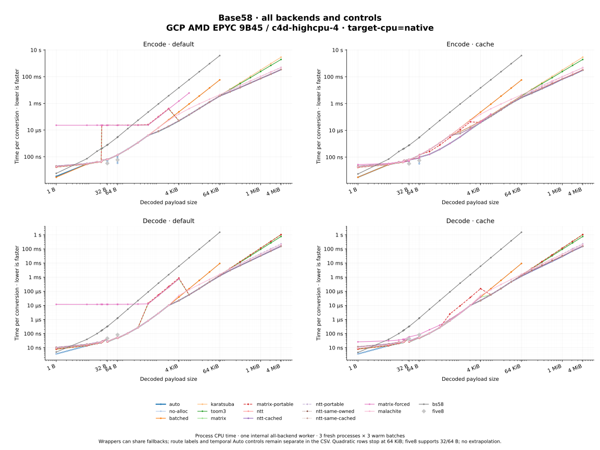

# Performance and resource tradeoffs

The [README tables](../README.md#performance) show selected conversion times and
linked sizes. Auto uses more workspace and linked code to accelerate large
inputs. `no_alloc` avoids internal heap allocation; general large conversions
remain quadratic. The optional cache is most useful for repeated medium-sized
inputs. Its value depends on input sizes, call history and memory constraints.
[DESIGN.md](../DESIGN.md) describes algorithms and the current dispatcher;
[CORRECTNESS.md](../CORRECTNESS.md) describes validation and open gaps.

## Measurement scope

These measurements describe fixed source snapshots, not every later revision.
Source identities below are resource fingerprints, not Git commit IDs. All
sizes refer to decoded payload bytes; Base58 text is longer.

| Results | Source and build | Measurement |
| --- | --- | --- |
| README M5 public timings | `a479a143…7f474d`; 2026-10-27; Apple M5 Pro; Rust 1.99.1 / LLVM 23.1.1; compiler-default target flags | Ordinary public consumers without `__internals`; process CPU time. |
| README Wasm public timings | `4e5ac883…1e760`; 2026-10-27; M5 Pro / Node V8; Rust 1.99.1; scalar Wasm | Ordinary public modules without `__internals`; elapsed time. |
| README GCP and generic/native comparison below | `4e5ac883…1e760`; 2026-10-28 UTC; AMD EPYC 9B45, GCP `c4d-highcpu-4`; Rust 1.99.1 / LLVM 23.1.1 | One internal all-backend worker per CPU/cache cohort; process CPU time. |
| README linked sizes | `4e5ac883…1e760`; opt-level 3, fat LTO; generic x86-64 | Separate linked consumers with both API directions reachable, minus matching empty probes. |
| Compact feature comparison | `304dc4c5…000add`; 2026-10-28 UTC; ordinary EPYC consumers; Rust 1.99.1 / LLVM 23.1.1 | Actual feature wiring; separate size and timing study. |

Public timing cells are medians of three fresh-process medians, each with three
warm batches. GCP internal cells are medians of all nine warm batches. These
estimators and call contexts differ. Native process CPU time and Wasm elapsed
time also measure different quantities. Bold README values mark the lowest
observed median, without a statistical significance claim.

The study covered 29 sizes from empty through 4 MiB, including boundaries around
32/64 bytes. Quadratic no-allocation, batched and bs58 measurements stop at
64 KiB by policy, not an API limit. Five8 covers only supported 32/64-byte cases.
Unsupported cells are not extrapolated. Logarithmic figures omit empty inputs.

Warm loops reuse caller output buffers and include Auto's workspace allocations.
They exclude fixture construction, caller-buffer allocation and checks outside
the timed loop. Repeated decode exports use prevalidated text and exclude its
preceding UTF-8 scan. Owned String/Vec helpers need separate measurements that
include allocation and destruction. Cold and second calls are separate from
warm results, especially with cache setup.

Fixtures use deterministic data per size and independent Malachite Natural
conversion checks. They do not represent every input distribution. Leading
zeros, tails, invalid inputs and short buffers require separate checks. Backend
names can share kernels or take fallback routes; `*_portable` replaces one
kernel family and does not disable all compiler vectorization or downstream
ISA-specific fallbacks.

### Timing limits

Byte-identical GCP libraries loaded from two files differed by about 27% in a
tiny-decode control; two labels for the same file were near parity. This
implicates file identity or loading context, but its physical cause is unknown.
Old/current or candidate timings alone therefore do not establish that a source
change caused a speedup. Unchanged Auto temporal-control medians in the backend
study ranged from 0.895 to 1.068 times the earlier Auto result.

The compact study instead used one fixed path/inode, CPU pinning and longer
batches, with five alternating fresh-process pairs per case. Its 56
identical-content control-cell medians ranged from 0.994 to 1.018; individual
pairs varied more widely. This does not establish sub-percent stability.

The earlier surveys ran without overlapping compiler, test, proof or fuzz work.
That does not fix frequency, temperature, host contention or buffer placement.
Observed ranges are descriptive, not confidence intervals. Small changes require
unchanged-artifact controls before they justify runtime tuning. Historical empty
native decode also depended strongly on the address of its zero-length buffer;
those cells do not characterize general empty-input API latency.

## Generic and native x86-64

Generic builds retain runtime CPU selection. Native builds use
`-C target-cpu=native` on the EPYC VM, whose AVX2, AVX-512 IFMA and VBMI support
was checked. These internal-worker observations use the same source and protocol
as the README's GCP table. They are separate from ordinary M5/Wasm consumers.

Each cell is **encode / decode**, using warm process-CPU medians:

| Build / policy | 4 KiB | 64 KiB | 4 MiB |
| --- | ---: | ---: | ---: |
| Generic / default | 50.963 µs / 33.094 µs | 3.558 ms / 1.363 ms | 350.689 ms / 165.306 ms |
| Generic / cache | 41.331 µs / 33.293 µs | 2.776 ms / 1.295 ms | 325.575 ms / 163.279 ms |
| Native / default | 48.796 µs / 21.894 µs | 3.557 ms / 1.236 ms | 339.745 ms / 156.087 ms |
| Native / cache | 38.430 µs / 22.210 µs | 2.770 ms / 1.169 ms | 313.082 ms / 154.469 ms |



Native code generation helps several decode sizes in this cohort. It is not a
portable deployment setting or evidence that every backend improves. Shared
wrapper fallbacks explain some equal timings and do not justify deleting an
underlying algorithm family.

## basexx comparison

`basexx` remains a benchmark comparator: its `Base58` implementation is much
faster than bs58 at the sampled sizes. Auto is faster than both here, but its
margin over basexx is much smaller than its margin over bs58.

Measured **2026-10-29**, Git source `bf58dc8`, Apple M5 Pro, Rust 1.99.1 / LLVM
23.1.1, `-C target-cpu=apple-m4`, release/fat LTO, `__internals` enabled,
cache off. These are the existing Criterion 0.8.2 encode/decode benchmarks,
which link the development backends; they are separate from the earlier public
consumer surveys. Values are Criterion median estimates of elapsed wall time per
conversion, from 30 samples per case, with 1 second warm-up and a 2 second
measurement target, in one process per direction. Input is one deterministic fixture per size with
its first byte nonzero, checked before timing.

| Operation / payload | Auto | bs58 0.5.1 | basexx 0.2.0 / Base58 | basexx 0.2.0 / Base58B |
| --- | ---: | ---: | ---: | ---: |
| Encode / 1 KiB | 12.5 µs | 1.14 ms | 28.0 µs | 968 µs |
| Encode / 4 KiB | 109 µs | 17.2 ms | 188 µs | 13.7 ms |
| Decode / 1 KiB | 2.77 µs | 333 µs | 5.45 µs | 315 µs |
| Decode / 4 KiB | 49.9 µs | 5.34 ms | 73.0 µs | 5.38 ms |

The basexx APIs allocate an owned result, which the adapter copies into the
output buffer and drops inside the timing loop. bs58 and Auto reuse caller
output. These measure the available API paths, not identical allocation costs.
The M5 host was on AC, but other work was active. This exploratory comparison
has no fresh-process replication or architecture/input-distribution sweep; it
supports retaining the comparator, not a universal performance ranking.

Reproduce with `RUSTFLAGS='-C target-cpu=apple-m4'` when building
`benches/encode.rs` and `benches/decode.rs`, filtering
`encode/(bs58|basexx|basexx-b|auto)/(1024|4096)$` or its `decode/` counterpart,
and Criterion options `--warm-up-time 1 --measurement-time 2 --sample-size 30
--noplot`. Build both before timing and run them serially. Keep raw outputs
under ignored `target/measurements/`.

## Cache and memory

Enabling `cache` changes dispatch and leaf policy as well as retaining tables.
At 4 KiB on M5, warm cache encoding/decoding took 28.3/25.2 µs versus
110/39.9 µs by default. A rough cold-plus-warm model recovered setup after about
17/47 repeated calls. These are workload estimates from separately scheduled
medians, not universal break-even counts. At 4 MiB, the warm improvement was
smaller: 280/139 ms versus 298/142 ms.

Requested peak extra heap for a random 4 MiB borrowed Auto conversion was:

| Platform / policy | Encode peak | Decode peak | Retained encode / decode |
| --- | ---: | ---: | ---: |
| M5 / default | 201,582,112 B | 109,997,816 B | 0 / 0 B |
| M5 / cache | 214,372,960 B | 110,631,416 B | 14,401,152 / 616,704 B |
| GCP / default | 201,207,328 B | 109,807,352 B | 0 / 0 B |
| GCP / cache | 199,813,368 B | 109,807,352 B | 233,984 / 0 B |

These are architecture/policy-specific operation windows, excluding caller
buffers. Rust allocator probes count requested layouts, not allocator overhead,
RSS, stack or realloc-internal overlap. An allocation request count is
`alloc_calls + realloc_calls`; `zeroed_calls` is already a subset of
`alloc_calls`. No-allocation, bs58 and five8 borrowed conversions made no
allocator requests in their supported measured cases.

Matrix table capacities sum to 18,617,760 B; production NTT retention for logs
5–18 permits 25,164,288 B. Their combined 41.8 MiB capacity depends on call
history. Cache families also have 6,280 B of static headers in the recorded
64-bit layout, with unused families subject to dead stripping. Fixed 32/64-byte
encoder constants have a separate 2,208 B reference layout. Construction scratch,
larger per-call tables, allocator overhead and concurrent operations add memory;
the capacity sum is not an active-heap bound.

Wasm's default 4 MiB encode/decode requested peaks were
201,580,924/109,997,432 B. A fresh cache-enabled 4 MiB conversion retained no
backend heap there, while mixed-size histories retained tables. Released heap
does not imply that Wasm linear-memory pages return to the host. RSS includes
runtime, fixtures and validation copies; subtracting process peaks does not
isolate exact backend memory. Static assembly frames are also separate from
dynamic stack high water, which was not measured as a full recursive bound.

## Linked size and compact

The [README size table](../README.md#linked-size) subtracts matching empty
consumers. These deltas include reachable code and associated metadata; they are
not crate-only instruction counts or rlib sizes. Code, readonly data, initialized
data, BSS and stripped file size are separate metrics. Wasm CODE/DATA sections
and 64 KiB memory pages are different again. Reachable APIs, LTO, compiler and
feature unification can change an application's result.

On x86-64, `compact` keeps eight IFMA widths instead of twelve, increasing chunk
counts for some operand shapes. Final-source generic Auto code above empty
fell from 286,445 to 191,005 B by default, and 277,101 to 181,661 B with cache:
95,440 B, about 93.2 KiB, saved in each case. Native EPYC consumers saved the
same amount, about 35–37% of their Auto code delta. M5 and scalar Wasm had no
code/data-section saving in the separate final-source size builds.

On the measured EPYC VM, compact/wide paired latency ratios for 4 KiB–4 MiB
cache-off encoding ranged from 0.9095 to 0.9819. Default decoding ranged from
1.0104 to 1.0246; cache encoding from 1.0043 to 1.0297; cache decoding from
1.0069 to 1.0290. These are whole-consumer observations with the timing limits
above. Wide remains the default. Tiny inputs bypass IFMA, so their layout-driven
differences do not measure an IFMA primitive.

## Optimization conclusions

Keep batched/fixed paths for small and no-allocation work, Karatsuba for recursive
and short-product fallbacks, NTT for large conversions, and Matrix for useful
cache-enabled medium sizes. Toom-3 remains experimental; Malachite is a
development reference.

Storage pooling and earlier temporary drops reduced allocation requests and
some peaks; timings were mixed. Padding nearby sizes into exact 32/64-byte
tables and portable fixed-matrix decoding were rejected. Broader threshold-state
plumbing, six NTT loop rewrites and explicit Wasm panel prototypes did not show
a consistent benefit. Linked assembly can expose candidates, but static call or
instruction counts do not measure their cost. Resolve indirect-looking calls
and inspect the final linked artifact before changing dispatch or ISA guards.

Compiler-enabled Wasm SIMD can help large NTT routes and regress cached Matrix
routes. One frozen-source Node study observed 8 KiB default encode/decode gains
of about 28/21% on M5 and 15/16% on GCP, while M5 cached 4 KiB encode/decode
regressed about 37/31%. Both-direction stripped Auto modules grew about 9 KiB.
These results used Rust 1.99.1 / LLVM 23.1.1 and Node 26.12.1 / V8
14.6.202.34-node.40, resource source `17ab5f264ed4`. A SIMD module requires an
engine with SIMD support; it has no scalar runtime fallback inside that module.
Measure the deployment workload before selecting it.

## Measure and update

Run from the repository root. Freeze the revision, use fresh output directories
under ignored `target/measurements/`, and record source/compiler/target/features,
flags, clocks and artifact identities. Build compared variants before timing,
then run them serially on an idle host. Keep counted allocation builds separate
from timing and size builds. Use `scripts/ac_power_run.py` to record laptop AC
and available thermal status when applicable.

For an internal backend survey, build an uncounted worker, then run it:

```sh
rtk proxy python3 scripts/resource_report.py build --target-dir target/measurements/default-build --binary-output target/measurements/default-worker --output target/measurements/default-build.json
```

```sh
rtk proxy python3 scripts/resource_report.py run --build-metadata target/measurements/default-build.json --output target/measurements/default-timing --mode timing --repeats 3 --samples 3 --timeout 600
```

Use `--cache` or `--compact` on separate build cohorts. For allocations, build
with `--count-allocations` into new paths and run with `--mode allocations`.
The worker enforces backend domains and policy skips. Its metadata identifies
the source under test; these commands do not recreate the historical tables.

`scripts/public_api_campaign.py` provides build, measure and allocations phases
for public modes, but its timing phase uses internal workers. Ordinary public
consumer measurements require separate qualification of the standalone
`scripts/code_size.py` probes and their repeat-call interfaces. Do not relabel an
internal-worker result as a public-consumer result.

For deployment size, use `scripts/code_size.py` with an explicit target and CPU.
Its legacy CPU default is model-specific, so do not omit `--cpu`:

```sh
rtk proxy python3 scripts/code_size.py --source . --output target/measurements/linked --target x86_64-unknown-linux-gnu --cpu generic --backends empty,auto --directions both --kinds cdylib --strip-tool /path/to/llvm-strip
```

Use a matching linker/strip tool. Native timing must run on the actual target;
cross-compilation or Rosetta-hosted code generation establishes size only. For
Wasm, build separate modules with `--target wasm32-unknown-unknown --cpu generic`;
`--wasm-simd128` selects a separate cohort. The metadata-bound
`scripts/wasm_tradeoffs.mjs` timing driver uses Node with
`--no-liftoff --no-wasm-lazy-compilation --no-wasm-async-compilation`.
`scripts/wasm_allocations.mjs` qualifies separate counted modules.

For fresh-process Wasm layout collection, `tools/fixture-export/` builds the
Natural-only fixture exporter, `scripts/make_fixtures.py` writes its fixture
files and manifest, and `scripts/count_wasm.py` collects layouts through
`scripts/count_wasm.mjs`. Keep fixture and collector outputs under the same
measurement directory. Qualify counted modules on disposable instances before
collecting from fresh measurement instances.

Keep new CSV/JSON outputs in the measurement directory. Public figures can be
rendered from external inputs with `assets/graphs/render_current.py --data
TIMINGS.csv --sizes SIZES.csv --output NEW_DIRECTORY`; internal backend figures
use `assets/graphs/render_backends.py --data TIMINGS.csv --output NEW_DIRECTORY`.
Use the pinned plotting environment in `assets/graphs/requirements.txt`.
`python3 -B assets/graphs/render.py --check` checks the selected committed
figures and documentation without running benchmarks. It does not reconstruct
removed measurement inputs or independently reproduce their numbers.

When updating results, change each table, figure, date, source and build scope
together. Include cold costs, memory and linked-size effects. Check unchanged
routes and identical artifacts, preserve failed cases in the new measurement
output, and state unresolved variation before drawing a causal conclusion.
