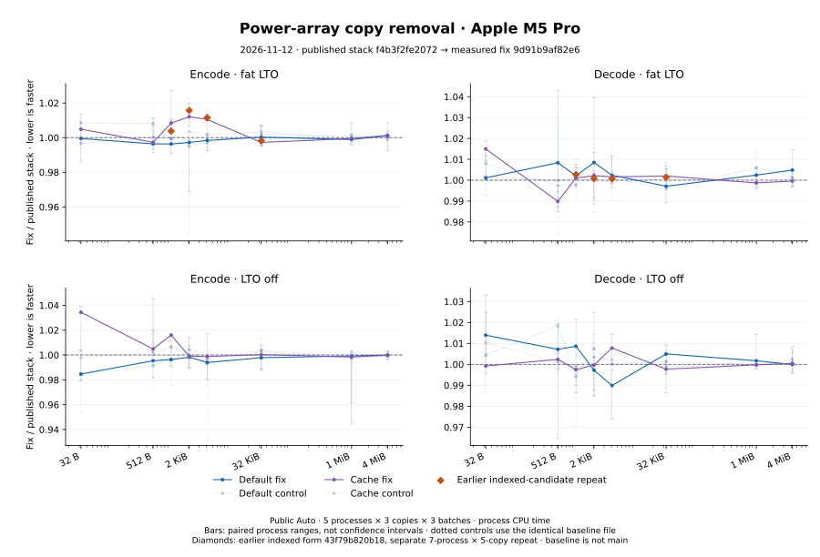
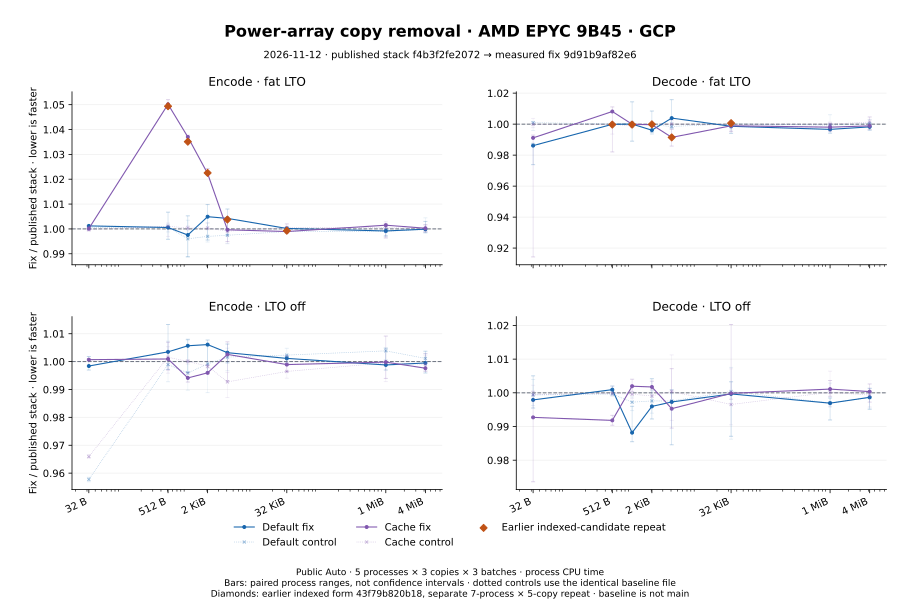
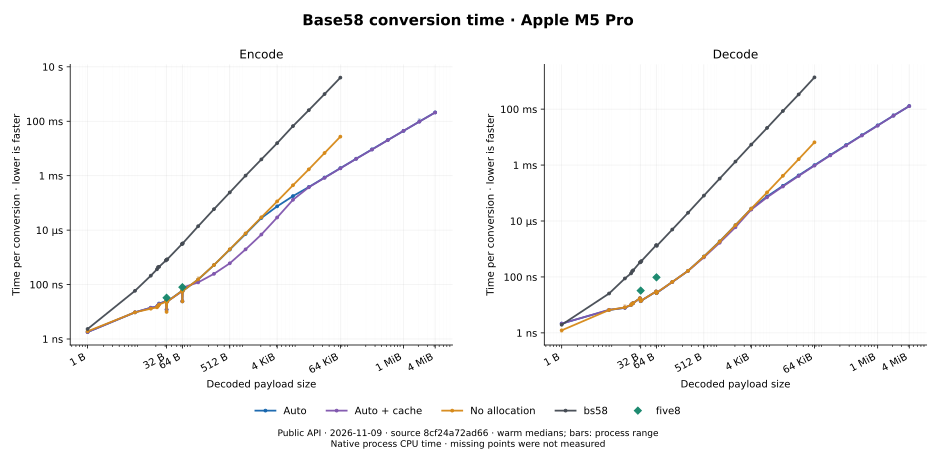
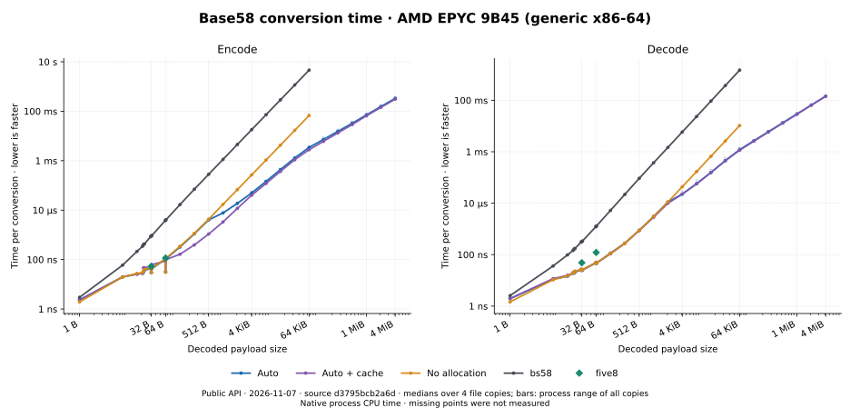
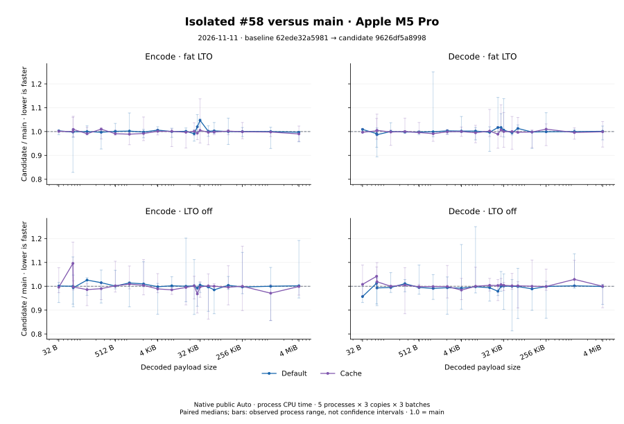
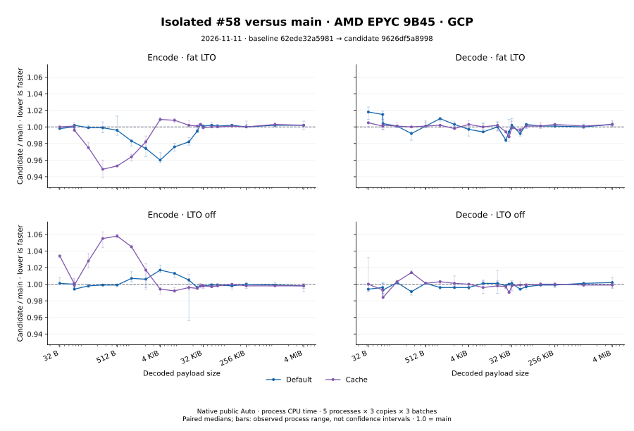

# Performance and resource tradeoffs

The [README tables](../README.md#performance) show the public-API timings and
linked sizes. Auto trades workspace for large-input speed; disabling `alloc`
avoids internal allocation, and its general large conversions remain quadratic.
[DESIGN.md](../DESIGN.md) describes dispatch and algorithms;
[CORRECTNESS.md](../CORRECTNESS.md) describes validation and remaining gaps.

## Power-array copy follow-up — 2026-11-12

This separate comparison measures the full stack before and after the safe
`dc::powers` refactor on #55. Baseline is the previously published full stack
`f4b3f2fe20720d0504447038a24f49ff4fa4ca65`; candidate is the rebased stack
`9d91b9af82e6921367e56878475f1fc8be5c7e4f`. **This baseline is not main.** The
earlier main/#58 studies below retain their measured revisions and values.
The only Rust-source difference is the power-builder loop; later data/docs
commits do not change its measured Rust, Cargo or consumer-harness inputs.

The builder writes each Power into the returned array directly. Its existing
checked prefix, `powers[..levels]`, bounds the indexed loop. No unsafe operation
or unchecked indexing is introduced. The inspected optimized native artifacts
have no new per-iteration Power-index bounds guard. The prior extent and
limb-table capacity checks remain. Debug builds and other compilers are not
covered by this emitted-code claim.

All four M5 NTT instances and all four GCP NTT instances lose the 2,048-byte
return copy. The inspected GCP Karatsuba instances also lose it: standalone
no-LTO/default, fat/default encode and decode, and no-LTO/default decode.
M5 NTT total frames shrink from 0x10b0 to 0x8b0 with fat LTO, and to 0x8a0
without LTO. GCP NTT local stack allocation (excluding unchanged pushes) shrinks
from 0x1038 to 0x838 with fat LTO, and to 0x828 without LTO. The separate
2 KiB zero-chunk buffer remains. The final form keeps the previous Power in
local state and avoids the per-iteration four-field array reloads found in the
earlier indexed candidate. Register allocation and spill scheduling still
change, and standalone no-LTO Karatsuba has two more decoded instructions than
that intermediate candidate. These local findings do not certify every emitted
instruction stream as cheaper.

Hosts, compiler versions and public-consumer build settings match the native
study below: generic flags, release opt-level 3, 16 codegen units, default/cache
and fat/off LTO. GCP uses `/mnt/bench`, waits for the shared VM lock and pins vCPU
1. M5 warm timing starts and ends on AC with no reported thermal warning. Timing
does not overlap our builds/tests. Each warm cohort uses 5 processes × 3 fresh
file copies × 3 interleaved batches, at least 5 ms per batch. Both public
operations are checked before timing at 32, 512, 1,024, 2,048, 4,096, 32,768,
1,048,576 and 4,194,304 decoded bytes. The same fixtures, borrowed aligned
buffers and process-CPU timing exclusions described below apply. `ctrl` is a
separate label copied from the identical baseline artifact.

The removed setup copy does not establish a uniform public-API latency win.
Final fat/cache encode ratios include M5 2 KiB **1.012 [1.007, 1.020]**,
GCP 512 B **1.050 [1.049, 1.052]**, and GCP 1 KiB
**1.037 [1.035, 1.038]**. These artifact-level differences are retained.
M5 no-LTO/cache 32 B encode is **1.034 [1.004, 1.039]**, with a wider
process range; it is also retained in the table and figure, without assigning
the difference to the power builder's execution.

The earlier indexed candidate `43f79b820b1854510903dd3401c7d8021303886e`
was also measured. Separate 7-process × 5-copy × 3-batch, 15 ms repeats gave
M5 2 KiB encode 1.016 [1.010, 1.057], GCP 512 B 1.049 [1.047, 1.051],
and GCP 1 KiB 1.035 [1.035, 1.037], with median controls about 1.000–1.001.
Those repeats belong to the earlier candidate; the figure diamonds are labeled
separately and do not replace final measurements. The inspected M5 2 KiB and GCP
512 B/1 KiB/2 KiB cached encodes use matrix conversion and do not reach `dc::powers`.
The earlier candidate's reached instructions and hot constant bytes match the
baseline after verified address relocations; linked loop and static-data
placement change. No direct added hot-path work was identified there. Placement
is a possible explanation, not a demonstrated cause or a basis to dismiss the
timing difference. See the PR notes for the assembly review and limits.
Other measured differences and all controls remain in the
[warm summary](https://github.com/elichai/faster-base58/blob/9a5b13e6c6ec7ec44618d3b5d6376b8157fb166b/assets/graphs/data/power-copy-20261112-warm.csv).





Ratios below are fix/published-stack median [min, max] of paired process ratios,
after taking each process's median over copies. Below 1 is faster. Ranges are
observations, not confidence intervals.

<details>
<summary>m5 / fat: warm paired ratios</summary>

| Decoded B | Default encode | Default decode | Cache encode | Cache decode |
| ---: | ---: | ---: | ---: | ---: |
| 32 | 1.000 [0.997, 1.005] | 1.001 [1.000, 1.012] | 1.005 [0.987, 1.014] | 1.015 [1.009, 1.019] |
| 512 | 0.996 [0.991, 1.011] | 1.008 [0.985, 1.043] | 0.997 [0.994, 1.007] | 0.990 [0.987, 0.995] |
| 1,024 | 0.996 [0.991, 1.027] | 1.002 [1.000, 1.008] | 1.008 [0.999, 1.011] | 1.001 [0.998, 1.006] |
| 2,048 | 0.997 [0.969, 0.999] | 1.008 [0.992, 1.040] | 1.012 [1.007, 1.020] | 1.002 [0.989, 1.004] |
| 4,096 | 0.998 [0.992, 1.003] | 1.002 [0.998, 1.012] | 1.010 [1.002, 1.014] | 1.002 [0.997, 1.004] |
| 32,768 | 1.000 [0.995, 1.007] | 0.997 [0.989, 1.005] | 0.997 [0.995, 1.007] | 1.002 [0.998, 1.007] |
| 1,048,576 | 0.999 [0.996, 1.002] | 1.002 [0.996, 1.005] | 0.999 [0.997, 1.009] | 0.999 [0.997, 1.001] |
| 4,194,304 | 1.001 [0.993, 1.004] | 1.005 [0.997, 1.015] | 1.001 [0.998, 1.009] | 1.000 [0.997, 1.003] |

</details>

<details>
<summary>m5 / off: warm paired ratios</summary>

| Decoded B | Default encode | Default decode | Cache encode | Cache decode |
| ---: | ---: | ---: | ---: | ---: |
| 32 | 0.985 [0.979, 1.004] | 1.014 [1.004, 1.033] | 1.034 [1.004, 1.039] | 0.999 [0.996, 1.025] |
| 512 | 0.995 [0.982, 1.020] | 1.007 [0.965, 1.019] | 1.005 [1.000, 1.045] | 1.002 [0.998, 1.005] |
| 1,024 | 0.996 [0.991, 1.007] | 1.009 [0.986, 1.021] | 1.016 [1.006, 1.016] | 0.997 [0.990, 1.000] |
| 2,048 | 0.998 [0.990, 1.014] | 0.997 [0.988, 1.025] | 0.999 [0.989, 1.008] | 1.000 [0.985, 1.004] |
| 4,096 | 0.994 [0.980, 1.000] | 0.990 [0.974, 0.997] | 0.999 [0.997, 1.018] | 1.008 [1.000, 1.014] |
| 32,768 | 0.998 [0.989, 1.004] | 1.005 [0.986, 1.009] | 1.000 [0.988, 1.007] | 0.998 [0.996, 1.002] |
| 1,048,576 | 0.999 [0.945, 1.003] | 1.002 [0.999, 1.014] | 0.998 [0.962, 1.002] | 1.000 [0.998, 1.002] |
| 4,194,304 | 1.000 [0.997, 1.003] | 1.000 [0.996, 1.006] | 1.000 [0.999, 1.003] | 1.000 [0.997, 1.009] |

</details>

<details>
<summary>gcp / fat: warm paired ratios</summary>

| Decoded B | Default encode | Default decode | Cache encode | Cache decode |
| ---: | ---: | ---: | ---: | ---: |
| 32 | 1.001 [1.001, 1.001] | 0.986 [0.974, 0.988] | 1.000 [0.999, 1.001] | 0.991 [0.914, 0.993] |
| 512 | 1.001 [0.996, 1.007] | 1.000 [0.999, 1.001] | 1.050 [1.049, 1.052] | 1.008 [0.982, 1.011] |
| 1,024 | 0.998 [0.989, 1.005] | 1.000 [0.989, 1.014] | 1.037 [1.035, 1.038] | 1.000 [0.999, 1.002] |
| 2,048 | 1.005 [0.996, 1.010] | 0.996 [0.994, 1.008] | 1.022 [1.022, 1.024] | 1.000 [0.999, 1.001] |
| 4,096 | 1.004 [0.998, 1.008] | 1.004 [0.997, 1.016] | 1.000 [0.995, 1.003] | 0.991 [0.986, 0.997] |
| 32,768 | 1.000 [1.000, 1.001] | 0.999 [0.994, 1.000] | 0.999 [0.998, 1.002] | 0.999 [0.995, 1.001] |
| 1,048,576 | 0.999 [0.997, 1.000] | 0.997 [0.994, 0.999] | 1.001 [0.996, 1.002] | 0.998 [0.995, 1.000] |
| 4,194,304 | 1.000 [0.999, 1.003] | 0.998 [0.996, 1.000] | 1.000 [0.999, 1.002] | 0.999 [0.996, 1.005] |

</details>

<details>
<summary>gcp / off: warm paired ratios</summary>

| Decoded B | Default encode | Default decode | Cache encode | Cache decode |
| ---: | ---: | ---: | ---: | ---: |
| 32 | 0.998 [0.997, 1.002] | 0.998 [0.995, 1.005] | 1.001 [1.000, 1.001] | 0.993 [0.974, 1.000] |
| 512 | 1.003 [0.997, 1.013] | 1.001 [1.001, 1.002] | 1.001 [0.997, 1.007] | 0.992 [0.990, 0.993] |
| 1,024 | 1.006 [0.996, 1.008] | 0.988 [0.985, 0.996] | 0.994 [0.993, 0.996] | 1.002 [1.000, 1.004] |
| 2,048 | 1.006 [0.996, 1.008] | 0.996 [0.992, 1.004] | 0.996 [0.996, 0.999] | 1.002 [1.001, 1.003] |
| 4,096 | 1.003 [1.000, 1.006] | 0.997 [0.985, 1.001] | 1.003 [0.993, 1.007] | 0.995 [0.990, 1.007] |
| 32,768 | 1.001 [1.000, 1.002] | 1.000 [0.987, 1.003] | 0.999 [0.996, 1.002] | 1.000 [0.998, 1.020] |
| 1,048,576 | 0.999 [0.997, 1.005] | 0.997 [0.992, 0.998] | 1.000 [0.994, 1.009] | 1.001 [0.999, 1.004] |
| 4,194,304 | 1.000 [0.996, 1.004] | 0.999 [0.995, 1.001] | 0.998 [0.996, 1.003] | 1.000 [0.997, 1.003] |

</details>

### Coupled linked sizes

These are from the same timing artifacts, with each matching empty consumer
subtracted. Deltas compare the fixed stack to the previously published stack.
Path labels have equal lengths. Readonly metadata, BSS, initialized data and
file/page layout remain separate from instructions; a positive BSS delta is
not a measured retained-heap increase.

| Host / LTO / policy | Fixed code B | Code Δ B | Readonly Δ B | Data Δ B | BSS Δ B | Stripped file Δ B |
| --- | ---: | ---: | ---: | ---: | ---: | ---: |
| m5 / fat / default | 67,888 | -128 | +0 | +0 | +0 | +0 |
| m5 / fat / cache | 76,360 | +64 | +8 | +0 | +0 | +0 |
| m5 / off / default | 80,856 | -64 | +0 | +0 | +0 | +0 |
| m5 / off / cache | 84,952 | -128 | +8 | +0 | +0 | -16 |
| gcp / fat / default | 308,301 | -240 | -16 | +0 | +256 | -256 |
| gcp / fat / cache | 303,885 | -64 | +16 | +0 | +48 | -48 |
| gcp / off / default | 332,931 | -320 | -20 | +0 | +320 | -320 |
| gcp / off / cache | 324,819 | -208 | +132 | -72 | +152 | -152 |

The [size summary](https://github.com/elichai/faster-base58/blob/9a5b13e6c6ec7ec44618d3b5d6376b8157fb166b/assets/graphs/data/power-copy-20261112-sizes.csv) retains all baseline
and fixed values.

### First-call decode and validation

A separate first-call cohort uses 15 fresh processes × 2 copies per label,
rotating call order, for `"2"` repeated 2,816 or 32,768 times. Each result is
checked against an independent Python integer oracle. Input/output buffers,
oracle construction and library loading are outside timing; first codec setup
and internal allocation are included. The [cold summary](https://github.com/elichai/faster-base58/blob/9a5b13e6c6ec7ec44618d3b5d6376b8157fb166b/assets/graphs/data/power-copy-20261112-cold.csv)
retains both sizes and identical-baseline controls. These short measurements
have wide process ranges and do not establish a cold-call speedup.

Default/cache correctness suites with `check,__internals` pass in debug and
release on M5 with 512 property cases. Formatting and all-target/all-feature
Clippy pass. The owner and full-stack Linux inlining manifests pass in all six
x86-64/AArch64 × default/cache/compact configurations without expectation edits.
No new Wasm, alloc-disabled, checked-conversion, owned-output, native-CPU or
alternate-toolchain performance claim is made.

Derived data and [raw-input hashes](https://github.com/elichai/faster-base58/blob/9a5b13e6c6ec7ec44618d3b5d6376b8157fb166b/assets/graphs/data/power-copy-20261112-sources.json)
are frozen with the figures. Raw measurements, metadata, commands and assembly
remain in ignored `target/measurements/power-copy` locally and
`/mnt/bench/power-copy` on GCP. From a repository checkout with the pinned plotting
requirements, regenerate into a new directory with:

```sh
python3 assets/graphs/render_power_copy.py --output target/measurements/power-copy-regenerated
```

## Native refresh — 2026-11-11

Two independently timed native comparisons are reported here. Do not compare
absolute times across their different phases or relabel the earlier comparator
and Wasm cohort as current.

| Study | Baseline source | Candidate source |
| --- | --- | --- |
| Whole #53 → #55 → #57 → #59 stack | `9825212e9b9223f13cfae73905357e7877ded357` | `d82345997505864abd732a7f4b6d497827072564` |
| Isolated #58, based directly on main | `62ede32a59814a3385383dd93ae8d118be5bf284` | `9626df5a899836a9c63c58c2c2621810050e432d` |

The published full-stack code at `972c29a58db6733fa32f523f5cf24d17eae44628`
differs from its measured candidate only in `scripts/check_simd_inlining.txt`.
Main `9825212` already includes merged #58; the full-stack comparison does not
isolate the final #59 commit. Documentation/figure changes do not remeasure code.

Both studies use ordinary public Auto consumers with encode and decode reachable
in each shared library. No `__internals`, allocation counter, `check` or `compact`
feature is enabled. Builds use release opt-level 3, 16 codegen units, no debug
information, generic CPU flags (`RUSTFLAGS=""`), and either fat LTO or fully
disabled LTO (`CARGO_PROFILE_RELEASE_LTO=off`). Default and `cache` are separate
builds. Linked sizes come from the same artifacts as timing, subtracting the
matching empty consumer. Code, readonly, initialized data, BSS and stripped file
are distinct. File/page layout and embedded paths can affect non-code sizes.

| Host | Compiler | Execution |
| --- | --- | --- |
| Apple M5 Pro, macOS 26.7.2 | Rust 1.99.1 / LLVM 23.1.1 | AC power; process CPU time |
| GCP c4d-highcpu-4, AMD EPYC 9B45 | Rust 1.99.0 / LLVM 23.1.1 | Process CPU time; vCPU 1 pinned |

GCP sources, builds, temporary files and results use `/mnt/bench`; execution waits
for the shared VM lock. These are shared/interactive hosts without exclusive
hardware, fixed frequency, SCHED_FIFO or disabled ASLR. No timing overlaps our
builds or tests. The older protocol below describes a different cohort.

Each primary cohort has **5 fresh processes × 3 fresh file copies × 3 interleaved
batches**. Calibration targets at least 5 ms per batch for the full stack and
10 ms for #58; one large conversion can exceed that. Fixtures are deterministic
random bytes without leading zero bytes, at 27 full-stack sizes or 22 #58 sizes
from empty through 4 MiB. Outputs are checked against the common fixture before
timing. Caller buffers are reused and 64-byte aligned; decode capacity is exact.
Fixture construction, caller-buffer allocation and UTF-8 prevalidation for the
Rust `&str` API are outside timing. Internal codec workspace allocation remains
included. These are warm borrowed-buffer measurements.

Ratios are candidate/main medians [min, max] of paired process ratios, after
taking the median over copies within each process. Below 1 is faster. Ranges are
descriptive, not confidence intervals. Absolute times use a separate estimator:
median over copies of each copy's process median. Dividing the displayed absolute
times need not reproduce a paired ratio. #58's retained stdout ratios have three
decimal places; that precision is preserved.

### Corrected whole stack

The large default/fat-LTO encoder regression was removed in the measured native
configurations by explicit four-lane carry updates and restoring the encoder's
complete-word/panel traversal and the decoder's indexed table-row builder. Some
small differences remain: M5 fat-LTO cached 512-byte decode is about 2.6% slower.
No uniform speedup or universal non-regression is established.





The original GCP no-LTO/default 32-byte encode ratio was 1.096 [1.093, 1.099],
while an identical-main control was 1.048. A separate 7-process × 5-copy × 3-batch,
15 ms repeat measured candidate/main 0.999 [0.998, 1.000], and control/main
1.000 [1.000, 1.000]. The graphs retain the original points and show the focused
repeat at 32/64/65 bytes as diamonds. Neither run is silently substituted for the
other, and the original outlier is not attributed to a source-level regression.

Absolute values below are **main → candidate**. All measured sizes of at least
32 bytes are included in the expandable paired-ratio tables.

#### Apple M5 Pro, fat LTO

| Payload | Default encode | Default decode | Cache encode | Cache decode |
| --- | ---: | ---: | ---: | ---: |
| 32 B | 11.7 ns → 11.7 ns | 13.5 ns → 13.4 ns | 11.8 ns → 11.9 ns | 13.8 ns → 13.5 ns |
| 512 B | 1.83 µs → 1.73 µs | 520 ns → 503 ns | 584 ns → 588 ns | 489 ns → 501 ns |
| 4 KiB | 72.6 µs → 71.5 µs | 26.7 µs → 25.3 µs | 28.7 µs → 28.8 µs | 24.6 µs → 24.5 µs |
| 32 KiB | 837 µs → 828 µs | 421 µs → 416 µs | 823 µs → 823 µs | 403 µs → 406 µs |
| 1 MiB | 43.4 ms → 42.8 ms | 25.6 ms → 25.2 ms | 43.3 ms → 43.4 ms | 25 ms → 25.2 ms |
| 4 MiB | 206 ms → 204 ms | 126 ms → 125 ms | 205 ms → 206 ms | 124 ms → 125 ms |

<details>
<summary>All paired warm ratios, median [min, max]</summary>

| Payload | Default encode | Default decode | Cache encode | Cache decode |
| --- | ---: | ---: | ---: | ---: |
| 32 B | 0.997 [0.994, 1.000] | 0.995 [0.991, 1.005] | 1.004 [1.002, 1.008] | 0.974 [0.971, 0.985] |
| 52 B | 0.989 [0.964, 0.999] | 1.004 [0.991, 1.008] | 1.001 [0.992, 1.012] | 0.991 [0.988, 0.995] |
| 64 B | 1.008 [1.002, 1.014] | 0.982 [0.966, 0.997] | 0.996 [0.991, 1.005] | 0.985 [0.976, 0.990] |
| 65 B | 1.000 [0.980, 1.048] | 0.986 [0.983, 0.988] | 0.941 [0.934, 0.946] | 0.982 [0.977, 0.987] |
| 128 B | 0.970 [0.958, 0.981] | 0.986 [0.979, 0.986] | 0.973 [0.964, 0.978] | 0.972 [0.970, 0.976] |
| 256 B | 0.946 [0.938, 0.957] | 0.976 [0.974, 0.980] | 0.983 [0.966, 0.988] | 0.981 [0.976, 0.992] |
| 512 B | 0.948 [0.934, 0.960] | 0.964 [0.962, 0.972] | 1.008 [1.000, 1.015] | 1.026 [1.020, 1.027] |
| 1 KiB | 0.970 [0.965, 0.976] | 0.971 [0.958, 0.985] | 1.000 [0.997, 1.010] | 0.998 [0.995, 1.002] |
| 1,504 B | 0.968 [0.963, 0.990] | 0.953 [0.932, 0.959] | 1.002 [0.997, 1.009] | 0.996 [0.993, 0.999] |
| 1,875 B | 0.960 [0.956, 0.965] | 0.955 [0.948, 0.964] | 1.000 [0.989, 1.017] | 0.998 [0.993, 1.004] |
| 2 KiB | 0.952 [0.941, 0.969] | 0.942 [0.937, 0.946] | 0.998 [0.973, 1.025] | 1.001 [0.986, 1.012] |
| 4 KiB | 0.985 [0.978, 1.001] | 0.947 [0.893, 0.958] | 0.999 [0.991, 1.004] | 1.003 [0.994, 1.004] |
| 8 KiB | 0.986 [0.975, 0.990] | 1.002 [1.001, 1.015] | 1.001 [0.976, 1.015] | 1.000 [0.997, 1.005] |
| 16 KiB | 0.982 [0.980, 0.987] | 0.987 [0.971, 1.008] | 1.002 [1.001, 1.020] | 1.006 [1.001, 1.007] |
| 24 KiB | 0.980 [0.976, 0.989] | 0.988 [0.981, 0.998] | 0.995 [0.988, 0.997] | 1.003 [0.995, 1.008] |
| 28 KiB | 0.980 [0.975, 0.983] | 0.990 [0.978, 1.003] | 0.997 [0.993, 1.003] | 1.004 [1.002, 1.005] |
| 32 KiB | 0.984 [0.974, 0.998] | 0.985 [0.980, 0.992] | 1.000 [0.995, 1.007] | 1.010 [1.004, 1.035] |
| 36 KiB | 0.988 [0.965, 0.994] | 0.992 [0.990, 1.001] | 1.002 [1.000, 1.006] | 1.005 [1.003, 1.005] |
| 48 KiB | 0.986 [0.981, 0.994] | 0.993 [0.984, 0.997] | 0.993 [0.991, 1.023] | 1.006 [1.005, 1.007] |
| 64 KiB | 0.981 [0.972, 0.987] | 0.987 [0.982, 0.995] | 1.004 [0.971, 1.009] | 1.010 [1.003, 1.010] |
| 128 KiB | 0.979 [0.977, 0.991] | 0.988 [0.984, 0.992] | 1.005 [0.999, 1.012] | 1.011 [1.008, 1.050] |
| 144 KiB | 0.992 [0.975, 0.998] | 0.990 [0.978, 0.999] | 1.006 [1.001, 1.010] | 1.006 [1.004, 1.011] |
| 256 KiB | 0.979 [0.937, 0.986] | 0.990 [0.984, 0.998] | 1.003 [0.999, 1.004] | 1.011 [1.007, 1.012] |
| 1 MiB | 0.986 [0.979, 0.987] | 0.988 [0.986, 0.991] | 1.002 [1.001, 1.003] | 1.009 [1.009, 1.010] |
| 4 MiB | 0.987 [0.983, 0.990] | 0.992 [0.990, 1.013] | 1.001 [0.998, 1.004] | 1.008 [1.006, 1.009] |

</details>

#### Apple M5 Pro, LTO off

| Payload | Default encode | Default decode | Cache encode | Cache decode |
| --- | ---: | ---: | ---: | ---: |
| 32 B | 23.2 ns → 23 ns | 40.1 ns → 38.5 ns | 23.2 ns → 22.5 ns | 40.1 ns → 38.5 ns |
| 512 B | 2.36 µs → 2.27 µs | 896 ns → 904 ns | 578 ns → 570 ns | 504 ns → 514 ns |
| 4 KiB | 75.8 µs → 76.5 µs | 32 µs → 27.3 µs | 28.8 µs → 28.8 µs | 24.4 µs → 24.5 µs |
| 32 KiB | 863 µs → 871 µs | 440 µs → 444 µs | 858 µs → 859 µs | 407 µs → 408 µs |
| 1 MiB | 44.1 ms → 44.3 ms | 26.1 ms → 26.1 ms | 44.7 ms → 44.7 ms | 25.2 ms → 25.2 ms |
| 4 MiB | 209 ms → 209 ms | 128 ms → 128 ms | 211 ms → 211 ms | 125 ms → 126 ms |

<details>
<summary>All paired warm ratios, median [min, max]</summary>

| Payload | Default encode | Default decode | Cache encode | Cache decode |
| --- | ---: | ---: | ---: | ---: |
| 32 B | 0.996 [0.965, 1.014] | 0.962 [0.956, 0.979] | 0.977 [0.969, 0.989] | 0.962 [0.948, 0.978] |
| 52 B | 0.983 [0.966, 1.032] | 0.982 [0.980, 0.993] | 0.973 [0.973, 0.989] | 0.975 [0.968, 0.995] |
| 64 B | 0.998 [0.994, 1.006] | 0.984 [0.978, 1.003] | 0.990 [0.982, 1.007] | 0.987 [0.980, 0.998] |
| 65 B | 1.018 [0.998, 1.038] | 0.991 [0.990, 0.998] | 0.988 [0.985, 1.009] | 0.988 [0.983, 1.002] |
| 128 B | 1.003 [0.971, 1.050] | 0.992 [0.976, 1.008] | 0.993 [0.978, 1.006] | 1.003 [0.996, 1.020] |
| 256 B | 0.951 [0.933, 0.967] | 1.003 [0.982, 1.016] | 1.004 [0.979, 1.024] | 1.007 [0.991, 1.021] |
| 512 B | 0.954 [0.942, 0.995] | 1.012 [0.995, 1.028] | 0.989 [0.983, 0.994] | 1.018 [1.012, 1.024] |
| 1 KiB | 0.975 [0.970, 1.001] | 0.961 [0.945, 0.975] | 1.001 [0.984, 1.009] | 1.007 [0.999, 1.018] |
| 1,504 B | 0.964 [0.957, 0.971] | 0.920 [0.908, 0.934] | 0.991 [0.985, 0.997] | 0.998 [0.988, 1.002] |
| 1,875 B | 0.963 [0.958, 0.973] | 0.892 [0.883, 0.896] | 0.999 [0.982, 1.006] | 0.998 [0.994, 1.003] |
| 2 KiB | 0.961 [0.953, 0.970] | 0.887 [0.875, 0.904] | 0.999 [0.964, 1.007] | 1.003 [0.998, 1.020] |
| 4 KiB | 1.009 [1.003, 1.014] | 0.860 [0.807, 0.862] | 0.998 [0.989, 1.014] | 1.002 [0.991, 1.005] |
| 8 KiB | 1.007 [0.998, 1.018] | 0.994 [0.987, 0.999] | 1.000 [0.985, 1.010] | 0.999 [0.995, 1.003] |
| 16 KiB | 1.003 [0.995, 1.018] | 0.990 [0.985, 1.001] | 1.005 [1.000, 1.032] | 1.004 [1.000, 1.008] |
| 24 KiB | 1.008 [0.998, 1.020] | 0.987 [0.973, 1.004] | 0.994 [0.989, 1.002] | 1.003 [1.000, 1.006] |
| 28 KiB | 0.996 [0.991, 1.005] | 0.991 [0.982, 1.002] | 1.003 [1.000, 1.021] | 1.007 [1.001, 1.011] |
| 32 KiB | 1.010 [0.995, 1.013] | 0.989 [0.959, 1.011] | 1.003 [0.983, 1.006] | 1.003 [0.998, 1.010] |
| 36 KiB | 1.003 [0.992, 1.009] | 0.996 [0.993, 0.997] | 0.996 [0.995, 1.001] | 1.009 [0.998, 1.014] |
| 48 KiB | 1.005 [1.002, 1.010] | 0.990 [0.982, 0.997] | 1.002 [0.994, 1.006] | 1.003 [0.981, 1.007] |
| 64 KiB | 1.012 [1.000, 1.013] | 0.990 [0.988, 1.000] | 1.006 [1.003, 1.019] | 0.999 [0.984, 1.010] |
| 128 KiB | 1.012 [1.000, 1.014] | 0.993 [0.991, 0.996] | 1.000 [0.991, 1.016] | 1.004 [1.003, 1.008] |
| 144 KiB | 1.004 [0.990, 1.015] | 0.992 [0.988, 0.998] | 0.996 [0.990, 1.003] | 1.005 [0.978, 1.011] |
| 256 KiB | 1.007 [1.003, 1.015] | 0.993 [0.989, 1.010] | 1.003 [0.999, 1.011] | 1.001 [0.999, 1.005] |
| 1 MiB | 1.003 [1.002, 1.006] | 0.996 [0.995, 0.998] | 1.002 [0.996, 1.003] | 1.004 [1.000, 1.011] |
| 4 MiB | 1.005 [1.001, 1.005] | 0.998 [0.994, 1.002] | 1.001 [0.998, 1.012] | 1.004 [0.999, 1.008] |

</details>

#### AMD EPYC 9B45 · GCP, fat LTO

| Payload | Default encode | Default decode | Cache encode | Cache decode |
| --- | ---: | ---: | ---: | ---: |
| 32 B | 30.1 ns → 30.2 ns | 24.4 ns → 24.5 ns | 30.1 ns → 30.1 ns | 23.6 ns → 23.3 ns |
| 512 B | 3.24 µs → 3.23 µs | 884 ns → 847 ns | 1.08 µs → 1.08 µs | 872 ns → 845 ns |
| 4 KiB | 48.6 µs → 47.6 µs | 16.1 µs → 16.1 µs | 39.8 µs → 39.6 µs | 16.2 µs → 16.1 µs |
| 32 KiB | 1.01 ms → 1 ms | 412 µs → 412 µs | 925 µs → 920 µs | 381 µs → 382 µs |
| 1 MiB | 48.5 ms → 48.1 ms | 24.1 ms → 24.2 ms | 47.8 ms → 47.6 ms | 22.8 ms → 22.8 ms |
| 4 MiB | 223 ms → 221 ms | 120 ms → 120 ms | 223 ms → 222 ms | 117 ms → 117 ms |

<details>
<summary>All paired warm ratios, median [min, max]</summary>

| Payload | Default encode | Default decode | Cache encode | Cache decode |
| --- | ---: | ---: | ---: | ---: |
| 32 B | 1.002 [1.000, 1.002] | 1.006 [0.973, 1.010] | 1.000 [0.999, 1.001] | 0.989 [0.985, 0.990] |
| 52 B | 1.015 [1.015, 1.018] | 0.997 [0.972, 1.003] | 1.001 [0.996, 1.005] | 1.005 [1.002, 1.006] |
| 64 B | 0.994 [0.989, 1.074] | 0.997 [0.997, 0.998] | 0.998 [0.858, 1.002] | 0.999 [0.998, 1.008] |
| 65 B | 1.010 [1.007, 1.013] | 0.988 [0.970, 0.993] | 1.003 [0.997, 1.005] | 1.014 [1.007, 1.018] |
| 128 B | 0.993 [0.992, 1.022] | 0.982 [0.977, 0.996] | 1.000 [0.999, 1.001] | 0.985 [0.984, 0.987] |
| 256 B | 0.987 [0.979, 0.990] | 0.949 [0.947, 0.950] | 0.984 [0.981, 1.001] | 0.977 [0.975, 0.977] |
| 512 B | 0.994 [0.988, 0.999] | 0.961 [0.959, 0.966] | 0.998 [0.997, 1.002] | 0.971 [0.969, 0.973] |
| 1 KiB | 0.982 [0.979, 0.987] | 1.021 [1.015, 1.023] | 1.002 [1.000, 1.002] | 1.006 [1.003, 1.010] |
| 1,504 B | 0.976 [0.971, 0.980] | 0.997 [0.995, 0.998] | 1.002 [1.001, 1.002] | 1.002 [0.999, 1.004] |
| 1,875 B | 0.970 [0.958, 0.973] | 0.965 [0.961, 0.968] | 1.001 [1.000, 1.002] | 1.003 [1.001, 1.004] |
| 2 KiB | 0.965 [0.960, 0.971] | 0.984 [0.972, 0.991] | 1.002 [1.001, 1.002] | 1.003 [1.002, 1.004] |
| 4 KiB | 0.977 [0.971, 0.981] | 0.994 [0.993, 1.004] | 0.994 [0.981, 1.009] | 0.992 [0.985, 1.014] |
| 8 KiB | 0.997 [0.993, 1.001] | 1.007 [0.995, 1.007] | 0.997 [0.988, 1.000] | 0.997 [0.992, 1.009] |
| 16 KiB | 0.996 [0.993, 1.000] | 1.003 [1.002, 1.007] | 0.999 [0.995, 1.000] | 0.994 [0.985, 1.005] |
| 24 KiB | 0.996 [0.995, 0.997] | 1.000 [0.996, 1.001] | 1.002 [0.998, 1.004] | 1.000 [0.996, 1.002] |
| 28 KiB | 0.992 [0.992, 0.993] | 0.989 [0.986, 0.993] | 0.992 [0.990, 0.995] | 0.990 [0.988, 0.992] |
| 32 KiB | 0.994 [0.986, 0.995] | 0.999 [0.996, 1.004] | 0.995 [0.993, 0.997] | 1.004 [1.000, 1.005] |
| 36 KiB | 0.997 [0.996, 1.002] | 1.001 [0.999, 1.005] | 0.991 [0.981, 0.997] | 0.998 [0.995, 0.999] |
| 48 KiB | 0.994 [0.991, 0.994] | 0.997 [0.995, 1.004] | 1.001 [0.999, 1.002] | 1.000 [0.999, 1.002] |
| 64 KiB | 0.993 [0.992, 0.994] | 1.000 [0.999, 1.004] | 0.993 [0.989, 0.994] | 0.998 [0.995, 1.004] |
| 128 KiB | 0.992 [0.990, 0.998] | 1.002 [1.000, 1.008] | 0.996 [0.989, 0.996] | 1.001 [0.996, 1.004] |
| 144 KiB | 1.001 [0.999, 1.004] | 1.004 [0.998, 1.006] | 0.995 [0.993, 0.997] | 0.999 [0.996, 1.002] |
| 256 KiB | 0.993 [0.993, 0.994] | 1.001 [1.001, 1.004] | 0.995 [0.991, 0.999] | 0.999 [0.998, 0.999] |
| 1 MiB | 0.992 [0.991, 0.997] | 1.003 [1.001, 1.006] | 0.995 [0.990, 0.997] | 1.000 [0.997, 1.002] |
| 4 MiB | 0.994 [0.993, 0.998] | 1.002 [1.001, 1.003] | 0.993 [0.989, 0.994] | 0.999 [0.992, 1.001] |

</details>

#### AMD EPYC 9B45 · GCP, LTO off

| Payload | Default encode | Default decode | Cache encode | Cache decode |
| --- | ---: | ---: | ---: | ---: |
| 32 B | 33.2 ns → 36.4 ns | 70.5 ns → 70.1 ns | 34.8 ns → 35.3 ns | 69.9 ns → 70.3 ns |
| 512 B | 4.49 µs → 4.4 µs | 1.56 µs → 1.49 µs | 1.17 µs → 1.11 µs | 1.56 µs → 1.5 µs |
| 4 KiB | 57.9 µs → 56.9 µs | 21.8 µs → 21.9 µs | 41.9 µs → 41.8 µs | 22.1 µs → 22 µs |
| 32 KiB | 1.05 ms → 1.06 ms | 457 µs → 459 µs | 965 µs → 975 µs | 431 µs → 429 µs |
| 1 MiB | 49.8 ms → 49.7 ms | 25.7 ms → 25.7 ms | 48.8 ms → 48.9 ms | 24.2 ms → 24.2 ms |
| 4 MiB | 227 ms → 226 ms | 126 ms → 126 ms | 226 ms → 226 ms | 122 ms → 122 ms |

<details>
<summary>All paired warm ratios, median [min, max]</summary>

| Payload | Default encode | Default decode | Cache encode | Cache decode |
| --- | ---: | ---: | ---: | ---: |
| 32 B | 1.096 [1.093, 1.099] | 0.994 [0.987, 1.010] | 1.015 [1.003, 1.016] | 1.010 [0.999, 1.026] |
| 52 B | 0.987 [0.981, 0.994] | 0.992 [0.987, 1.008] | 0.991 [0.987, 0.994] | 1.010 [0.996, 1.022] |
| 64 B | 0.995 [0.994, 1.003] | 0.994 [0.903, 1.009] | 1.000 [0.994, 1.008] | 1.005 [0.999, 1.014] |
| 65 B | 0.990 [0.976, 0.992] | 0.993 [0.989, 1.000] | 0.994 [0.993, 0.997] | 1.004 [0.996, 1.015] |
| 128 B | 0.978 [0.977, 0.980] | 0.978 [0.955, 0.985] | 0.965 [0.960, 0.971] | 0.990 [0.988, 0.998] |
| 256 B | 0.975 [0.973, 0.977] | 0.964 [0.962, 0.967] | 0.941 [0.940, 0.950] | 0.971 [0.970, 0.982] |
| 512 B | 0.973 [0.968, 0.989] | 0.949 [0.945, 0.951] | 0.948 [0.941, 0.950] | 0.957 [0.956, 0.964] |
| 1 KiB | 0.977 [0.963, 0.987] | 0.999 [0.998, 1.007] | 0.965 [0.963, 0.965] | 0.998 [0.993, 1.000] |
| 1,504 B | 0.983 [0.981, 0.987] | 0.988 [0.982, 0.995] | 0.973 [0.969, 0.975] | 0.995 [0.994, 0.996] |
| 1,875 B | 0.983 [0.982, 0.986] | 1.003 [0.995, 1.007] | 0.976 [0.975, 0.979] | 0.998 [0.997, 0.999] |
| 2 KiB | 0.977 [0.971, 0.980] | 1.007 [0.993, 1.021] | 0.978 [0.976, 0.981] | 0.999 [0.997, 0.999] |
| 4 KiB | 0.983 [0.978, 0.988] | 1.001 [0.998, 1.003] | 0.997 [0.993, 1.001] | 0.999 [0.985, 1.004] |
| 8 KiB | 0.986 [0.985, 0.990] | 1.001 [0.993, 1.008] | 0.997 [0.993, 1.002] | 0.990 [0.987, 1.004] |
| 16 KiB | 0.989 [0.987, 0.995] | 0.998 [0.994, 1.009] | 0.997 [0.992, 0.999] | 0.998 [0.989, 1.003] |
| 24 KiB | 0.992 [0.988, 0.992] | 0.995 [0.993, 0.997] | 1.001 [0.997, 1.001] | 0.990 [0.987, 0.991] |
| 28 KiB | 1.006 [1.004, 1.008] | 0.989 [0.982, 0.990] | 1.010 [1.007, 1.011] | 0.993 [0.991, 0.995] |
| 32 KiB | 1.000 [0.999, 1.002] | 1.009 [1.000, 1.019] | 1.009 [1.009, 1.011] | 0.997 [0.992, 1.000] |
| 36 KiB | 0.992 [0.990, 0.994] | 0.998 [0.993, 1.001] | 0.991 [0.986, 0.995] | 0.996 [0.993, 1.000] |
| 48 KiB | 1.009 [1.009, 1.010] | 0.999 [0.998, 1.001] | 1.001 [0.998, 1.003] | 0.994 [0.991, 0.995] |
| 64 KiB | 1.002 [1.001, 1.004] | 1.002 [0.995, 1.006] | 1.008 [1.000, 1.013] | 0.997 [0.995, 1.005] |
| 128 KiB | 1.000 [0.998, 1.002] | 1.002 [1.000, 1.005] | 1.004 [1.002, 1.010] | 0.995 [0.994, 1.001] |
| 144 KiB | 0.995 [0.993, 0.998] | 0.999 [0.996, 1.003] | 0.994 [0.991, 0.999] | 0.997 [0.990, 1.005] |
| 256 KiB | 1.000 [0.998, 1.001] | 1.002 [0.998, 1.005] | 1.003 [1.000, 1.006] | 0.996 [0.993, 1.002] |
| 1 MiB | 0.998 [0.992, 0.999] | 1.000 [0.999, 1.006] | 1.001 [1.000, 1.013] | 0.998 [0.996, 1.000] |
| 4 MiB | 0.996 [0.992, 0.997] | 1.001 [0.998, 1.002] | 1.000 [0.998, 1.004] | 0.998 [0.995, 1.002] |

</details>

#### Linked sections above the matching empty consumer

| Host / LTO / policy | Code B, main → candidate (Δ) | Readonly B, main → candidate (Δ) | Data / BSS Δ B | Stripped file B, main → candidate (Δ) |
| --- | ---: | ---: | ---: | ---: |
| m5 / fat / default | 69,424 → 67,952 (-1,472) | 25,835 → 24,854 (-981) | +0 / +0 | 82,784 → 82,768 (-16) |
| m5 / fat / cache | 77,832 → 76,296 (-1,536) | 28,665 → 27,628 (-1,037) | +0 / +0 | 99,328 → 99,328 (+0) |
| m5 / off / default | 80,728 → 80,920 (+192) | 50,491 → 49,974 (-517) | +0 / +0 | 132,416 → 132,432 (+16) |
| m5 / off / cache | 84,760 → 85,080 (+320) | 58,404 → 58,055 (-349) | +0 / +0 | 132,464 → 132,480 (+16) |
| gcp / fat / default | 309,277 → 308,541 (-736) | 38,676 → 38,160 (-516) | -648 / +1,896 | 354,936 → 353,040 (-1,896) |
| gcp / fat / cache | 304,845 → 303,949 (-896) | 39,528 → 38,952 (-576) | -600 / +2,072 | 354,144 → 352,072 (-2,072) |
| gcp / off / default | 341,635 → 333,251 (-8,384) | 76,340 → 75,688 (-652) | -712 / -2,552 | 429,048 → 419,312 (-9,736) |
| gcp / off / cache | 332,947 → 325,027 (-7,920) | 72,048 → 71,644 (-404) | -608 / +752 | 417,224 → 408,280 (-8,944) |

### First-call decode

Separate full-stack first-call confirmation uses 15 fresh processes and two
fresh copies per label. Each mapping makes one first public decode of `b"2" * N`
with an exact output buffer; an independent Python integer oracle checks output.
Library loading, fixture/oracle construction and caller-buffer allocation are
outside timing. Conversion and table initialization where selected are included;
OS caches are not flushed. This measures the first call, not an isolated table
constructor. Ratios use median [min, max] over process ratios after merging copies.

At 2,816 characters:

| Host / LTO / policy | Candidate/main | Identical-main control/main |
| --- | ---: | ---: |
| m5 / fat / default | 0.909 [0.731, 1.238] | 1.000 [0.731, 1.364] |
| m5 / fat / cache | 0.982 [0.920, 1.019] | 0.997 [0.920, 1.111] |
| m5 / off / default | 0.931 [0.750, 1.107] | 1.000 [0.806, 1.179] |
| m5 / off / cache | 0.990 [0.952, 1.090] | 0.993 [0.950, 1.059] |
| gcp / fat / default | 1.030 [0.956, 1.160] | 0.969 [0.921, 1.101] |
| gcp / fat / cache | 1.007 [0.948, 1.047] | 1.006 [0.943, 1.052] |
| gcp / off / default | 1.021 [0.861, 1.090] | 1.020 [0.884, 1.153] |
| gcp / off / cache | 1.000 [0.959, 1.012] | 1.002 [0.957, 1.044] |

The [cold summary CSV](https://github.com/elichai/faster-base58/blob/18de968a9ba6bf1f712104041621f0f0d6a9a58f/assets/graphs/data/native-20261111-cold.csv) also retains
1,408- and 5,632-character cells. Wide ranges remain part of the result.

### Assembly findings and limits

The linked native public paths were reviewed on both hosts for default/cache and
fat/no LTO, including setup, tails and cold/error branches. The fixed carry loops
retain four explicit chains. The then-published code had a 2 KiB local
Power-array return copy and larger stack frame, removed by the dated follow-up
above. Other retained tradeoffs include no-LTO quarter/NEON/matrix/shift setup, and encoder register-pressure tradeoffs. The M5 generic no-LTO invalid-input
scan also adds work. AVX-512 fixed twiddles retain direct loads without an array
copy; all twelve IFMA convolution streams match after relocation normalization
in each of the four GCP configurations. These facts do not prove latency for
every input, compiler-created copy or feature.

Software `perf` on GCP supports the earlier carry-loop attribution: the final
1 MiB encode sample run reports 48.61 ms/encode with 24.02% of samples in
`Arithmetic::multiply_add`, versus the regressed stack's separate 54.28 ms and
33.78%. The final run has 7,982 samples and zero lost. These are separate software
profiles, not paired estimates. Hardware cycles/instructions are unsupported;
no IPC or retired-instruction count is claimed. Detailed investigation, controls
and scoped validation are in [#59](https://github.com/elichai/faster-base58/pull/59).

No Wasm, no-allocation, comparator, checked-conversion, owned-output, native-CPU
flag or alternate compiler cohort is refreshed here. Checked/internal-only
callers and every compiler-created clone are not certified by this assembly
audit. Allocation/retention figures elsewhere retain their own measurement dates.

### Isolated PR 58

The independent #58 comparison establishes **no consistent cross-platform latency
win**. On GCP, default 4 KiB encode is 0.960× with fat LTO versus 1.017× without
LTO; cached 256-byte encode is 0.949× versus 1.055×. M5 results are mixed and some
ranges are wide. Large conversions are mostly near parity. Do not use the
full-stack cohort's absolute times as this study's baseline.





Original-boundary assembly shows direct short-head stores with fat LTO. Without
LTO, width dispatch and fixed-copy helpers remain. The inline hint also moves
existing batched helper logic into callers, changing code size/call placement.
It does not establish call-free or universally faster code. The suspected extra
GCP column-loop pointer reload was disproved by checking the exact baseline.

Build paths were not remapped: the `pr58main` source directory name is four bytes
longer than `main`. Its embedded strings affect readonly/file deltas. For example,
the M5 default fat-LTO readonly increase of 76 B matches 19 paths × 4 B; those
small non-code deltas are raw artifact differences, not isolated store costs.
Code bytes are reported separately. More context is in
[#58](https://github.com/elichai/faster-base58/pull/58).

Absolute values below are **main → candidate**.

#### Apple M5 Pro, fat LTO

| Payload | Default encode | Default decode | Cache encode | Cache decode |
| --- | ---: | ---: | ---: | ---: |
| 32 B | 12 ns → 11.9 ns | 13.8 ns → 13.9 ns | 12.1 ns → 12.1 ns | 14.1 ns → 14.1 ns |
| 512 B | 1.91 µs → 1.93 µs | 531 ns → 532 ns | 602 ns → 592 ns | 497 ns → 496 ns |
| 4 KiB | 75.1 µs → 75.4 µs | 27.6 µs → 27.7 µs | 29.8 µs → 29.8 µs | 24.9 µs → 24.8 µs |
| 32 KiB | 998 µs → 1.05 ms | 505 µs → 500 µs | 930 µs → 993 µs | 499 µs → 485 µs |
| 1 MiB | 44.4 ms → 44.4 ms | 26.6 ms → 26.5 ms | 44.1 ms → 44 ms | 26.6 ms → 25.8 ms |
| 4 MiB | 226 ms → 226 ms | 134 ms → 135 ms | 226 ms → 222 ms | 133 ms → 132 ms |

<details>
<summary>All paired warm ratios, median [min, max]</summary>

| Payload | Default encode | Default decode | Cache encode | Cache decode |
| --- | ---: | ---: | ---: | ---: |
| 32 B | 1.003 [0.987, 1.004] | 1.009 [0.995, 1.013] | 1.001 [0.997, 1.003] | 0.997 [0.996, 1.011] |
| 64 B | 0.998 [0.829, 1.008] | 0.991 [0.934, 1.004] | 1.000 [0.997, 1.060] | 1.003 [0.968, 1.055] |
| 65 B | 0.999 [0.976, 1.011] | 0.987 [0.894, 1.015] | 1.009 [0.978, 1.064] | 1.005 [0.985, 1.073] |
| 128 B | 1.000 [0.986, 1.024] | 1.000 [0.998, 1.037] | 0.991 [0.991, 1.018] | 0.998 [0.942, 1.007] |
| 256 B | 0.997 [0.927, 1.006] | 0.998 [0.993, 1.004] | 1.010 [0.969, 1.016] | 1.000 [0.995, 1.056] |
| 512 B | 1.001 [0.998, 1.034] | 0.998 [0.987, 1.003] | 0.991 [0.985, 1.006] | 0.996 [0.993, 1.038] |
| 1 KiB | 1.002 [0.994, 1.078] | 0.999 [0.978, 1.250] | 0.989 [0.945, 0.999] | 0.991 [0.959, 0.997] |
| 2 KiB | 0.998 [0.974, 1.009] | 1.003 [0.989, 1.008] | 0.992 [0.962, 1.061] | 0.999 [0.988, 1.008] |
| 4 KiB | 1.006 [1.002, 1.020] | 1.002 [0.995, 1.063] | 1.001 [0.986, 1.009] | 1.000 [0.980, 1.019] |
| 8 KiB | 1.000 [0.976, 1.014] | 1.002 [0.965, 1.017] | 1.001 [0.937, 1.011] | 0.995 [0.953, 1.026] |
| 16 KiB | 1.001 [0.998, 1.015] | 0.997 [0.917, 1.020] | 0.997 [0.931, 1.001] | 1.002 [0.979, 1.093] |
| 24 KiB | 0.991 [0.960, 1.007] | 1.017 [0.991, 1.143] | 1.001 [0.983, 1.037] | 0.989 [0.930, 1.021] |
| 28 KiB | 1.020 [1.001, 1.071] | 1.017 [1.004, 1.075] | 0.993 [0.966, 1.021] | 1.007 [0.979, 1.112] |
| 32 KiB | 1.047 [1.000, 1.053] | 1.006 [0.977, 1.138] | 1.005 [0.952, 1.137] | 1.000 [0.934, 1.080] |
| 48 KiB | 1.001 [0.980, 1.024] | 0.995 [0.986, 1.002] | 0.997 [0.945, 1.006] | 1.000 [0.926, 1.063] |
| 64 KiB | 1.003 [0.992, 1.038] | 1.013 [0.996, 1.028] | 0.998 [0.987, 1.005] | 0.997 [0.992, 1.059] |
| 128 KiB | 1.000 [0.946, 1.056] | 0.998 [0.929, 1.002] | 1.002 [0.987, 1.008] | 0.998 [0.933, 1.007] |
| 256 KiB | 1.000 [0.979, 1.017] | 0.999 [0.998, 1.079] | 0.999 [0.970, 1.038] | 1.010 [0.941, 1.032] |
| 1 MiB | 1.000 [0.929, 1.018] | 1.000 [0.998, 1.009] | 0.998 [0.979, 1.001] | 0.996 [0.968, 1.016] |
| 4 MiB | 0.997 [0.957, 1.000] | 1.001 [0.965, 1.023] | 0.990 [0.959, 1.023] | 0.999 [0.935, 1.042] |

</details>

#### Apple M5 Pro, LTO off

| Payload | Default encode | Default decode | Cache encode | Cache decode |
| --- | ---: | ---: | ---: | ---: |
| 32 B | 27.2 ns → 26 ns | 46.5 ns → 43.6 ns | 26.9 ns → 27.1 ns | 43.6 ns → 46 ns |
| 512 B | 2.89 µs → 3.03 µs | 1.01 µs → 1.08 µs | 672 ns → 743 ns | 552 ns → 557 ns |
| 4 KiB | 103 µs → 90.9 µs | 37.7 µs → 37.2 µs | 36.1 µs → 36 µs | 30.8 µs → 29.1 µs |
| 32 KiB | 1.08 ms → 1.1 ms | 578 µs → 574 µs | 1.13 ms → 1.09 ms | 547 µs → 551 µs |
| 1 MiB | 52.8 ms → 51.1 ms | 30.2 ms → 35.3 ms | 54.4 ms → 50.2 ms | 30.1 ms → 33.3 ms |
| 4 MiB | 212 ms → 217 ms | 130 ms → 130 ms | 226 ms → 220 ms | 127 ms → 127 ms |

<details>
<summary>All paired warm ratios, median [min, max]</summary>

| Payload | Default encode | Default decode | Cache encode | Cache decode |
| --- | ---: | ---: | ---: | ---: |
| 32 B | 1.001 [0.932, 1.016] | 0.957 [0.932, 1.007] | 0.996 [0.973, 1.078] | 1.008 [0.958, 1.089] |
| 64 B | 1.000 [0.925, 1.123] | 1.013 [0.926, 1.018] | 1.096 [0.998, 1.185] | 1.042 [1.009, 1.081] |
| 65 B | 0.994 [0.914, 1.047] | 0.993 [0.919, 1.035] | 0.997 [0.985, 1.023] | 1.019 [0.990, 1.099] |
| 128 B | 1.026 [0.962, 1.036] | 0.995 [0.974, 1.057] | 0.986 [0.919, 1.012] | 1.000 [0.989, 1.005] |
| 256 B | 1.015 [0.930, 1.068] | 1.011 [0.977, 1.028] | 0.990 [0.944, 1.015] | 1.005 [0.885, 1.078] |
| 512 B | 1.001 [0.989, 1.067] | 0.995 [0.967, 1.089] | 1.002 [0.976, 1.105] | 0.998 [0.990, 1.008] |
| 1 KiB | 1.014 [0.914, 1.018] | 0.991 [0.945, 1.049] | 1.009 [0.989, 1.085] | 0.999 [0.988, 0.999] |
| 2 KiB | 1.010 [0.998, 1.103] | 0.994 [0.883, 1.039] | 1.004 [0.964, 1.112] | 0.999 [0.951, 1.087] |
| 4 KiB | 0.998 [0.883, 1.012] | 0.992 [0.904, 1.175] | 0.989 [0.973, 1.053] | 0.984 [0.944, 1.033] |
| 8 KiB | 1.002 [0.995, 1.040] | 0.998 [0.972, 1.250] | 0.985 [0.966, 0.995] | 1.000 [0.997, 1.080] |
| 16 KiB | 1.000 [0.935, 1.202] | 0.994 [0.938, 1.003] | 0.995 [0.922, 1.001] | 1.004 [0.980, 1.033] |
| 24 KiB | 1.002 [0.882, 1.112] | 0.979 [0.961, 1.006] | 1.002 [0.947, 1.042] | 1.003 [0.940, 1.028] |
| 28 KiB | 0.992 [0.916, 1.003] | 1.000 [0.979, 1.062] | 0.968 [0.888, 0.999] | 1.007 [0.994, 1.033] |
| 32 KiB | 1.005 [0.974, 1.015] | 1.001 [0.903, 1.052] | 0.997 [0.954, 1.019] | 1.004 [0.982, 1.016] |
| 48 KiB | 0.997 [0.895, 1.002] | 1.000 [0.813, 1.028] | 1.002 [0.862, 1.052] | 1.002 [0.988, 1.054] |
| 64 KiB | 0.985 [0.885, 1.002] | 0.999 [0.865, 1.075] | 1.000 [0.987, 1.011] | 1.002 [0.909, 1.019] |
| 128 KiB | 1.004 [0.987, 1.041] | 0.989 [0.899, 1.002] | 0.996 [0.922, 1.086] | 1.000 [0.992, 1.110] |
| 256 KiB | 0.997 [0.969, 1.142] | 0.999 [0.866, 1.021] | 1.000 [0.898, 1.168] | 0.999 [0.983, 1.072] |
| 1 MiB | 1.000 [0.856, 1.079] | 1.002 [0.992, 1.136] | 0.971 [0.857, 1.007] | 1.029 [0.999, 1.109] |
| 4 MiB | 1.002 [0.951, 1.192] | 0.999 [0.924, 1.008] | 0.999 [0.963, 1.002] | 1.000 [0.910, 1.008] |

</details>

#### AMD EPYC 9B45 · GCP, fat LTO

| Payload | Default encode | Default decode | Cache encode | Cache decode |
| --- | ---: | ---: | ---: | ---: |
| 32 B | 29.9 ns → 29.9 ns | 23.8 ns → 24.2 ns | 29.9 ns → 29.9 ns | 23.4 ns → 23.5 ns |
| 512 B | 3.22 µs → 3.21 µs | 872 ns → 871 ns | 1.13 µs → 1.08 µs | 867 ns → 869 ns |
| 4 KiB | 49.8 µs → 47.8 µs | 16 µs → 15.9 µs | 39.6 µs → 39.9 µs | 15.8 µs → 15.8 µs |
| 32 KiB | 1.01 ms → 1.02 ms | 408 µs → 409 µs | 959 µs → 960 µs | 380 µs → 379 µs |
| 1 MiB | 47.8 ms → 47.8 ms | 24 ms → 24 ms | 47.8 ms → 47.9 ms | 22.6 ms → 22.6 ms |
| 4 MiB | 220 ms → 221 ms | 118 ms → 119 ms | 220 ms → 220 ms | 115 ms → 116 ms |

<details>
<summary>All paired warm ratios, median [min, max]</summary>

| Payload | Default encode | Default decode | Cache encode | Cache decode |
| --- | ---: | ---: | ---: | ---: |
| 32 B | 0.998 [0.998, 0.999] | 1.018 [1.009, 1.024] | 1.000 [0.999, 1.000] | 1.005 [1.000, 1.006] |
| 64 B | 1.000 [1.000, 1.000] | 1.015 [1.009, 1.019] | 1.001 [0.997, 1.005] | 1.001 [0.999, 1.002] |
| 65 B | 1.002 [1.001, 1.002] | 1.004 [0.997, 1.015] | 0.996 [0.996, 0.998] | 1.002 [0.997, 1.003] |
| 128 B | 0.999 [0.999, 1.002] | 1.001 [0.999, 1.002] | 0.975 [0.974, 0.981] | 1.001 [1.001, 1.005] |
| 256 B | 0.999 [0.993, 1.006] | 0.992 [0.984, 0.994] | 0.949 [0.939, 0.960] | 1.000 [0.999, 1.000] |
| 512 B | 0.996 [0.990, 1.013] | 1.001 [1.000, 1.006] | 0.953 [0.953, 0.954] | 1.001 [0.999, 1.008] |
| 1 KiB | 0.983 [0.977, 0.984] | 1.010 [1.007, 1.011] | 0.964 [0.959, 0.967] | 1.002 [0.999, 1.002] |
| 2 KiB | 0.974 [0.964, 0.984] | 1.003 [1.000, 1.006] | 0.982 [0.976, 0.989] | 0.998 [0.998, 1.004] |
| 4 KiB | 0.960 [0.957, 0.969] | 0.997 [0.989, 0.999] | 1.009 [1.007, 1.011] | 1.003 [1.001, 1.008] |
| 8 KiB | 0.976 [0.971, 0.980] | 0.994 [0.994, 1.005] | 1.008 [1.005, 1.010] | 1.000 [0.997, 1.004] |
| 16 KiB | 0.982 [0.978, 0.987] | 1.000 [0.996, 1.006] | 1.002 [1.000, 1.008] | 1.002 [0.995, 1.006] |
| 24 KiB | 0.995 [0.993, 1.000] | 0.984 [0.982, 0.988] | 1.001 [0.997, 1.001] | 0.994 [0.993, 0.996] |
| 28 KiB | 1.003 [1.003, 1.003] | 0.994 [0.992, 1.009] | 1.003 [1.002, 1.004] | 0.988 [0.982, 0.988] |
| 32 KiB | 1.001 [1.000, 1.002] | 1.002 [0.997, 1.010] | 0.999 [0.998, 1.000] | 0.999 [0.999, 1.007] |
| 48 KiB | 1.002 [1.000, 1.003] | 0.992 [0.989, 0.998] | 1.000 [1.000, 1.005] | 0.996 [0.993, 0.998] |
| 64 KiB | 1.001 [1.000, 1.003] | 1.003 [0.998, 1.003] | 1.000 [0.999, 1.002] | 1.001 [0.999, 1.004] |
| 128 KiB | 1.002 [1.001, 1.003] | 1.001 [1.000, 1.002] | 1.001 [1.000, 1.002] | 1.001 [0.998, 1.005] |
| 256 KiB | 1.000 [1.000, 1.003] | 1.001 [0.999, 1.002] | 1.000 [1.000, 1.007] | 1.003 [1.001, 1.004] |
| 1 MiB | 1.002 [1.000, 1.003] | 1.000 [0.998, 1.003] | 1.003 [1.001, 1.005] | 1.001 [1.001, 1.002] |
| 4 MiB | 1.002 [1.000, 1.007] | 1.003 [1.001, 1.006] | 1.002 [0.997, 1.002] | 1.003 [1.000, 1.008] |

</details>

#### AMD EPYC 9B45 · GCP, LTO off

| Payload | Default encode | Default decode | Cache encode | Cache decode |
| --- | ---: | ---: | ---: | ---: |
| 32 B | 34.6 ns → 34.7 ns | 70.1 ns → 69.9 ns | 34.7 ns → 35.9 ns | 69.5 ns → 69.5 ns |
| 512 B | 4.47 µs → 4.48 µs | 1.56 µs → 1.56 µs | 1.1 µs → 1.17 µs | 1.56 µs → 1.56 µs |
| 4 KiB | 57.7 µs → 58.6 µs | 21.9 µs → 21.8 µs | 42.1 µs → 41.8 µs | 22 µs → 22 µs |
| 32 KiB | 1.06 ms → 1.06 ms | 459 µs → 458 µs | 998 µs → 997 µs | 429 µs → 428 µs |
| 1 MiB | 48.9 ms → 48.9 ms | 25.5 ms → 25.6 ms | 48.9 ms → 48.9 ms | 24.1 ms → 24.1 ms |
| 4 MiB | 226 ms → 226 ms | 125 ms → 125 ms | 226 ms → 226 ms | 122 ms → 122 ms |

<details>
<summary>All paired warm ratios, median [min, max]</summary>

| Payload | Default encode | Default decode | Cache encode | Cache decode |
| --- | ---: | ---: | ---: | ---: |
| 32 B | 1.001 [1.000, 1.008] | 0.994 [0.991, 1.001] | 1.034 [1.032, 1.035] | 1.000 [0.992, 1.032] |
| 64 B | 1.000 [0.996, 1.005] | 0.996 [0.993, 1.001] | 1.001 [0.998, 1.007] | 0.993 [0.991, 0.995] |
| 65 B | 0.994 [0.993, 0.998] | 0.993 [0.989, 1.002] | 0.999 [0.997, 1.000] | 0.984 [0.984, 0.985] |
| 128 B | 0.998 [0.996, 0.999] | 1.002 [1.000, 1.003] | 1.028 [1.020, 1.037] | 1.003 [1.001, 1.005] |
| 256 B | 0.999 [0.998, 1.000] | 0.991 [0.987, 0.992] | 1.055 [1.044, 1.063] | 1.014 [1.013, 1.017] |
| 512 B | 0.999 [0.998, 1.000] | 1.001 [1.001, 1.002] | 1.058 [1.056, 1.060] | 1.001 [1.000, 1.002] |
| 1 KiB | 1.007 [1.003, 1.015] | 0.996 [0.994, 0.996] | 1.045 [1.044, 1.047] | 1.003 [1.001, 1.004] |
| 2 KiB | 1.006 [0.996, 1.016] | 0.996 [0.995, 0.999] | 1.017 [0.994, 1.025] | 1.001 [0.998, 1.010] |
| 4 KiB | 1.017 [1.014, 1.023] | 0.996 [0.994, 0.999] | 0.994 [0.988, 0.996] | 1.000 [0.994, 1.001] |
| 8 KiB | 1.013 [1.008, 1.014] | 1.001 [0.999, 1.004] | 0.992 [0.990, 0.996] | 0.996 [0.989, 1.005] |
| 16 KiB | 1.005 [0.956, 1.007] | 1.001 [0.989, 1.004] | 0.996 [0.993, 1.012] | 0.998 [0.997, 1.017] |
| 24 KiB | 0.996 [0.994, 0.999] | 0.998 [0.995, 1.000] | 0.995 [0.994, 0.995] | 0.997 [0.995, 0.999] |
| 28 KiB | 0.998 [0.998, 0.998] | 1.000 [0.999, 1.001] | 0.998 [0.996, 1.001] | 0.990 [0.990, 0.991] |
| 32 KiB | 0.998 [0.997, 0.998] | 1.001 [0.992, 1.004] | 0.998 [0.995, 1.000] | 0.998 [0.994, 1.002] |
| 48 KiB | 0.999 [0.997, 1.001] | 0.994 [0.993, 0.995] | 0.997 [0.996, 0.998] | 0.999 [0.999, 1.003] |
| 64 KiB | 0.999 [0.998, 0.999] | 0.997 [0.994, 0.999] | 0.998 [0.997, 1.001] | 0.999 [0.999, 1.001] |
| 128 KiB | 0.998 [0.997, 0.998] | 0.999 [0.998, 1.002] | 1.000 [0.994, 1.001] | 1.000 [0.999, 1.001] |
| 256 KiB | 1.000 [0.998, 1.001] | 0.999 [0.996, 0.999] | 0.998 [0.995, 1.002] | 1.000 [0.998, 1.002] |
| 1 MiB | 0.999 [0.999, 1.002] | 1.001 [0.998, 1.002] | 0.998 [0.998, 0.999] | 0.999 [0.997, 1.000] |
| 4 MiB | 0.998 [0.991, 1.000] | 1.002 [0.995, 1.008] | 0.998 [0.995, 1.001] | 0.999 [0.996, 1.001] |

</details>

#### Linked sections above the matching empty consumer

| Host / LTO / policy | Code B, main → candidate (Δ) | Readonly B, main → candidate (Δ) | Data / BSS Δ B | Stripped file B, main → candidate (Δ) |
| --- | ---: | ---: | ---: | ---: |
| m5 / fat / default | 69,488 → 69,424 (-64) | 25,949 → 26,025 (+76) | +0 / +0 | 82,784 → 82,784 (+0) |
| m5 / fat / cache | 77,576 → 77,832 (+256) | 28,785 → 28,885 (+100) | +0 / +0 | 99,328 → 99,328 (+0) |
| m5 / off / default | 80,664 → 80,728 (+64) | 50,625 → 50,701 (+76) | +0 / +0 | 132,416 → 132,416 (+0) |
| m5 / off / cache | 84,632 → 84,760 (+128) | 58,604 → 58,624 (+20) | +0 / +0 | 132,464 → 132,464 (+0) |
| gcp / fat / default | 309,277 → 309,277 (+0) | 38,828 → 38,900 (+72) | +0 / -80 | 355,080 → 355,160 (+80) |
| gcp / fat / cache | 304,717 → 304,845 (+128) | 39,680 → 39,784 (+104) | +0 / -224 | 354,176 → 354,400 (+224) |
| gcp / off / default | 341,203 → 341,635 (+432) | 76,488 → 76,596 (+108) | +48 / -544 | 428,760 → 429,304 (+544) |
| gcp / off / cache | 332,627 → 332,947 (+320) | 72,064 → 72,304 (+240) | +72 / -696 | 416,784 → 417,480 (+696) |

### Reproduce this documentation refresh

The committed [warm summary CSV](https://github.com/elichai/faster-base58/blob/18de968a9ba6bf1f712104041621f0f0d6a9a58f/assets/graphs/data/native-20261111.csv),
[linked-size CSV](https://github.com/elichai/faster-base58/blob/18de968a9ba6bf1f712104041621f0f0d6a9a58f/assets/graphs/data/native-20261111-sizes.csv), and
[input-hash manifest](https://github.com/elichai/faster-base58/blob/18de968a9ba6bf1f712104041621f0f0d6a9a58f/assets/graphs/data/native-20261111-sources.json) identify
the two studies, policies, LTO settings and revisions. Raw records, source/harness
hashes and commands remain under ignored `target/measurements/pr-vetting` and
`pr-stack-refresh` locally, with their corresponding `/mnt/bench` directories on
GCP. Perf data remain on GCP.

The summary data, renderer, historical figures and PR-specific figures are
repository-only assets. Reproduce the figures from a repository checkout; the
published crate includes the three primary README figures. Links to the other
assets use the frozen repository revision so they also work from the crate docs.

With the pinned `assets/graphs/requirements.txt` installed, regenerate all four
native SVGs and their tables into a new directory:

```sh
python3 assets/graphs/render_pr20261111.py --output target/measurements/native-docs-regenerated
```

The renderer refuses an existing destination. Review generated files before
replacing tracked figures. `render.py --check` below checks links and SVG syntax;
it does not validate numeric provenance or pixels.

## Earlier public-consumer results — 2026-11-09

The results in this historical section and the README's expandable comparator
cohort predate the tree-decoder change. Their native Auto tree-decode and linked
sizes are superseded by the native refresh above. Wasm and the other backends
were not remeasured in that refresh. Historical figures retain their original
dates, values and withdrawal limits.

Measured **2026-11-09** with ordinary public consumers:
`code_size.py` cdylibs that call `Encoder::bitcoin().encode(..).onto(..)` and
`Decoder::bitcoin().decode(..).onto(..)`, with no `__internals`. Release opt-level
3, fat LTO, 16 codegen units, generic target flags (`RUSTFLAGS=""`). Default and
`cache` are separate builds; no-allocation uses `default-features = false`; bs58
0.5.1 and five8 1.0.0 use their defaults.

| Platform | Compiler / runtime | Clock, processes |
| --- | --- | --- |
| Apple M5 Pro, macOS 26.7.2, AC power | Rust 1.99.1 / LLVM 23.1.1 | process CPU, 5 |
| GCP AMD EPYC 9B45 (Zen 5, 4 vCPU), Linux 6.1, vCPU 1 pinned, [protocol](#measure-and-update) | Rust 1.99.0 / LLVM 23.1.1 | process CPU, 3 × 4 copies |
| Scalar Wasm on the M5 | Rust 1.99.1; Node 26.13.0 / V8 14.6.202.34 | V8 elapsed, 5 |

Each fresh process times every library, interleaved, in three batches of at least
10 ms after calibration. A cell is the median of the process medians (on Zen 5, the
median over copies of each copy's process median); figure bars span the process
medians. Fixtures are random bytes without leading zeros. Outputs and round trips
are checked outside timing, decode input is prevalidated UTF-8, and caller buffers
are reused (decode output is exact). Workspace allocation is inside the timing.
No-allocation and bs58 stop at 64 KiB; five8 covers 32/64 B.

On Zen 5 the copies of one Auto file spread by more than 5% in default decoding from
1 KiB to 32 KiB (copy max/min 1.05–1.16, largest at 2 KiB): code placement moves the
IFMA Karatsuba decoder.

Ranges for 4 MiB Auto (median [min, max] of process medians):

| Platform / policy | Encode | Decode |
| --- | ---: | ---: |
| M5 / default | 212 ms [210 ms, 215 ms] | 129 ms [128 ms, 134 ms] |
| M5 / cache | 210 ms [208 ms, 213 ms] | 129 ms [127 ms, 133 ms] |
| x86-64 / default | 227 ms [226 ms, 228 ms] | 119 ms [119 ms, 122 ms] |
| x86-64 / cache | 227 ms [226 ms, 228 ms] | 116 ms [116 ms, 117 ms] |
| Wasm / default | 1.61 s [1.59 s, 1.63 s] | 773 ms [765 ms, 792 ms] |
| Wasm / cache | 1.61 s [1.59 s, 1.65 s] | 768 ms [766 ms, 774 ms] |

Default Auto encoding around the fixed 32/64-byte routes:

| Payload | M5 | x86-64 | Wasm |
| --- | ---: | ---: | ---: |
| 16 B | 14 ns | 24.8 ns | 21.3 ns |
| 21 B | 15.4 ns | 28.1 ns | 27.6 ns |
| 22 B | 17 ns | 29.9 ns | 30.3 ns |
| 31 B | 24.4 ns | 42.3 ns | 50.9 ns |
| 32 B | 12 ns | 30 ns | 26.1 ns |
| 33 B | 23.7 ns | 42 ns | 50.6 ns |
| 63 B | 59.2 ns | 102 ns | 146 ns |
| 64 B | 24.1 ns | 31.2 ns | 101 ns |
| 65 B | 58.2 ns | 105 ns | 160 ns |
| 128 B | 152 ns | 313 ns | 526 ns |

Not measured: cold calls, owned-output helpers, checked conversion, native CPU
flags and other compilers.

## Measure and update

Run from the repository root on an idle host (laptops on AC power); keep output
under ignored `target/measurements/`. Build every compared artifact before timing
and never time while compiling.

Public consumers (the README tables and figures):

```sh
python3 -B scripts/code_size.py --source . --output target/measurements/m5-default --target aarch64-apple-darwin --cpu generic --backends empty,auto,no-alloc,bs58,five8 --directions both --kinds cdylib
python3 -B scripts/code_size.py --source . --output target/measurements/m5-cache --target aarch64-apple-darwin --cpu generic --backends empty,auto --directions both --kinds cdylib --cache
python3 -B scripts/public_bench.py --platform m5 --output target/measurements/m5.csv auto=target/measurements/m5-default/auto-both-cdylib.dylib auto+cache=target/measurements/m5-cache/auto-both-cdylib.dylib no-alloc=target/measurements/m5-default/no-alloc-both-cdylib.dylib bs58=target/measurements/m5-default/bs58-both-cdylib.dylib five8=target/measurements/m5-default/five8-both-cdylib.dylib
```

On Linux add `--strip-tool strip` to `code_size.py` (it expects `llvm-strip`) and
`--cpu N` to `public_bench.py` to pin workers. Native workers place every input and
output buffer at a 64-byte boundary.

On the GCP Zen 5 VM (`c4d-highcpu-4`: vCPUs 0/2 and 1/3 are SMT siblings), time on
vCPU 1 and keep vCPU 3 idle:

- before and after each run, the metadata server's `instance/maintenance-event`
  must read `NONE`;
- run a 10-second unmeasured busy loop on vCPU 1 first;
- start `public_bench.py --cpu 1 --copies 4` under `sudo chrt -f 99`, `setarch -R`
  (no address randomization) and `prctl(PR_SET_THP_DISABLE)`; the workers inherit
  all three, and no system setting changes;
- sample `vmstat -t 1` on vCPU 0 and discard a run with any steal above 0.

The guest has no `cpufreq` driver (the host sets the frequency) and already uses the
`tsc` clocksource. SCHED_FIFO tasks are still throttled to 950 ms per second. Report
a cell whose process or copy medians spread by more than 3% with its range instead
of dropping it: on Zen 5 such spread usually comes from code placement, which is
real variation between builds.

For Wasm, build with `--target
wasm32-unknown-unknown` (add `--wasm-simd128` for the SIMD cohort) and time with
`public_bench.py --wasm`; it runs Node with
`--no-liftoff --no-wasm-lazy-compilation --no-wasm-async-compilation` and refuses
allocation-counting modules. Render the README figures and tables from the CSVs and
each cohort's `sizes.csv`:

```sh
python3 -B assets/graphs/render_current.py --data m5.csv gcp.csv wasm.csv --sizes m5=m5-default/sizes.csv m5+cache=m5-cache/sizes.csv ... --output NEW_DIRECTORY
```

Rendering needs the pinned Matplotlib in `assets/graphs/requirements.txt`.
`python3 -B assets/graphs/render.py --check` validates links and figure syntax
only; it does not reproduce numbers.

Paired comparisons: build both variants' Auto probes, then pass both to
`public_bench.py` with `--baseline LABEL` (more `--processes` and `--batches` help
for small effects). It prints each cell's median and range of per-process
ratios against the baseline with the same cache policy. To see what a change
inlined or moved out of line, compare the two unstripped probes:
`python3 -B scripts/check_simd_inlining.py --compare OLD NEW` (sizes run to the
next symbol, so they include alignment padding).

For traversal refactors, check both fat LTO and LTO disabled, with and without
`cache`. Inspect the linked hot loops as well as the symbol list. Radix carry
keeps its four lane updates explicit so each carry chain can stay in registers.
Matrix encoding packs complete words separately from the partial head and keeps
the panel loop indexed, avoiding iterator setup on small cached conversions.
The decoder table builder also keeps row indexing so each block does not recreate
chunk/zip iterators; first-call table construction needs its own measurements.
Loop iterators that remove bounds checks can still inhibit vectorization or
leave iterator-construction calls in the linked code. Measure an isolated
alternative before treating either code shape as a latency improvement.

Internal backends and allocations: `scripts/resource_report.py build` / `run`
times internal workers (`__internals`, not ordinary public consumers) and counts
allocations with `--count-allocations` in separate, untimed builds;
`scripts/wasm_allocations.mjs` counts Wasm allocations. The Criterion benches
(`benches/encode.rs`, `decode.rs`, `check.rs`, `dispatch.rs`) compare backends and
comparators in one process with wall time. `benches/encode_tune.rs` and
`encode_matrix_tune.rs` tune the encoder leaves, `MATRIX_MIN` and `IFMA_CAP`;
`benches/radix_tune.rs` times the forced radix and division trees in one binary
(with a division A/A arm) for the [radix utilization rule](#radix-route-utilization).
`benches/threshold_tune.rs` sweeps the dispatch crossovers and the NTT and IFMA
product thresholds in one binary; its internal arms fall back below their own
minimums (divide-and-conquer decoding needs two leaves). Constants without a runtime
parameter, such as leaf sizes and the cutoffs in `src/api.rs`, are compared as rebuilt
Auto probes with `public_bench.py --baseline`; on Zen 5 the rebuild alone moved
untouched cells by up to 7%, so judge only the cells the change reaches.

When the code changes, remeasure the affected tables, figures and scope together,
or withdraw them.

## Timing limits

Code placement can move a cell more than many source changes do. On Zen 5 (GCP EPYC
9B45, 2026-11-07, Auto probes):

- a loop whose closing branch straddles a 64-byte line ran 1.2–1.3× slower, so a
  16-byte shift of unrelated code moved such cells by that much;
- the placement of a library file's pages matters as well: in one run the original
  probe file took 1.87× as long as each of three byte-identical copies on a 32 KiB
  decode, and 1.2× on an 8 KiB encode, so the same binary can change speed between
  files and VM sessions;
- loading the same library at another address can move a 1 KiB encode by 12%.

On the M5, LLVM function and loop alignment options moved cells by up to 7%.
Therefore:

- compare variants only within one paired run (`--baseline`); on Zen 5 also pass
  `--copies 4`, which times fresh copies of each library file and compares
  medians over copies;
- judge a change by the cells its code reaches, and treat movement in untouched
  cells as the noise floor;
- for effects below about 5%, add an aligned build
  (`-C llvm-args=-align-all-functions=6 -C llvm-args=-align-loops=64`) as a
  diagnostic; it is not the shipped configuration.

Background load on a laptop can make one process of a cell slow (a bimodal spread);
rerun with more processes rather than dropping observations.

## Wasm SIMD128

The published Wasm cohort is scalar. Builds with `-C target-feature=+simd128` are a
separate cohort that needs a SIMD-capable engine. Measured **2026-11-07** on the M5
Pro (AC power), Node 26.13.0 / V8 14.6.202.34, Rust 1.99.1: `code_size.py
--wasm-simd128` Auto probes (generic CPU, fat LTO, default and `cache` builds),
`public_bench.py --wasm`, five processes, three batches, V8 elapsed time. Ratios are
medians [range] of per-process ratios against the same build without the Wasm
kernels (portable kernels, autovectorized):

| Payload | Default encode | Default decode | Cache encode | Cache decode |
| --- | ---: | ---: | ---: | ---: |
| 64 B | 0.56 [0.55, 0.57] | 0.96 [0.86, 1.04] | 0.58 [0.57, 0.59] | 0.99 [0.91, 1.06] |
| 128 B | 1.00 [0.99, 1.02] | 1.00 [0.92, 1.02] | 0.50 [0.50, 0.51] | 1.00 [0.93, 1.08] |
| 1 KiB | withdrawn | 0.97 [0.84, 1.01] | 0.29 [0.28, 0.29] | 0.33 [0.32, 0.33] |
| 4 KiB | withdrawn | withdrawn | 0.26 [0.26, 0.27] | 0.27 [0.27, 0.28] |
| 8 KiB | withdrawn | withdrawn | withdrawn | withdrawn |
| 64 KiB | withdrawn | withdrawn | withdrawn | withdrawn |
| 4 MiB | withdrawn | withdrawn | withdrawn | withdrawn |

The NTT rows and the 4 MiB SIMD128 times are withdrawn until remeasured: the NTT's
inverse transform and Garner step changed in both arms. The 4 KiB default decode
cell is withdrawn too: Wasm now decodes it with the NTT decoder instead of Karatsuba.
The default 1 KiB and 4 KiB encodes are withdrawn as well: they now take the radix
route, which uses the kernels. Cells that reach no Wasm kernel (batched sizes, fixed
32 bytes) stay within 0.95–1.05. The stripped Auto probe's growth from the kernels is
withdrawn until remeasured. In the same run, `+simd128` without the explicit kernels
took 1.24–1.30 times scalar time for cached Matrix sizes of 512 B–8 KiB; its NTT-size ratio is
withdrawn with the rows above.

## basexx comparison

`basexx` 0.2.0 is a benchmark comparator: its `Base58` is much faster than bs58.
Criterion medians (wall time) on the M5, 2026-11-09, generic flags, fat LTO,
`__internals`, cache off. basexx returns an owned result that the adapter copies
and drops inside the loop; bs58 and Auto reuse caller output.

| Operation / payload | Auto | bs58 0.5.1 | basexx Base58 | basexx Base58B |
| --- | ---: | ---: | ---: | ---: |
| Encode / 1 KiB | 7.24 µs | 1.02 ms | 23 µs | 843 µs |
| Encode / 4 KiB | 74.4 µs | 16.1 ms | 180 µs | 13.4 ms |
| Decode / 1 KiB | 1.91 µs | 336 µs | 5.51 µs | 314 µs |
| Decode / 4 KiB | 28.8 µs | 5.42 ms | 73.4 µs | 5.22 ms |

Reproduce with `cargo bench --features __internals --bench encode` (or `decode`),
filtering `(bs58|basexx|basexx-b|auto)/(1024|4096)$`.

## Cache and memory

Enabling `cache` changes dispatch and leaf policy as well as retention. Maximum
retained payloads are in [DESIGN.md](../DESIGN.md#heap-stack-and-cache-costs):
Matrix tables 18,617,760 B and NTT twiddles 9,436,416 B (26.8 MiB combined,
depending on call history), plus 2,176 B of static headers. Per-call scratch,
larger owned tables, allocator overhead and concurrent calls add to that; it is not
an active-heap bound. Wasm linear-memory pages need not return to the host. First
cached calls build the tables they need; whether reuse repays that depends on the
workload.

Warm peaks on the M5 (2026-11-09, counted `__internals` Auto workers, caller buffers
and previously retained tables excluded):

| Payload | Policy | Operation | Warm requests | Warm peak | First call retains |
| --- | --- | --- | ---: | ---: | ---: |
| 1 MiB | default | encode | 7 | 17,787,780 B | 0 B |
| 1 MiB | default | decode | 16 | 14,781,952 B | 0 B |
| 1 MiB | cache | encode | 7 | 17,787,780 B | 0 B |
| 1 MiB | cache | decode | 13 | 10,849,792 B | 4,090,048 B |
| 4 MiB | default | encode | 7 | 69,574,884 B | 0 B |
| 4 MiB | default | decode | 18 | 56,783,096 B | 0 B |
| 4 MiB | cache | encode | 7 | 69,574,884 B | 0 B |
| 4 MiB | cache | decode | 18 | 56,783,096 B | 616,704 B |

Requests count allocations plus reallocations; peaks are requested Rust layouts,
not RSS, allocator usable sizes or stack high water.

## Linked size and compact

The [README size table](../README.md#linked-size) subtracts each cohort's empty
consumer (same scaffold, no conversion call) from cdylibs with both directions
reachable. Native columns are code and readonly sections; Wasm columns are CODE and
DATA sections. Initialized data, BSS, file size and linear-memory pages are
different costs. `CHAR_PAIRS` (3,364 two-byte entries, 6,728 B) is in readonly data
whenever a reachable path uses it.

On x86-64, `compact` keeps eight IFMA kernel widths instead of twelve: less code,
more chunks for some multiplications. Other targets do not use these kernels; wide
is the default.

## Base58Check cost

`cargo bench --features check --bench check` compares checked buffer conversion with
plain conversion of the same complete frame, with and without separate hashing and
validation; repeat with `check,cache` or `--no-default-features --features check`.
Double SHA-256 adds a fixed cost to every checked call.

## Radix route utilization

The radix route needs a used fraction of its root transform (base-`58^3` digit
bound over transform points) of 5/8, or 3/4 with `cache`; on scalar Wasm 9/16 and
on Wasm `simd128` none, under both policies. The fraction rises
linearly with the input from 0.48 just above each transform-length step
(`17 * 2^k + 1` bytes) to 0.97 below the next one.

Measured **2026-11-07** with `benches/radix_tune.rs`: one `__internals` binary per
feature set times the forced radix tree, the forced division tree and a division
A/A arm, in 15 rounds of interleaved blocks of at least 10 ms. A cell is the median
of the per-round radix/division ratios. Generic flags (`RUSTFLAGS=""`), fat LTO,
default and `cache` builds. M5 Pro: AC power, Rust 1.99.1, two runs, which agree
within 0.02. Zen 5 (EPYC 9B45, 4 vCPU): Rust 1.99.0, pinned to CPU 1, one run.
Process samplers showed no other load. A/A medians stay within 0.97–1.02 (M5) and
0.99–1.01 (Zen 5). Ranges cover the size medians, 34 KiB–4 MiB on M5 and
40 KiB–4 MiB on Zen 5:

| Used | M5 default | M5 cache | Zen 5 default | Zen 5 cache |
| ---: | ---: | ---: | ---: | ---: |
| 0.48 | 1.02–1.12 | 1.17–1.22 | 1.07–1.16 | 1.13–1.24 |
| 0.56 | 0.93–0.95 | 1.05–1.13 | 1.04–1.25 | 1.10–1.24 |
| 0.62 | 0.91–0.94 | 0.96–1.03 | 0.95–1.07 | 0.97–1.05 |
| 0.68 | 0.84–0.87 | 0.99–1.06 | 0.90–0.94 | 0.97–1.04 |
| 0.75 | 0.80–0.81 | 0.89–0.95 | 0.83–0.86 | 0.84–0.90 |
| 0.81 | 0.77–0.78 | 0.83–0.91 | 0.84–0.89 | 0.82–0.89 |
| 0.88 | 0.77 | 0.81–0.89 | 0.83–0.85 | 0.84–0.88 |
| 0.94 | 0.67–0.69 | 0.73–0.81 | 0.74–0.77 | 0.76–0.79 |

The Zen 5 cells above 1 at 0.62 are 44 KiB (below the x86 minimum) and 349 KiB
(1.02). On M5 at 8.5–34 KiB, default reaches 0.95–0.99 at 0.56 used and `cache`
0.98–1.03 at 0.75. At 4.25–8.5 KiB, default takes 1.01–1.02 at 0.62 and 0.88–0.89
at 0.68. With `cache`, cached Matrix leaves speed up only the division tree, which
moves its crossover from about 0.55–0.62 to about 0.7.

End to end (`public_bench.py --baseline`, Auto probes of d317ee4 and this rule,
same flags, five processes; Zen 5 `--cpu 0`): cells that change route take
0.78–0.87 (M5 default), 0.86–0.94 (M5 cache, except 1.03 at 13,495 B),
0.84–0.93 (Zen 5 default) and 0.87 (Zen 5 cache) of the earlier time. Cells that
keep their route, and all decode cells, stay within 0.978–1.014. Power-of-two sizes,
which the README tables use, keep their route.

### Wasm

Measured **2026-11-09** on the M5 Pro (AC power), Rust 1.99.1, Node 26.13.0 /
V8 14.6.202.34 with `--no-liftoff --no-wasm-lazy-compilation
--no-wasm-async-compilation`: `wasm32-wasip1` builds of `benches/radix_tune.rs`
(11 rounds, 7 from 640 KiB) and of a same-binary sweep of every encoder backend
(15–21 rounds), scalar and `+simd128`, default and `cache` builds. Other sessions
loaded the host (load average about 5); A/A medians stay within 0.97–1.03. Wasm
division trees keep Horner leaves under both policies, and the `cache` cells (to
544 KiB) match the default ones within 0.04, so the table gives the default build.

Each time cell is the radix route's time divided by the division tree's time, for
the same input: below 1 the radix route is faster. A cell is the median of the
per-round ratios; a range covers the measured sizes with that used fraction, from
the smallest size to the largest. The last column says which build selects the
route at that fraction (scalar Wasm needs 9/16 = 0.5625; `simd128` has no rule).

| Root transform used | Sizes measured | Scalar: radix / division | `simd128`: radix / division | Route selected |
| ---: | --- | ---: | ---: | --- |
| 0.48 | 8.5 KiB–8.5 MiB | 0.93 → 1.10 | 0.59 → 0.91 | `simd128` only |
| 0.51 | 9 KiB | 1.06 | 0.67 | `simd128` only |
| 0.57 | 10 KiB–5 MiB | 0.89–0.92 | 0.57 → 0.75 | both |
| 0.62 | 11 KiB, 88 KiB | 0.84–0.86 | 0.53–0.63 | both |
| 0.68 | 12–96 KiB | 0.76–0.79 | 0.52–0.59 | both |
| 0.75 | 105 KiB | 0.72 | 0.55 | both |
| 0.91 | 16 KiB | 0.58 | 0.45 | both |

An arrow marks a ratio that rises steadily with input size. At 0.48 used, the
scalar route is faster up to 34 KiB and slower from 68 KiB (scalar sizes stop at
1.06 MiB). With `simd128` it stays faster at every size, though the gain shrinks:
0.91 at 8.5 MiB. The transform limit stops the route at 16 MiB.

Below the default encoder's NTT threshold the alternative is batched encoding. The
forced route took 0.97 of batched time at 768 B with `simd128` (1.03 at 736 B,
0.71 at 1 KiB, 0.93–0.94 at 1152 B with 0.51 used) and 0.965 at 3 KiB scalar (0.84 at
3.25 KiB, 0.59 at 4 KiB, 1.15–1.64 at 2.25–2.75 KiB with 0.51–0.63 used). The
forced division tree took 1.0–1.8 times batched time below 3 KiB (`simd128`) and
4.3 KiB (scalar). Hence Wasm uses the route's minimum, 768 B (`simd128`) or 3 KiB,
as the NTT threshold; from 3 KiB the scalar sizes up to 4352 B are used at least
0.68. With `cache`, cached Matrix took 0.80–0.90 of the route's time at 8 KiB and
less below, so the Matrix range is unchanged.

The route adds to Wasm Auto probes (`code_size.py --target wasm32-unknown-unknown
--cpu generic`, both directions, above the empty consumer, 2026-11-09):

| Cohort | CODE section | DATA section | Stripped gzip |
| --- | ---: | ---: | ---: |
| Scalar, default | +13,663 B (75,736 → 89,399) | +700 B | +5,285 B |
| Scalar, `cache` | +13,667 B (77,819 → 91,486) | +729 B | +4,992 B |
| `simd128`, default | +15,463 B (84,449 → 99,912) | +777 B | +5,196 B |
| `simd128`, `cache` | +15,229 B (86,723 → 101,952) | +772 B | +5,289 B |

End to end (`public_bench.py --wasm --baseline`, Auto probes of 9f5a778 and this
route, same flags and day, five processes, three batches; median [range] of
per-process ratios against 9f5a778, same cache policy):

| Payload | Scalar | Scalar `cache` | `simd128` | `simd128` `cache` |
| ---: | ---: | ---: | ---: | ---: |
| 769 B | 1.00 | 1.01 | 1.01 [1.00, 1.01] | 1.01 |
| 1 KiB | 1.00 | 1.01 | 0.73 [0.73, 0.74] | 1.00 |
| 1152 B | 1.00 | 0.99 | 0.95 [0.93, 0.97] | 0.99 |
| 3073 B | 0.97 [0.96, 1.03] | 1.01 | 0.37 [0.37, 0.38] | 1.00 |
| 4 KiB | 0.59 [0.58, 0.64] | 1.00 | 0.25 [0.24, 0.25] | 1.00 |
| 5 KiB | 0.94 [0.93, 1.00] | 0.99 | 0.56 [0.55, 0.56] | 0.98 |
| 8 KiB | 0.57 [0.54, 0.58] | 1.00 | 0.46 [0.45, 0.46] | 1.00 |
| 10 KiB | 0.89 [0.88, 0.93] | 0.89 [0.88, 0.96] | 0.60 [0.59, 0.61] | 0.58 [0.57, 0.60] |
| 16 KiB | 0.58 [0.56, 0.58] | 0.59 [0.58, 0.59] | 0.48 [0.47, 0.51] | 0.46 [0.46, 0.47] |
| 64 KiB | 0.60 [0.60, 0.62] | 0.60 [0.59, 0.61] | 0.52 [0.50, 0.52] | 0.50 [0.49, 0.50] |
| 1 MiB | 0.65 [0.64, 0.67] | 0.65 [0.57, 0.65] | 0.57 [0.57, 0.58] | 0.56 [0.55, 0.57] |
| 4 MiB | 0.66 [0.66, 0.68] | 0.65 [0.63, 0.67] | 0.60 [0.59, 0.61] | 0.58 [0.58, 0.59] |

Ranges are given where the route changes. At 769 B with `simd128` the route only
breaks even. Encode cells that keep their route take 0.95–1.03 of the earlier time,
and all decode cells 0.98–1.04.

## Open levers

Unmeasured candidates, largest expected effect first:

- Radix tree: fuse the first forward stage, whose upper half is always zero
  (about 2–3% of encode); build sparse schoolbook products column by column
  (sparse inputs need more heap); share the digit scratch with the output (about
  11% of the 4 MiB peak).
- NTT: clip the scratch envelope at the prepared length (−3.5 MiB at a 4 MiB
  decode) and reserve the cyclic sums only when used (−2 MiB); quantize cached
  twiddle classes (−49% worst-case retention, larger first builds); a forward
  transform with Cooley–Tukey butterflies and one twiddle per block, which could
  use the inverse's reduction schedule (bit-reversed twiddles for the small stages).
- Division encoder: 5 allocations per call down to 1–2; reuse the dead quotient
  buffer during the remainder product (−10–14% node scratch); non-power-of-two
  wrapped remainders; a scaled remainder tree; Karp–Markstein at the top node.
- Matrix: build table panels as a wavefront (faster first cached calls); vector
  digit conversion in the general x86 encoder; retune the 8192-byte cached encode
  cap on AVX2-only x86; retune the 1024-digit cached x86 decode start for
  AVX2 Matrix parsing.
